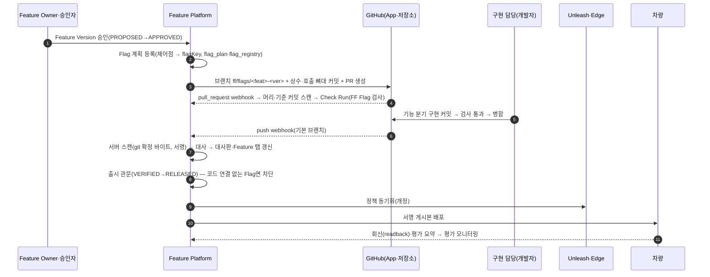

# Flag 코드 연결·대사·통제 — 차량 SW 저장소와 Feature Platform

## 0. 목적과 확정 전 기본값

사용자 요청(2026-11-06)은 세 가지다.

1. 등록이 끝난 Feature의 Flag는 실제 Git 저장소의 프로젝트·파일에서 Flag 호출로 존재해야 한다.
2. Feature Platform(FF)에 해당 기술 메뉴가 있어야 한다. 이 메뉴로 코드 연결을 통제하고 상세히 모니터링한다.
3. 원래는 개발자의 일이다. 시연이므로 현재 데이터를 기준으로 코드를 미리 만들어 둔다. 동시에 실제 업무 절차대로 만들 수 있는 경로도 구현한다.

이 문서는 [20-96](20-96-feature-flag-source.md)의 스캐너·가져오기·5단계 탭 위에 다음을 설계한다. 대상은 저장소 연결, 자동 Flag PR, 서명된 스캔, 5원천 대사, 출시 관문, 평가 모니터링이다. 계약은 `FF/contracts/src/schemas/flag-code.ts`·`rules/flag-coverage.ts`·`rules/flag-scaffold.ts`와 `routes.ts`의 20개 경로로 고정했다(§4). 구현은 백엔드·화면·생성기 세 갈래로 병렬 진행한다(§9).

사용자가 질문을 건너뛰어 아래는 **확정 전 기본값**(추천안)이다. 결정이 바뀌면 이 표와 해당 절만 고친다.

| 번호 | 항목 | 확정 전 기본값 | 바뀌면 영향 |
| --- | --- | --- | --- |
| B-1 | 대상 저장소 | 플랫폼과 분리한 가상 차량 SW 저장소 `mutuuslab/vehicle-feature-apps`. 도메인 패키지 `packages/<adas·ivi·body·chassis·powertrain·safety·connectivity·platform>`. 저장소 표·패키지 표로 다중 저장소 확장 | 생성기 출력 경로·저장소 URL |
| B-2 | 저장소 생성·push | 사용자 확인 뒤 코디네이터가 한다. 그 전에는 로컬 미러(DEMO_MIRROR)로 동작한다 | GitHub 링크의 실제 존재 여부 |
| B-3 | 코드 반영 | Feature Version 승인 시 FF가 Flag 상수·호출 뼈대 PR을 자동 생성한다. 개발자가 다른 위치에 직접 작성해도 스캔이 찾으면 연결로 인정한다 | §1.3, PR 검사 규칙 |
| B-4 | 시연 데이터 | 현재 데이터(FF_SEED=v0.81, FF_DEMO_ACTIVITY, FF_SHOWCASE)의 모든 Flag 코드를 미리 생성한다 | §5 |
| B-5 | 통제 | GitHub PR 검사(미등록 키·등록 Flag 호출 삭제·동적 키 → 실패)와 FF 출시 관문(코드 연결 없는 Flag의 출시 차단)을 모두 둔다 | §3.4·§3.5 |
| B-6 | 범위 | 등록된 전체 Feature Version의 모든 Flag. 대사판이 실제로 잡는 모습을 위해 소수는 의도적 이상 상태로 둔다 | §5.5 |
| B-7 | 연결 방식 | 실제 모드는 GitHub App(권장)이다. Actions OIDC 업로드는 보조다. GitLab 어댑터는 같은 계약의 후속 구현이다 | §1.4 |

## 1. 흐름

### 1.1 전체 순서



### 1.2 단계별 주체와 근거

| 단계 | 주체 | FF가 남기는 근거 | 실패·예외 |
| --- | --- | --- | --- |
| ① 승인 | Feature 승인자 | Lifecycle 전이 감사, `feature.lifecycle.changed` | — |
| ② Flag 계획 | FF(SYSTEM) | `flag_plan` 행, `flag_registry` 바인딩(ID 재사용 금지) | 제어점이 없는 Version은 계획 0개(화면에 '제어점 미정의'로 표시) |
| ③ Flag PR 생성 | FF GitHub App | `flag_pull_request`(PLANNED→OPEN), PR 번호·URL | App 미연결·권한 부족이면 FAILED. 구현 담당이 **PR 다시 만들기**(`createFlagPr`) |
| ④ PR 검사 | FF 스캐너 | `flag_scan_run`(PULL_REQUEST)·Check Run 결론 | 미등록·퇴역 키, 등록 Flag의 마지막 호출 삭제, 새 동적 키 → failure |
| ⑤ 병합 | 구현 담당 | GitHub 병합 커밋 | PR 닫힘(CLOSED) → 대사 '코드 없음' |
| ⑥ push 스캔 | FF 스캐너 | `flag_scan_result`(FF_SCAN, Ed25519 서명) | 서명·커밋 불일치 → REJECTED, 이전 결과 유지 |
| ⑦ 대사 | FF | 5원천 판정(§3) | — |
| ⑧ 출시 관문 | Release Manager 전이 시 FF | `FLAG_CODE_MISSING` 차단 사유 | 해제 요청·승인(§3.6) |
| ⑨ Unleash·⑩ 배포·⑪ 회신 | 기존 경로(20-96·20-98) | 동기화 기록·게시본·readback | 기존 규칙 그대로 |

### 1.3 Flag 계획과 뼈대 PR

- **계획 규칙** (`planFeatureFlags`). Feature Version의 `controlPoints`마다 Flag 하나를 만든다.
  - 같은 Feature에 같은 제어점 유형의 정책이 있으면 그 정책 키를 쓴다. 예: `care_00022_signal`.
  - 정책이 없으면 `<패키지>_<번호5>_<접미사>[_순번]` 키를 만든다. 접미사는 Flag→`enable`, Parameter→`param`, Signal→`signal`, DTC→`dtc`다.
  - 제어점에 대응하지 않는 정책 키도 계획 뒤에 붙인다. 예: `ivi_00027_voice`.
  - 키는 Feature 단위다. 같은 Feature의 새 Version은 같은 키를 다시 쓴다.
- **패키지** (`flagPackageOf`). 대표 기준 행의 공식 도메인 약어로 정한다(AD→adas, IN→ivi, BC→body, CH→chassis, PC·PE→powertrain, SF→safety, CO·BE→connectivity, PL→platform). 기준 행이 없으면 담당 조직의 낱말로, 그다음 태그의 낱말로 고른다. 아무것도 맞지 않으면 `platform`이다.
- **뼈대 파일** (`flagScaffoldFiles`). 파일은 `packages/<패키지>/src/features/feat-NNNNN/` 아래 두 개다.
  - `flags.ts`는 키 문자열의 유일한 위치다.
  - `flag-guards.ts`는 `getBooleanValue(상수, false, ctx)`, 즉 기본값 OFF로 호출한다.
  - 브랜치는 `ff/flags/feat-nnnnn-<ver>`, 제거 PR은 `ff/remove/<flagKey>`다. PR 제목·본문은 `flagPrText`가 만들며 FF 화면 경로만 싣는다.
- **개발자 직접 작성 인정**. 스캔은 저장소 전체(`scanPaths`)를 본다. 뼈대 밖에서 등록된 키를 문자열 리터럴이나 상수로 호출해도 연결이다. 뼈대 PR을 닫고 다른 PR에서 구현해도 된다.
- **스캐너 v2 필수 변경**. 뼈대가 상수를 넘기므로, 모듈 최상위 `const X = '<키>'`(`as const` 포함)를 같은 파일 또는 상대 경로 named import에서 키로 푼다(`via: 'CONST'`). 그 밖의 식별자·템플릿 치환·함수 반환은 동적 키(`unresolved[]`)다.

### 1.4 실제 모드와 시연 모드

| 구분 | 실제 모드 — GitHub App(권장) | 실제 모드 — Actions OIDC(보조) | 시연 모드 — DEMO_MIRROR |
| --- | --- | --- | --- |
| 연결 | 조직에 FF GitHub App 설치. 권한은 contents:write, pull_requests:write, checks:write, metadata:read. 이벤트는 push, pull_request, installation | 저장소 워크플로가 `flags:scan` v2 실행 후 `uploadFlagScan` | 생성기가 만든 로컬 bare 저장소(`FF_FLAG_DEMO_REPO`) 또는 픽스처만 |
| 비밀 | `FF_GITHUB_APP_ID`·`FF_GITHUB_APP_PRIVATE_KEY`·`FF_GITHUB_WEBHOOK_SECRET`는 서버 설정에만 둔다. 계약·DB·화면에 넣지 않는다 | 없음. OIDC 토큰은 검증 후 버린다(aud=`ff-flag-scan`, repository·sha·ref 일치) | 시연 서명 키(공개된 시연 전용, keyId `ff-demo-scan-1`) |
| 스캔 위치 | FF 서버. 설치 토큰으로 해당 커밋을 받아 확정 바이트를 스캔하고 서명한다 | CI 러너. FF는 OIDC 신원과 결과를 대조한다 | 생성기가 미리 스캔·서명한 결과 |
| PR 생성 | FF가 생성한다 | 없음. 화면에 '수동 반영' 안내와 패치 내려받기 | 픽스처 PR 기록. 열린 PR은 `demoMergeFlagPr`로 병합을 재현한다 |
| PR 검사 | Check Run `FF Flag 검사` | 워크플로 단계 실패 | 픽스처 검사 결과 |
| 출처 표시 | 'FF 스캔(서명 확인)' | 'CI 업로드(OIDC 확인)' | '시연 저장소 · 미리 생성' |

- **기존 GitLab 결정과의 관계**. `ext-sync.ts`(2026-10-18)는 GitLab을 업무 코드·MR·파이프라인의 원장(IF-13)으로 정했다. 이 결정은 유지한다.
  - 이번 기본값은 시연용 가상 차량 SW 저장소를 GitHub에 두는 것이다.
  - 계약의 `provider`는 GITHUB·GITLAB을 모두 받는다. 화면·대사는 제공자와 무관하다.
  - 고객 운영 환경은 GitLab 어댑터(project webhook, MR 생성, commit status = 검사 결과)로 같은 경로를 탄다. 이 어댑터는 후속 구현이다.
  - GitLab MR 결과는 기존 연계와 같이 변경 기록·Evidence로 들어온다.
- **20-96 v1 가져오기와의 관계**. `POST /api/flag-sources`(v1)는 그대로 둔다. 플랫폼 예제 저장소의 6개 Flag 소스로 남는다. 대사는 연결된 저장소의 v2 결과만 원천으로 쓴다. `GET /api/feature-flags`의 `sources[]`는 v1·v2를 합쳐 Feature Flag 탭 1단계에 둘 다 보여 준다.

## 2. 원천과 신뢰

| 원천 | 데이터 | 신뢰 근거 | 없음의 뜻 |
| --- | --- | --- | --- |
| 등록 | `flag_plan` + 정책(`policy`) + Retirement + `flag_registry.retired_at` | FF 원장 | 미등록 키 |
| 코드 | 저장소별 기본 브랜치의 최신 성공 스캔(`flag_scan_result`) | Ed25519 서명(FF_SCAN) 또는 OIDC 확인(CI_ATTESTED). 서명 없는 v1은 대사에 쓰지 않는다 | 연결 저장소 0개면 코드 칸 전부 '미연결' |
| Unleash | 정책별 마지막 동기화 기록(`policyUnleash`) | 기존 동기화 결과 | 동기화 미설정 = 판단하지 않음(NOT_APPLICABLE) |
| 배포 | 현재 정책 개정의 서명 게시본 | 기존 게시본 원장 | 정책 DEPLOYED인데 게시본 없음 = MISSING |
| 회신 | 같은 게시본·개정의 서명 검증된 readback | 20-96 규칙 | 미수신 = PENDING |

이전 스캔과의 비교(`lastSeen`)는 같은 저장소의 서명된 결과끼리만 한다. 스캔 실패·거부는 마지막 성공 결과를 유지한다. 실패는 저장소 관리 화면에 표시한다.

- **기본 브랜치 원천은 '브랜치 머리 스캔 실행'으로 고른다**(2026-11-06 보강). 결과는 커밋마다 하나라 PR 기준 커밋·PR 머리(포크 브랜치 이름이 `main`일 수 있다)·PR 맥락 CI 업로드도 같은 ref로 남는다. 그래서 최신 결과·`lastSeen`·이력은 결과 행의 ref·`scannedAt`이 아니라, 성공했고 PR 맥락이 아닌(PUSH·MANUAL·SCHEDULE·CI_UPLOAD·DEMO_SEED, PR 번호 없음) 실행을 서버 기록 시각 순으로 본다. CI 업로드의 `scannedAt`은 지금보다 5분 넘게 뒤면 거부한다.

## 3. 대사(reconciliation)

### 3.1 상태

| 상태 | 표시 | 판정(요약) | 심각도 | 출시 차단 |
| --- | --- | --- | --- | --- |
| `OK` | 정상 | 아래 어느 것도 아님 | OK | 아니오 |
| `PR_OPEN` | Flag PR 검토 중 | 코드 필요, 호출 0, 뼈대 PR이 열린 지 10일 이내 | INFO | 예(코드 미병합) |
| `NO_CODE` | 코드 없음 | 코드 필요, 호출 0, 이전에 본 적 없음 | VERIFIED 이후 또는 정책 APPROVED·DEPLOYED면 BLOCKER, 아니면 WARNING | BLOCKER일 때 |
| `CALL_DELETED` | 삭제된 호출 | 코드 필요, 호출 0, 이전 서명 스캔에는 있었음 | BLOCKER | 예 |
| `UNREGISTERED_KEY` | 미등록 키 | 등록 원장에 없는 키가 코드에 있음 | BLOCKER | 예(PR 검사에서 먼저 막힘) |
| `DYNAMIC_KEY` | 동적 키 | 파일 단위. 정적으로 풀 수 없는 SDK 호출 | 파일 행 | PR 검사에서 새 것만 차단 |
| `UNLEASH_MISMATCH` | Unleash 불일치 | 정책 APPROVED·DEPLOYED인데 Unleash에 없음·보관됨·개정 다름. 원장에 없는데 Unleash에 있으면 BLOCKER. 퇴역했는데 남아 있으면 WARNING | BLOCKER/WARNING | BLOCKER일 때 |
| `STALE` | 오래된 Flag | 코드가 있고, 정책 전면 배포(100%) 뒤 90일 경과 또는 RELEASED·DEPRECATED Feature인데 90일 평가 없음 | WARNING | 아니오 |
| `REMOVAL_DUE` | 제거 대상 | Retirement 승인 뒤 코드가 남음. 삭제 기한 경과면 BLOCKER(에스컬레이션) | WARNING/BLOCKER | 아니오(해당 Feature는 퇴역 중) |

- **코드 필요** (`codeRequired`)의 조건은 세 가지를 모두 만족하는 것이다.
  - 등록돼 있다.
  - Registry 퇴역 전이고 Retirement가 승인되지 않았다.
  - Feature Lifecycle이 APPROVED·DEVELOPING·VERIFIED·RELEASED·DEPRECATED 중 하나다.
- PROPOSED는 계획 전이다. RETIRED는 코드가 없어야 정상이다.
- 한 Flag에 어긋남이 여럿이면 모두 `findings[]`에 남긴다. 주 상태는 다음 우선순위로 정한다: `UNREGISTERED_KEY > CALL_DELETED > NO_CODE > UNLEASH_MISMATCH > REMOVAL_DUE > PR_OPEN > STALE > DYNAMIC_KEY > OK`.

### 3.2 다섯 칸(lane)

`lanes`는 화면의 5원천 칸이다. 값은 OK·PENDING·MISSING·MISMATCH·NOT_APPLICABLE이다.

| 칸 | OK | PENDING | MISSING | MISMATCH |
| --- | --- | --- | --- | --- |
| 등록 | 정책 있음 | 계획만 있음(정책 전) | 코드에만 있는 키 | — |
| 코드 | 호출 있음 | PR 열림 | 코드 필요한데 0 | 미등록·퇴역 중인데 호출 있음 |
| Unleash | 같은 개정 | 정책 초안·검증 중 | — | 없음·보관·개정 다름·남은 퇴역 Flag |
| 배포 | CONFIRMED·PARTIAL | SIGNED·DISPATCHED | DEPLOYED인데 게시본 없음 | 다른 개정·DIVERGED·TIMEOUT |
| 회신 | 일치 회신 1건 이상 | 게시본은 있으나 미수신 | — | — |

### 3.3 판정 함수

`FF/contracts/src/rules/flag-coverage.ts`가 순수 함수로 판정한다.

- `reconcileFlag(input)`: 위 표의 판정을 그대로 구현한다.
- `summarizeFlagCoverage`: 상태별 수와 코드 연결 비율의 분자·분모를 낸다.
- `flagReleaseGate`: 출시 관문 판정이다.
- `evaluateFlagPrCheck`: PR 검사다.
- `flagScanSigningPayload`: 서명 페이로드를 만든다. 형식은 `FF-FLAG-SCAN/1\n` + JCS다.

시험은 `rules/flag-coverage.test.ts`의 22개다. 백엔드는 입력을 모아 이 함수에 넘기기만 한다. 같은 판정을 화면·생성기·하네스에서 다시 쓴다.

### 3.4 출시 관문

- **Lifecycle 전이**. `evaluateTransition`에 선택 입력 `flagCodeGate`를 추가했다. RELEASED로 갈 때 막는 Flag마다 `FLAG_CODE_MISSING` 차단 사유를 낸다. 값이 없으면 보지 않으므로 기존 호출자는 그대로 동작한다.
  - 백엔드는 전이 판단(`transition`·미리 보기)에서 해당 Version의 Flag 계획 전체로 `flagReleaseGate`를 계산해 넘긴다.
  - 조회용 경로는 `flagReleaseGate`(`GET /api/features/:id/versions/:ver/flag-code-gate`)다.
- **정책 배포**. 정책을 DEPLOYED로 게시하기 전에도 같은 Flag의 `releaseBlocking`이 참이면 막는다. 백엔드 정책 게시 검사에 차단 사유 `FLAG_CODE_MISSING`을 추가한다.
- **출시를 막지 않는 상태**. STALE·REMOVAL_DUE·퇴역 Flag의 Unleash 잔존은 담당자 조치로 다루고 출시를 막지 않는다.

### 3.5 PR 검사 규칙

기준(base)·머리(head) 커밋의 서명 스캔을 비교한다(`evaluateFlagPrCheck`).

| 코드 | 결과 | 조건 |
| --- | --- | --- |
| `UNREGISTERED_KEY` | 실패 | 머리에 등록 원장에 없는 키 |
| `RETIRED_KEY_USED` | 실패 | 머리에 퇴역 키(ID 재사용 금지) |
| `REGISTERED_CALL_REMOVED` | 실패 | 기준에 있던 ACTIVE Flag의 호출이 머리에서 0 |
| `REMOVAL_ALLOWED` | 알림 | Retirement 승인(RETIRING)된 Flag의 호출 삭제 |
| `DYNAMIC_KEY` | 실패 | 기준보다 늘어난 동적 호출(파일·호출식별 개수 비교, 줄 이동 무시) |
| `EXISTING_DYNAMIC_KEY` | 경고 | 이미 있던 동적 호출 |

GitHub Check Run 요약은 findings를 표로 싣는다. 각 줄에는 FF의 `/flag-code/flags/:flagKey` 링크를 단다. 등록 원장 상태는 `ACTIVE`(코드 필요 또는 계획), `RETIRING`(Retirement 승인~퇴역 전), `RETIRED`, `null`(미등록)이다.

### 3.6 출시 차단 해제(waiver)와 직무 분리

- **요청**. 구현 담당 또는 Release Manager가 요청한다(`requestFlagGateWaiver`).
  - 사유는 10자 이상, 만료는 최대 30일이다.
  - 요청 당시의 대사 상태(`coverageStatus`)와 요청한 Feature Version에만 적용한다. 키는 Feature 단위라 같은 키를 쓰는 다른 Version은 따로 해제해야 한다. 다른 어긋남이 새로 생기면 다시 막는다.
- **결정**. Feature 승인자가 결정한다. F2 이상은 Safety Manager도 결정해야 한다. 요청자는 결정할 수 없고, 결정은 개인 서명으로 한다.
- **기록**. 해제는 감사·이벤트 `flag.waiver.*`로 남긴다. 만료되면 자동으로 EXPIRED가 된다.
- **직무 분리 규칙 추가**(`SOD_RULES` 후보).
  - Flag 출시 차단 해제 요청자는 같은 해제를 승인할 수 없다.
  - 저장소 연결·검사 설정은 출시 담당(RELEASE_MANAGER)만 바꾼다. 구현 담당이 자기 PR 검사를 약화하지 못하게 하기 위해서다.

## 4. 계약(실제 추가함)

### 4.1 파일

| 파일 | 내용 |
| --- | --- |
| `FF/contracts/src/schemas/flag-code.ts` | 저장소(`FlagRepository`·생성/변경 본문), 스캔(`FlagScanRun`·`FlagSourceManifestV2`·`FlagScanAttestation`·`UploadFlagScanBody`·PR 검사 결과), Flag PR(`FlagPullRequest`·생성 본문), 해제(`FlagGateWaiver`·요청/결정 본문), 대사(`FlagCoverageRow`·`FlagCoverageResponse`·`FlagCoverageQuery`·`FlagFileFinding`·`FlagReleaseGate`·`FlagPlanEntry`), 평가(`FlagEvaluationStat`·`FlagEvaluationSeries`·`VehicleFlagEvalSummary`), `GithubWebhookBody`, 상태 라벨 `FLAG_COVERAGE_LABEL` |
| `FF/contracts/src/rules/flag-coverage.ts` | 계획·패키지·판정·출시 관문·요약·PR 검사·서명 페이로드 |
| `FF/contracts/src/rules/flag-scaffold.ts` | 뼈대 파일·PR 문구 |
| `FF/contracts/src/rules/flag-coverage.test.ts` | 22개 시험(판정 표·우선순위·해제·PR 검사·계획·뼈대·스키마) |
| `FF/contracts/src/rules/lifecycle.ts` | `flagCodeGate` 선택 입력, 차단 사유 `FLAG_CODE_MISSING` |
| `FF/contracts/src/routes.ts` | 아래 20개 경로(끝에 덧붙임) |
| `docs/80-integration/openapi.json` | `npm run openapi`로 재생성(331개 경로) |

### 4.2 경로

| 이름 | 메서드·경로 | 역할 | 컴포넌트 |
| --- | --- | --- | --- |
| `flagCoverage` | GET `/api/flag-code/coverage` (q: featureId, version, status=쉼표목록, package, repoId, q) | 읽기 | D01-06 |
| `flagCoverageDetail` | GET `/api/flag-code/coverage/:flagKey` | 읽기 | D01-06 |
| `flagReleaseGate` | GET `/api/features/:id/versions/:ver/flag-code-gate` | 읽기 | D01-01 |
| `flagRepositories` | GET `/api/flag-code/repositories` | 읽기 | D04-01 |
| `createFlagRepository` | POST `/api/flag-code/repositories` | RELEASE_MANAGER | D04-01 |
| `updateFlagRepository` | PATCH `/api/flag-code/repositories/:id` | RELEASE_MANAGER | D04-01 |
| `rescanFlagRepository` | POST `/api/flag-code/repositories/:id/scans` | IMPLEMENTER, RELEASE_MANAGER | D04-01 |
| `flagScans` | GET `/api/flag-code/scans` (repoId, status, trigger, limit, cursor) | 읽기 | D04-01 |
| `flagScanDetail` | GET `/api/flag-code/scans/:id` | 읽기 | D04-01 |
| `uploadFlagScan` | POST `/api/flag-code/scans/upload` | IMPLEMENTER(+OIDC) | D04-01 |
| `githubFlagWebhook` | POST `/api/flag-code/webhooks/github` | 공개(HMAC 서명) | D04-01 |
| `flagPullRequests` | GET `/api/flag-code/pull-requests` (repoId, featureId, kind, state) | 읽기 | D01-06 |
| `createFlagPr` | POST `/api/flag-code/pull-requests` | IMPLEMENTER | D01-06 |
| `createFlagRemovalPr` | POST `/api/flag-code/removal-pull-requests` | IMPLEMENTER | D01-01 |
| `demoMergeFlagPr` | POST `/api/flag-code/pull-requests/:id/demo-merge` | IMPLEMENTER(시연 모드만) | D01-06 |
| `flagGateWaivers` | GET `/api/flag-code/waivers` (featureId, state) | 읽기 | D01-01 |
| `requestFlagGateWaiver` | POST `/api/flag-code/waivers` | IMPLEMENTER, RELEASE_MANAGER | D01-01 |
| `decideFlagGateWaiver` | POST `/api/flag-code/waivers/:id/decision` | FEATURE_APPROVER, SAFETY_OFFICER | D01-01 |
| `flagEvaluations` | GET `/api/flag-code/evaluations` (window, featureId, flagKey, source) | 읽기 | D04-03 |
| `flagEvaluationSeries` | GET `/api/flag-code/evaluations/:flagKey` (window) | 읽기 | D04-03 |

`personal`인 조회는 없다. 대사 결과는 계정과 무관하다. 해제 결정 가능 여부는 화면이 역할로 판단하고 서버가 다시 거부한다.

- **webhook**. `public: true`다. 서버가 원문 바이트로 `X-Hub-Signature-256`을 검증한다. `X-GitHub-Delivery` ID로 재전송을 무시한다. 서명 오류는 401과 배달 기록을 남긴다.
  - 처리 중 실패한 배달(ERROR)과 받은 뒤 5분 넘게 멈춘 배달(RECEIVED)은 재전송을 다시 처리한다(스캔은 커밋마다 멱등).
  - 연결한 App 설치와 다른 `installation.id`의 배달은 서명이 맞아도 403이다(같은 App 비밀을 쓰는 다른 설치의 저장소 사칭 차단).
  - PR 닫힘·병합은 브랜치 이름과 PR 번호가 모두 FF Flag PR과 같을 때만 반영한다(포크 PR의 같은 브랜치 이름).
- **시연 전용 경로**. `demoMergeFlagPr`는 운영(FF_AUTH=oidc)과 실제 연결 모드 저장소에서 409를 낸다.
- **routes 대조 시험**. 백엔드 `routes.spec.ts`는 백엔드 구현 전까지 이 20개를 `missing`으로 보고 실패한다. 백엔드 갈래가 끝나야 녹색이 된다.

### 4.3 마이그레이션 초안(백엔드가 구현)

다음 번호는 091부터다. 마지막은 `090_cost_actual`이다. 모두 SQLite 방언으로 쓰고 `pg-dialect.ts`로 변환한다. 원본(스캔 결과)은 추가만 가능하게 트리거를 건다. 추가 뒤 `npm run migrations:lock`을 실행한다.

```sql
-- 091_flag_code_repository
CREATE TABLE flag_code_repository (
  repo_id TEXT PRIMARY KEY, provider TEXT NOT NULL CHECK (provider IN ('GITHUB','GITLAB')),
  repository TEXT NOT NULL UNIQUE, mode TEXT NOT NULL CHECK (mode IN ('GITHUB_APP','ACTIONS_OIDC','DEMO_MIRROR')),
  status TEXT NOT NULL CHECK (status IN ('ACTIVE','PAUSED')), created_at TEXT NOT NULL, updated_at TEXT NOT NULL, doc TEXT NOT NULL);
CREATE TABLE flag_webhook_delivery (
  delivery_id TEXT PRIMARY KEY, repo_id TEXT, event TEXT NOT NULL, received_at TEXT NOT NULL,
  signature_ok INTEGER NOT NULL, outcome TEXT NOT NULL, scan_id TEXT);
-- 092_flag_scan
CREATE TABLE flag_scan_run (
  scan_id TEXT PRIMARY KEY, repo_id TEXT NOT NULL, trigger TEXT NOT NULL, ref TEXT NOT NULL, commit_id TEXT,
  base_commit TEXT, pr_number INTEGER, status TEXT NOT NULL, queued_at TEXT NOT NULL, finished_at TEXT, result_id TEXT, doc TEXT NOT NULL);
CREATE INDEX flag_scan_run_repo ON flag_scan_run (repo_id, queued_at);
CREATE TABLE flag_scan_result (
  result_id TEXT PRIMARY KEY, repo_id TEXT NOT NULL, ref TEXT NOT NULL, commit_id TEXT NOT NULL, scanned_at TEXT NOT NULL,
  content_hash TEXT NOT NULL, provenance TEXT NOT NULL CHECK (provenance IN ('FF_SCAN','CI_ATTESTED','DEMO')),
  attestation TEXT NOT NULL, doc TEXT NOT NULL, UNIQUE (repo_id, commit_id));
CREATE INDEX flag_scan_result_repo ON flag_scan_result (repo_id, ref, scanned_at);
CREATE TABLE flag_usage_index (result_id TEXT NOT NULL, flag_key TEXT NOT NULL, path TEXT NOT NULL, line INTEGER NOT NULL,
  PRIMARY KEY (result_id, flag_key, path, line));
CREATE INDEX flag_usage_index_key ON flag_usage_index (flag_key, result_id);
CREATE TRIGGER flag_scan_result_no_update BEFORE UPDATE ON flag_scan_result BEGIN SELECT RAISE(ABORT,'flag_scan_result는 추가만 가능'); END;
CREATE TRIGGER flag_scan_result_no_delete BEFORE DELETE ON flag_scan_result BEGIN SELECT RAISE(ABORT,'flag_scan_result는 추가만 가능'); END;
-- 093_flag_plan
CREATE TABLE flag_plan (
  flag_key TEXT PRIMARY KEY, feature_id TEXT NOT NULL, first_version TEXT NOT NULL, control_point TEXT NOT NULL,
  ordinal INTEGER NOT NULL, package TEXT NOT NULL, source TEXT NOT NULL CHECK (source IN ('POLICY','PLANNED')),
  planned_at TEXT NOT NULL, doc TEXT NOT NULL);
CREATE INDEX flag_plan_feature ON flag_plan (feature_id);
-- 094_flag_pull_request
CREATE TABLE flag_pull_request (
  pr_id TEXT PRIMARY KEY, repo_id TEXT NOT NULL, kind TEXT NOT NULL CHECK (kind IN ('SCAFFOLD','REMOVAL')),
  feature_id TEXT NOT NULL, version TEXT NOT NULL, branch TEXT NOT NULL, number INTEGER,
  state TEXT NOT NULL, created_at TEXT NOT NULL, updated_at TEXT NOT NULL, doc TEXT NOT NULL, UNIQUE (repo_id, branch));
-- 095_flag_gate_waiver
CREATE TABLE flag_gate_waiver (
  waiver_id TEXT PRIMARY KEY, flag_key TEXT NOT NULL, feature_id TEXT NOT NULL, version TEXT NOT NULL,
  state TEXT NOT NULL CHECK (state IN ('REQUESTED','APPROVED','REJECTED','EXPIRED')),
  requested_by TEXT NOT NULL, requested_at TEXT NOT NULL, decided_by TEXT, decided_at TEXT, expires_at TEXT NOT NULL, doc TEXT NOT NULL);
-- 096_flag_unleash_observation — Unleash 시연 동기화 기록만. 평가 지표는 102 한 저장소(통합 D-INT-2)
-- 102_flag_eval_hourly — Feature 평가 운영과 같은 칸. 경로 OFREP·VEHICLE_SDK·UNLEASH_EDGE·PLATFORM
CREATE TABLE flag_eval_hourly (
  hour TEXT NOT NULL, flag_key TEXT NOT NULL, source TEXT NOT NULL, app_name TEXT NOT NULL, environment TEXT NOT NULL,
  result TEXT NOT NULL CHECK (result IN ('ON','OFF','SAFE_DEFAULT','ERROR')), variant TEXT NOT NULL, reason TEXT NOT NULL, n INTEGER NOT NULL,
  PRIMARY KEY (hour, flag_key, source, app_name, environment, result, variant, reason));
CREATE TABLE flag_eval_reach (hour TEXT NOT NULL, flag_key TEXT NOT NULL, source TEXT NOT NULL, vehicles INTEGER NOT NULL, PRIMARY KEY (hour, flag_key, source));
CREATE TABLE flag_eval_last (flag_key TEXT PRIMARY KEY, last_at TEXT NOT NULL);
```

`flag_plan` 등록 때 기존 `flag_registry`에도 `INSERT OR IGNORE`(flag_key→feature_id)를 한다. 키 재사용 금지는 기존 규칙을 따른다.

## 5. 시연 데이터 생성 규칙

### 5.1 생성기와 산출물

- **생성기**. `FF/tools/flag-code/generate-vehicle-apps.ts`(`npm run flags:demo`)다. `snapshot-api.ts`처럼 빌드된 백엔드를 메모리 DB로 띄워(FF_SEED=v0.81, FF_DEMO_ACTIVITY 기본, FF_SHOWCASE=1) 현재 데이터를 GET으로 읽는다. 읽는 경로는 `listFeatures`·`featureDetail`·`listPolicies`·`flagRetirements`·`refDetail`이다. 등록 ID가 실행마다 같은지 두 번 실행해 비교한다.
- **출력 1 — 차량 SW 저장소**. 기본 `../vehicle-feature-apps`, 선택 `--out`이다. 기본 브랜치 `main`에 결정적 커밋 이력을 만든다.
  - 작성자·커밋 시각을 고정한다. GPG 서명은 쓰지 않는다. 같은 입력이면 같은 해시가 나와야 한다. 코디네이터가 GitHub에 push해도 픽스처의 커밋 링크가 그대로 맞는다.
  - **이력 고정**(2026-11-06). GitHub에 올린 이력은 `tools/flag-code/history-model.json`(그 이력을 만든 등록 데이터)으로만 그린다. 그 뒤 생긴 정책 키는 Feature마다 FF Flag Bot의 '정책 원장과 맞춤' PR(`ff/flags/align-<feat>`, 2026-11-05 10:00 KST부터 30분 간격, 10분 뒤 병합)로 덧붙인다. 같은 제어점(유형·순번)의 생성 규칙 키는 정책 키로 바꾸고, 대응 제어점이 없는 정책 키는 더한다. 올린 저장소는 바꾸지 않고 `<저장소>.next`에 덧붙인 이력을 만든다. 가져오기·push는 사람이 한다. 이력 고정 파일을 바꾸는 것은 이력을 다시 쓰는 결정(강제 push)이다.
- **출력 2 — 픽스처**. 위치는 `FF/data/fixtures/demo/flag-code/`이고 LF 고정이다. 파일은 `repositories.json`, `plans.json`, `scans.json`, `pull-requests.json`, `evaluations.json`, `unleash-sync.json`(시연 동기화 기록)이다.
  - `scans.json`의 각 결과는 manifest v2와 시연 키 Ed25519 서명을 담는다.
  - 백엔드는 부팅 시 이 픽스처를 시드한다. 운영·FF_SEED=none에서는 시드하지 않는다.
- **저장소 두 개**. 다중 저장소 시연이다.
  - `vehicle-feature-apps`는 v0.81과 데모 활동 Feature를 담는다.
  - `vehicle-feature-apps-fleet`는 FF_SHOWCASE Feature를 담고 FF_SHOWCASE=1일 때만 연결·시드한다. 쇼케이스를 끈 실행에서 쇼케이스 키가 미등록 키로 보이지 않게 하기 위해서다.
  - FF_DEMO_ACTIVITY=0이면 데모 활동의 2개 Version 폴더가 미등록 키로 보인다. 시연 기본값(켜짐)만 보장한다.

### 5.2 저장소 구조

```text
vehicle-feature-apps/
  package.json                 # workspaces: packages/*, scripts: test(node --test), typecheck
  tsconfig.base.json           # ES2022/NodeNext, allowImportingTsExtensions, noEmit
  ff-flags.config.json         # FF 연결 정보: repository, packages, sdkMethods (비밀 없음)
  .github/workflows/ff-flag-check.yml   # Actions OIDC 모드용 스캔·업로드(App 모드에서는 Check Run이 대신)
  packages/runtime/src/flag-client.ts   # FlagClient(OpenFeature 형태)·FlagContext·로컬 Guard·서명 스냅샷 검증 연결점
  packages/<pkg>/README.md     # 패키지 담당·Feature 목록(생성)
  packages/<pkg>/src/features/feat-NNNNN/
    flags.ts                   # 뼈대(flagScaffoldFiles) 그대로
    flag-guards.ts             # 뼈대 그대로
    feature.ts                 # 실제 분기 로직(생성기 템플릿, 아래)
    feature.test.ts            # node:test — 기본 OFF, ON 분기, Guard 차단, 오류 시 OFF
```

### 5.3 기능 분기 템플릿(제어점별)

모든 분기는 `flag-guards.ts`의 함수만 부른다. 예외·타임아웃은 OFF 경로로 간다.

| 제어점 | ON | OFF(기본) | 시험 |
| --- | --- | --- | --- |
| Flag | 새 기능 경로 실행(예: `startAssist()` 결과 반환) | 기존 경로 | OFF→기존, ON→새 경로, 클라이언트 오류→기존 |
| Parameter | 새 파라미터 묶음 적용(`getNumberValue`로 값, 범위 Guard) | 기본 파라미터 | 범위 밖 값→기본, ON→새 값 |
| Signal | 신호 발행(`publish(signal)`) | 발행 안 함 | OFF에서 발행 0회 |
| DTC | 고장 코드 보고 | 보고 안 함(내부 기록만) | OFF에서 보고 0회 |

F2 이상 ASIL Feature는 `runtime`의 로컬 Guard(`localGuard.allows(flagKey, vin)`)를 통과해야 ON이 된다. 기존 `snapshot-client.ts`와 같은 규칙이다. 기능 이름·설명 주석은 Feature 이름·설명에서 가져온다. 고객 코드가 아니라는 머리 주석을 단다. 모든 파일의 줄 끝은 LF다.

### 5.4 커밋·PR 이력

1. **첫 커밋**. 2026-01-02, 'chore: 차량 기능 앱 저장소 시작'이다. runtime 패키지와 설정을 만든다.
2. **승인 순서로 Version마다 PR 3커밋을 만든다**.
   - 승인 시각은 해당 Version의 G1~G3 PASS `judgedAt` 중 가장 늦은 값이다(`gateRecords.json`).
   - 기록이 없으면 `2026-01-05T09:00+09:00 + (번호 mod 60)일`로 둔다.
   - 같은 시각이면 featureId·version 순이다.
   - ① FF Flag Bot 뼈대 커밋: 승인 +5분, 작성자 `FF Flag Bot <ff-flags@mutuuslab.example>`.
   - ② 구현 담당 기능 커밋: +1~3일. 작성자는 `<pkg> 구현 담당 <dev-<pkg>@mutuuslab.example>`이고 날짜 편차는 번호로 결정한다.
   - ③ main 병합 커밋 `Merge pull request #N from mutuuslab/ff/flags/...`. N은 1부터 순서대로다.
3. **PR 기록**. 픽스처에 같은 번호·브랜치·상태 MERGED·병합 커밋을 넣는다.
   - 실제 GitHub PR 객체가 없으므로 `url`은 null이다. 화면은 병합 커밋 링크로 대신한다.
   - 코디네이터가 열린 PR을 실제로 만들면 그 URL만 채운다.
4. **PROPOSED는 커밋이 없다**. RETIRED Version은 퇴역 시각에 'chore: 퇴역 Flag 제거' 커밋으로 호출을 지운다. 결과는 정상(코드 불필요)이다.
5. **의도적 이상 커밋**(§5.5)은 해당 시각 순서에 끼운다.
6. **각 커밋을 v2로 스캔·서명해 `scans.json`에 넣는다**. 기본 브랜치의 모든 커밋이 대상이다. 그래야 `lastSeen`이 성립한다. 열린 PR은 머리 커밋 스캔과 PR 검사 결과도 넣는다.

### 5.5 의도적 이상 상태(결정적 선택)

- **선택 방식**. 후보 중 `sha256(flagKey)` 오름차순으로 앞에서 N개를 고른다.
- **제외**. 기존 6개 시연 Flag(`care_00022_*`, `ivi_00024_guide`, `ivi_00027_*`)는 제외한다. 이미 있는 e2e와 20-96 화면 근거를 바꾸지 않기 위해서다. 단, 데모 활동이 Retirement로 보내는 `ivi_00027_banner`의 자연 발생 REMOVAL_DUE는 그대로 둔다.

| 상태 | 수 | 후보·만드는 방법 |
| --- | --- | --- |
| NO_CODE | 3 | DEVELOPING의 PLANNED Flag 2개(WARNING). VERIFIED Flag 1개(BLOCKER, 출시 관문 차단 시연). 해당 Version의 기능 커밋에서 그 Flag만 빼고, 뼈대 PR은 CLOSED |
| CALL_DELETED | 2 | RELEASED Flag. 병합 뒤 2026-10-20·10-27 'refactor: …정리' 커밋에서 호출을 지운다 |
| UNREGISTERED_KEY | 2 | 기존 Feature 폴더 두 곳에 `<pkg>_<번호>_experiment` 호출을 추가하는 커밋(2026-10-29). PR 검사 기록은 failure인데 관리자 병합한 것으로 둔다 |
| DYNAMIC_KEY | 1파일·2호출 | ivi 패키지 한 Feature의 `feature.ts`에 템플릿 치환 키 호출(2026-10-30) |
| STALE | 5 | RELEASED Feature Flag. 평가 픽스처의 마지막 평가를 2026-07 이전으로 둔다 |
| REMOVAL_DUE | 2(+자연 1) | DEPRECATED Feature Flag 1개는 Retirement 승인 2026-04-01(기한 경과, BLOCKER). 1개는 2026-10-15(기한 전, WARNING). Retirement 행은 백엔드 시연 시드가 만든다 |
| PR_OPEN | 2 | 승인이 가장 늦은 DEVELOPING Version 2개. 뼈대 PR OPEN, `openedAt`은 시드 시각 −2일(픽스처는 `openedAtOffsetHours: -48`) |
| UNLEASH_MISMATCH | 1 | `ivi_00027_detail`의 시연 동기화 기록을 r2로 둔다(정책 r3). 실제 Unleash가 연결된 실행에서는 실제 기록이 우선한다 |

결과적으로 시연 Flag의 대부분(약 85% 이상)이 정상이다. 대사판 상태별 수는 생성기가 `plans.json` 요약에 기록한다. 하네스가 이 수와 백엔드 대사 결과를 대조한다(§7).

### 5.6 평가 지표 픽스처

- **대상**. 정책이 있거나 RELEASED·DEPRECATED Feature의 Flag다.
- **구간**. 7일 × 1시간 구간이다. 경로는 UNLEASH_EDGE와 VEHICLE_SDK(차량 회신)다. 시드는 수집기와 같은 쓰기로 평가 집계 한 저장소(102)에 넣는다.
- **차량 수**. 시간별 고유 차량 수다. 더할 수 없는 값이라 창 값은 시간별 최댓값(하한)이다.
- **평가 수**. 대상 차량 수 × 시간당 4회 × 주간 곡선(결정적 사인 곡선)이다.
- **켜짐 비율**. 정책 rollout 비율을 따르고, 정책이 없으면 0이다.
- **폴백**. TTL_EXPIRED 0.4%, DEFAULT_NO_SNAPSHOT 0.2%다. Flag 하나는 2026-11-04 하루 SIGNATURE_INVALID가 튄다(평가 모니터링 이상 시연). 오류는 0.05%다.
- **STALE 대상**. 7일 구간 값이 0이고 `lastEvaluatedAt`을 2026-07 이전으로 둔다.
- **실제 모드**.
  - Unleash 8.3.1 Admin API의 Feature 사용 지표(Edge가 위로 전달한 client metrics)를 5분마다 읽는다. 정확한 경로는 v8.3.1 OpenAPI로 확인한다.
  - 차량 SDK는 `VehicleFlagEvalSummary`를 IF-06 보고에 덧붙인다. 이것은 후속 계약 연결이다. 받으면 차량 SDK 경로로 센다. 같은 평가를 span과 요약으로 두 번 보내지 않는다.

## 6. 업무 절차 모델에 넣을 활동(docs/65-workflows)

`model/processes/*.yaml`에 아래를 추가한다. 이어서 `python -I scripts/check.py --live`, `npm run workflow:sync`를 실행한다. 화면 경로가 활동에 들어가야 부서 작업공간(DEP-INT·DEP-SE)의 메뉴에 나타난다. 이름은 24자 이내, 단계는 '~한다'로 끝낸다.

```yaml
# FPW.4 안전 설계·정책 설계 — 정책 승인 다음
    - id: FPW.4-A07
      name: Flag PR 검토·병합
      outcomes: [O3]
      rules: [FFG-LCY-011]
      raci: {R: [R-INT], A: R-ARC, C: [R-FO], I: [R-REL, R-TST]}
      inputs: [WP-IMPL-LINK]
      outputs: [WP-IMPL-LINK]
      steps:
        - Feature Version 승인 뒤 FF가 연 Flag PR에서 상수·호출 뼈대와 기본값 OFF를 확인한다
        - 기능 분기를 구현하고 FF Flag 검사가 통과한 뒤 병합한다
        - PR 생성이 실패했으면 Flag 코드 연결 화면에서 PR 다시 만들기를 요청한다
      checks:
        - 해당 Version의 Flag가 모두 코드 연결 정상 또는 검토 중이다
      platform: {actions: [createFlagPr, demoMergeFlagPr], screens: [/flag-code, /flag-code/flags/:flagKey]}
      next: [FPW.5-A07]
# FPW.5 검증·V&V — VERIFIED 전
    - id: FPW.5-A07
      name: Flag 코드 연결 확인
      outcomes: [O2]
      rules: []
      raci: {R: [R-INT], A: R-INT, C: [R-TST], I: [R-FO, R-REL]}
      inputs: [WP-IMPL-LINK]
      outputs: [WP-INTEGRATION-REC]
      steps:
        - 어긋남 대사판에서 이 Version의 Flag가 코드 없음·삭제된 호출·Unleash 불일치가 아닌지 확인한다
        - 미등록 키·동적 키 파일을 담당 패키지에 돌려보내고 재스캔으로 해소를 확인한다
        - 해소할 수 없으면 사유와 만료일로 출시 차단 해제를 요청한다
      checks:
        - 출시 관문의 Flag 코드 연결 판정이 통과 또는 승인된 해제다
      platform: {actions: [rescanFlagRepository, requestFlagGateWaiver], screens: [/flag-code/reconcile, /integration/code-scans]}
# FPW.7 출시·활성화 — 출시 차단 해제 결정
    - id: FPW.7-A13
      name: 출시 차단 해제 결정
      outcomes: [O1]
      rules: []
      independent_of: [FPW.5-A07]
      raci: {R: [R-REQ], A: R-REQ, C: [R-SM, R-FO], I: [R-REL, R-INT]}
      inputs: [WP-INTEGRATION-REC]
      outputs: [WP-FLAG-WAIVER]
      steps:
        - 해제 요청의 사유·만료·요청 당시 대사 상태를 확인한다
        - F2 이상이면 Safety Manager의 의견을 받는다
        - 개인 서명으로 승인 또는 반려하고 만료 뒤 다시 막히는 것을 확인한다
      checks:
        - 요청자와 결정자가 다른 사람이다
      platform: {actions: [decideFlagGateWaiver], screens: [/flag-code/reconcile]}
# FPW.6 서명 배포 — 저장소·검사 설정
    - id: FPW.6-A07
      name: 코드 저장소 연결 관리
      outcomes: [O1]
      rules: []
      raci: {R: [R-REL], A: R-REL, C: [R-INT], I: [R-ARC]}
      inputs: []
      outputs: [WP-INTEGRATION-REC]
      steps:
        - 차량 SW 저장소를 패키지·기본 브랜치·스캔 주기와 함께 연결한다
        - webhook 실패와 스캔 거부를 확인하고 원인을 통합 조직과 해소한다
        - 설정 변경은 사유를 남기고 구현 담당이 자기 검사를 약화하지 못하게 한다
      checks:
        - 연결 저장소의 webhook이 정상이고 최근 스캔이 서명 확인됐다
      platform: {actions: [createFlagRepository, updateFlagRepository], screens: [/integration/code-repositories, /integration/code-scans]}
# FPW.8 운영 — 평가 이상
    - id: FPW.8-A12
      name: Flag 평가 이상 확인
      outcomes: [O2]
      rules: []
      raci: {R: [R-OPS], A: R-OPS, C: [R-INT], I: [R-FO]}
      inputs: []
      outputs: []
      steps:
        - 평가 모니터링에서 기본값 폴백·서명 오류·오류 수가 늘어난 Flag를 찾는다
        - 차량 회신과 게시본을 대조해 원인이 배포·서명·차량 중 어디인지 가른다
        - 필요하면 긴급 차단 또는 재배포 절차로 넘긴다
      checks:
        - 폴백 급증 Flag마다 원인과 조치가 기록됐다
      platform: {screens: [/ops/flag-evaluations]}
# FPW.9 Retirement — 기존 A04 다음
    - id: FPW.9-A06
      name: Flag 제거 PR 병합
      outcomes: [O3]
      rules: [FFG-LCY-011]
      raci: {R: [R-INT], A: R-FO, C: [R-TST], I: [R-REL]}
      inputs: [WP-RETIRE-APPROVAL]
      outputs: [WP-RETIRE-LOG]
      steps:
        - Retirement가 승인된 Flag의 제거 PR을 Flag 수명 관리에서 연다
        - 최종 값 분기만 남기고 병합한 뒤 대사가 정상(코드 0)인지 확인한다
        - 4단계 기록에 정적 분석 근거로 마지막 스캔을 남긴다
      checks:
        - 제거 PR 병합 뒤 스캔에서 해당 Flag 참조가 0건이다
      platform: {actions: [createFlagRemovalPr, recordFlagRetirementStep], screens: [/flag-code/lifecycle, /flag-retirements]}
```

- **산출물**. `WP-FLAG-WAIVER`(출시 차단 해제 결정 기록)는 FPW.7의 산출물 목록에 새로 선언한다. 다른 과정의 산출물을 참조하는 입력이 거부되면 `check.py`가 알려 주는 규칙에 맞춘다.
- **수행 역할**. 활동의 `platform.actions`는 R[0]의 `platform_roles`로 허용돼야 한다. 해제 결정의 수행은 FEATURE_APPROVER를 가진 R-REQ이고, Feature Owner(R-FO)는 협의(C)다.
- **연결**. `next`는 각 과정의 기존 흐름에 맞춰 조정한다.

## 7. FF 기술 메뉴(화면)

### 7.1 메뉴 위치

| 경로 | 제목(=메뉴·h1) | 그룹 | 메뉴/부모 | 컴포넌트 |
| --- | --- | --- | --- | --- |
| `/flag-code` | Flag 코드 연결 | release(`/policies` 다음) | 메뉴 | D01-06 |
| `/flag-code/flags/:flagKey` | Flag 코드 상세 | release | parent `/flag-code` | D01-06 |
| `/flag-code/reconcile` | 어긋남 대사판 | release | parent `/flag-code` | D01-06 |
| `/flag-code/lifecycle` | Flag 수명 관리 | release | parent `/flag-code` | D01-01 |
| `/ops/flag-evaluations` | Flag 평가 모니터링 | ops | 메뉴 | D04-03 |
| `/integration/code-repositories` | 코드 저장소 연결 | admin(`/integration/connectors` 다음) | 메뉴 | D04-01 |
| `/integration/code-repositories/:repoId` | 저장소 상세 | admin | parent `/integration/code-repositories` | D04-01 |
| `/integration/code-scans` | 스캔 기록 | admin | parent `/integration/code-repositories` | D04-01 |

- **하위 이동**. `/flag-code` 아래 세 화면은 같은 상단 하위 탭(현황·대사판·수명 관리)으로 오간다.
- **부서 작업공간**. §6 활동이 경로를 넣는다. DEP-INT(SW통합·릴리스)는 수행(R) 화면으로, DEP-SE(시스템엔지니어링: 아키텍트)는 책임·참조로 보인다. 운영 화면은 DEP-OPS다.
- **Feature 상세 'Feature Flag' 탭**.
  - 각 Flag 카드 1단계(Git 커밋)에 대사 상태 배지와 '코드 연결 상세' 링크를 더한다.
  - Version 상단에 출시 관문 판정(통과/막힘 n개/해제)을 둔다.
- **정책 상세**. Unleash 패널 옆에 코드 연결 요약을 둔다.

### 7.2 화면 구성

| 화면 | 구성 | 데이터 | 통제 동작 |
| --- | --- | --- | --- |
| Flag 코드 연결 | 요약 줄(코드 필요·연결·출시 차단·마지막 스캔), 패키지 막대, 표(Flag·Feature·Version·패키지·상태·저장소·파일:줄·커밋·PR·마지막 스캔), 필터(상태·패키지·저장소·검색) | `flagCoverage` | PR 다시 만들기(구현 담당) |
| Flag 코드 상세 | 5원천 칸, 사용처 목록(저장소·파일·줄·호출식·기본값 분류·커밋 링크), 이전 스캔 근거, PR 이력, 해제 이력, 평가 미니 차트 | `flagCoverageDetail`·`flagEvaluationSeries` | 재스캔, 해제 요청, PR 다시 만들기 |
| 어긋남 대사판 | 상태별 열(코드 없음·삭제된 호출·미등록 키·동적 키·Unleash 불일치·제거 대상·오래된 Flag·검토 중) 카드, 심각도 정렬, 파일 단위 동적 키 목록 | `flagCoverage?status=...` | 해제 요청·결정, 재스캔, Unleash 동기화 바로가기 |
| Flag 수명 관리 | 오래된 Flag(근거 시각), 제거 대상(기한·경과), 제거 PR 상태, Retirement 단계 연결 | `flagCoverage?status=STALE,REMOVAL_DUE`·`flagPullRequests?kind=REMOVAL`·`flagRetirements` | Retirement 요청 바로가기, 제거 PR 생성 |
| Flag 평가 모니터링 | 창(1h/24h/7d), Flag별 평가 수·켜짐 비율·변형 분포·폴백 이유 누적 막대·오류·차량 수·마지막 평가, 선택 Flag 시계열 | `flagEvaluations`·`flagEvaluationSeries` | 지도(`lens=activation&flagKey`)·게시본 바로가기 |
| 코드 저장소 연결 | 저장소 표(제공자·모드·기본 브랜치·패키지·스캔 주기·webhook 상태·최근 배달·실패 수·최근 스캔) | `flagRepositories` | 연결·변경·일시 중지(Release Manager), 재스캔 |
| 저장소 상세 | 설정·webhook 배달 기록·실패 이유·패키지 경로 | `flagRepositories`·`flagScans?repoId=` | 변경(사유 필수) |
| 스캔 기록 | 계기·ref·커밋·결과·서명 출처·사용처/동적 수·PR 검사 결론, 행 펼침 | `flagScans`·`flagScanDetail` | 재스캔 |

- **문구**. 문구는 `frontend/src/copy/flag-code.ts`에 둔다. 상태 라벨은 계약의 `FLAG_COVERAGE_LABEL`을 쓴다.
- **규칙**. 내부 코드(FPW.x, SOD-x 등)와 'Twin/트윈'·'은퇴'는 쓰지 않는다. 빈 상태 문구 대신 시연 데이터로 채운다.
- **색·간격**. `design/tokens.css` 토큰만 쓴다. 상태 색은 기존 상태 토큰(성공·경고·위험·정보)을 쓴다.
- **정적 설치**. 새 GET마다 `tools/snapshot-api.ts`에 `save(...)`를 추가한다. 대상은 다음과 같다.
  - 전체 대사
  - 화면이 쓰는 상태 필터 조합 2개
  - Feature Version별 대사·출시 관문
  - Flag별 상세·24h 시계열
  - 저장소·스캔·PR·해제 목록, 평가 24h·1h·7d
  - 쓰기 버튼은 정적 모드에서 기존 READ_ONLY 안내를 따른다.

## 8. 하네스·검증

### 8.1 verify 단계

- `flag-code:check`를 새로 둔다. 순서는 `openfeature:check` 뒤다. 생성기·백엔드가 contracts dist를 읽으므로 이 단계만 돌려도(`--only`) 먼저 contracts를 빌드한다(판정 규칙 변경을 놓치지 않게). 대사 경로가 없거나(404) 실패하면 건너뛰지 않고 실패로 낸다.
  - ① 생성기를 `--check`로 실행해 같은 입력으로 다시 생성한다. 커밋 해시·픽스처가 바이트 단위로 같아야 한다(결정성).
  - ② 생성된 저장소에서 `npm test`(node --test)와 `tsc`를 실행한다.
  - ③ 픽스처 각 스캔의 서명을 시연 공개키로 검증한다.
  - ④ 대사 정합성: 픽스처를 시드한 백엔드의 `flagCoverage` 상태별 수가 `plans.json` 요약과 같아야 한다. 정상이 아닌 Flag는 §5.5 표의 수와 같아야 한다.
  - ⑤ 모든 PLANNED·POLICY Flag가 코드에 있거나 의도적 이상 목록에 있어야 한다. 누락 0이다.
- **contracts**: `rules/flag-coverage.test.ts`(22개, 작성 완료).
- **백엔드 시험**: `backend/test/d01/flag-code.spec.ts`에 다음을 넣는다.
  - webhook 서명·재전송·잘못된 저장소
  - 스캔 서명 거부·추가만 가능
  - 승인 시 계획·PR 생성(모의 GitHub)
  - PR 검사 Check Run 결론
  - 대사 행이 판정 함수와 일치
  - 출시 전이 `FLAG_CODE_MISSING`과 해제 뒤 통과
  - 해제 직무 분리
  - 시연 병합 → 상태 변화
  - 운영 모드 시연 경로 409
- **스캐너 시험**: `tools/flag-sources.test.ts`에 다음을 추가한다.
  - v2 상수 해석(같은 파일·상대 import)
  - `as const`
  - 재할당 가능한 `let`은 동적 키
  - 템플릿 치환은 동적 키
  - 줄·해시가 v1과 일치
- **모의 GitHub**: `FF/tools/flag-code/mock-github.ts`다. App 토큰·contents·git refs·pulls·check-runs의 최소 REST와 webhook 발신을 흉내 낸다. 시험과 e2e가 쓴다. 포트는 코디네이터가 배정한다.
- **화면 시험**: `frontend/src/__tests__/flagCode.test.tsx`에 다음을 넣는다.
  - 필터·상태 라벨
  - 출시 차단 배지
  - 역할별 버튼(구현 담당/출시 담당/승인자/열람)
  - 403·오류·지연
  - 해제 결정 직무 분리 안내
- **공통**: `lint:copy`·`lint:tokens`·`lint:spacing`·`ia.test`·정적 스냅샷 검사도 통과해야 한다.

### 8.2 e2e 시나리오(`FF/e2e/tests/flag-code.spec.ts`)

1. **구현 담당**.
   - Flag 코드 연결에서 PR_OPEN Flag를 찾는다.
   - 상세 → 시연 병합을 실행하면 상태가 정상이 되고, 스캔 기록에 PUSH 스캔(서명 확인)이 추가된다.
   - Feature 상세 Flag 탭 1단계에 새 커밋 링크가 나타난다.
2. **출시 담당**.
   - NO_CODE BLOCKER가 있는 VERIFIED Version의 출시 전이를 시도한다.
   - `FLAG_CODE_MISSING` 사유로 막히고, 대사판 링크로 이동한다.
3. **해제**.
   - 구현 담당이 해제를 요청한다.
   - 같은 계정의 결정은 거부된다.
   - Feature 승인자가 승인하면 출시 관문 판정이 '해제'로 바뀐다. 전이 미리 보기에서 차단이 사라진다.
4. **PR 검사**.
   - 모의 GitHub로 미등록 키를 추가한 PR webhook을 보낸다.
   - 스캔 기록에 PR 검사 failure와 `UNREGISTERED_KEY`가 보인다. 등록 키 호출 삭제 PR도 failure다.
5. **수명 관리**.
   - REMOVAL_DUE(기한 경과) Flag에서 제거 PR을 만든다.
   - 시연 병합 뒤 상태가 정상이 되고, Retirement 4단계 기록 화면으로 이어진다.
6. **운영**.
   - 평가 모니터링에서 SIGNATURE_INVALID 급증 Flag를 고른다.
   - 시계열과 지도(해당 flagKey)로 이동한다.
7. **저장소 관리**.
   - 구현 담당에게는 변경 버튼이 비활성이고 이유가 보인다.
   - 출시 담당이 스캔 주기를 바꾸면 사유 필수이고 감사에 기록된다.
8. **정적 설치**: 새 메뉴·하위 화면·탭에서 스냅샷 누락 0, 오류 상자 0이다.

## 9. 구현 분담(병렬)

| 갈래 | 주요 파일 | 완료 조건 |
| --- | --- | --- |
| 백엔드 | `backend/src/domains/d01-policy/flag-code/*`(모듈·컨트롤러·서비스·GitHub 어댑터·스캐너 코어), `kernel/migrations.ts` 091~096, `harness/migrations.lock.json`, `flag-source.service.ts`(v2 소스 합치기), 전이·정책 게시 관문, 시연 시드, `tools/flag-sources.ts` v2, `tools/flag-code/mock-github.ts`, `tools/snapshot-api.ts` | `routes.spec.ts` 녹색(20개 경로 실재), `flag-code.spec.ts`, 스캐너 시험, `test:pg` 호환, openapi 최신 |
| 화면 | `frontend/src/routes.tsx` 8개 경로, `screens/flag-code/*`, `copy/flag-code.ts`, `screens/features/FeatureFlags.tsx` 배지·관문, 정책 상세 요약, docs/65-workflows 활동 추가와 `workflow:sync` | 화면 시험·`ia.test`·lint 3종·정적 e2e·`flag-code.spec.ts` 시나리오 1~8 |
| 생성기 | `tools/flag-code/generate-vehicle-apps.ts`·템플릿, `data/fixtures/demo/flag-code/*`, 생성 저장소(`../vehicle-feature-apps`, `-fleet`), verify 단계 `flag-code:check` | 결정성(두 번 생성 동일), 생성 저장소 시험·타입 통과, 서명 검증, 대사 수 일치 |

순서 의존은 세 가지다.

- 생성기의 픽스처 형식은 이 계약으로 고정돼 있어 백엔드와 동시에 진행할 수 있다.
- 백엔드는 픽스처가 오기 전까지 최소 시연 픽스처(Flag 6개)로 시험한다.
- 화면은 계약 타입과 정적 스냅샷 형태로 먼저 개발하고, 백엔드가 끝나면 실데이터로 검증한다.

## 10. 남은 결정과 한계

- **사용자 결정 필요**.
  - B-1~B-7 확정.
  - GitHub 저장소 실제 생성·push와 공개 범위(공개/비공개).
  - GitHub App 등록 주체(조직 mutuuslab).
- **한계**.
  - 스캐너는 TypeScript 정적 호출만 해석한다. 차량 SW의 C/C++·Kotlin 등은 언어별 스캐너가 같은 manifest v2를 내야 한다(후속).
  - 동적 키는 Flag를 특정하지 못해 파일 단위로만 다룬다.
  - Unleash 평가 지표의 정확한 Admin API 경로는 v8.3.1에서 확인이 필요하다.
  - 실제 PR 객체가 없는 과거 PR은 병합 커밋 링크로 대신한다.
- **제외 범위**. 실제 고객 저장소·GitLab 어댑터·고객 IdP 연동은 이번 범위가 아니다.
