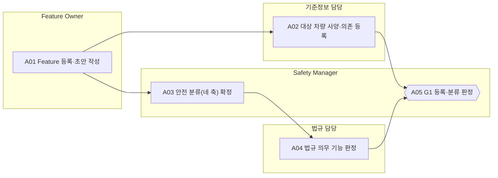

<!-- 생성물: docs/65-workflows/scripts/build_md.py — 손으로 고치지 않는다 -->

# WF-FPW-1 · FPW.1 Feature 등록·분류 / Feature Registration & Classification

> 통제할 Feature Version의 대상·소유자·적용 차량을 Registry에 등록하고, 네 축 안전 분류와 법규 등급을 확정해 이후 모든 Gate가 같은 분류를 기준으로 판단하게 한다.

보고서 Gate: G1 · 근거: 표준 보고서 5장(분류), 6.1절 G1, 6.4절 시나리오

## 1. 업무 흐름

## 2. 활동

| ID | 활동 | RACI | 입력 | 출력 | 플랫폼 권한·화면 | 이행 규칙 |
|---|---|---|---|---|---|---|
| FPW.1-A01 | Feature 등록·초안 작성 | R Feature Owner · A Feature Owner · C 아키텍트, 요구 Owner · I Safety Manager | WP-FEAT-PROPOSAL | WP-FEAT-REG | `createFeature`, `createVersion`, `updateDraft`, `/master/define`, `/feature/propose`, `/features` | FFG-CLS-008 |
| FPW.1-A02 | 대상 차량 사양·의존 등록 | R 기준정보 담당 · A Feature Owner · C 아키텍트 · I Safety Manager | WP-FEAT-REG | WP-FEAT-SCOPE | `createDependency`, `/variant-conditions`, `/arch/topology` | – |
| FPW.1-A03 | 안전 분류(네 축) 확정 | R Safety Manager · A Safety Manager · C Feature Owner, 아키텍트 · I 요구 Owner | WP-FEAT-REG, WP-FEAT-SCOPE | WP-SAFETY-PROFILE | `updateSafetyProfile`, `confirmSafetyProfile`, `/features/:id/:ver` | FFG-CLS-001, FFG-CLS-003, FFG-CLS-009 |
| FPW.1-A04 | 법규 의무 기능 판정 | R 법규 담당 · A 법규 담당 · C Safety Manager · I Feature Owner | WP-SAFETY-PROFILE, WP-COMPLIANCE-PROFILE | WP-REG-CLASS | 플랫폼 밖 | FFG-CLS-005 |
| FPW.1-A05 | G1 등록·분류 판정 (G1 판정) | R Safety Manager · A Safety Manager · C Feature Owner, 법규 담당 · I 요구 Owner, 기준정보 담당, 품질 조직 | WP-FEAT-REG, WP-FEAT-SCOPE, WP-SAFETY-PROFILE, WP-REG-CLASS | WP-G1-DECISION | `judgeGate`, `/features/:id/:ver`, `/admin/approval` | FFG-LCY-001, FFG-LCY-002, FFG-CLS-001 |

### 수행 절차와 완료 기준

#### FPW.1-A01 Feature 등록·초안 작성
1. 제안·변경요청을 검토해 기존 Feature의 새 Version인지 새 Feature인지 정한다
2. Feature 등록 화면에서 이름·설명·관련 요구 ID·판매 방식을 입력해 PROPOSED 초안을 만든다
3. Flag 유형을 고르고, Release·Experiment Flag면 만료일과 Retirement 계획을 함께 적는다
4. 아키텍트·요구 Owner와 Control Point 후보와 요구 범위를 맞춘다

완료 기준:
- [ ] Registry에 PROPOSED Version이 생기고 소유자가 지정되었다
- [ ] 만료일이 필요한 Flag 유형에 만료일과 Retirement 계획이 비어 있지 않다

#### FPW.1-A02 대상 차량 사양·의존 등록
1. 적용 차종·Trim·시장을 PLM 기준정보와 대조해 지원 조건을 등록한다
2. 다른 Feature와의 필요·배타 관계를 등록하고 의존 판정 결과를 확인한다
3. Topology에서 위험 전파 관계가 있는 Feature를 찾아 분류 담당에게 넘긴다

완료 기준:
- [ ] 모든 대상 Variant가 기준정보에 존재하고 의존 판정이 미판정으로 남지 않았다

#### FPW.1-A03 안전 분류(네 축) 확정
1. F 등급·비활성화 등급·법규 등급·Flag 유형 네 축을 모두 채운다
2. 비활성화 등급과 F 등급이 서로 허용되는 조합인지, 시간 프로파일 값이 0보다 큰지 확인한다
3. 위험 전파 관계가 있는 Feature의 F 등급을 낮추는 경우 영향 재분석 결과를 붙인다
4. 확정 버튼으로 개인 서명해 분류를 고정한다. 확정 뒤에는 초안 수정이 막힌다

완료 기준:
- [ ] 네 축 중 빈 값이 없고 분류 확정 서명이 남았다
- [ ] F 등급 하향이면 재분석 Evidence가 연결되었다

#### FPW.1-A04 법규 의무 기능 판정
1. 대상 시장 Compliance Profile의 의무 기능 목록과 Feature 기능을 대조한다
2. 의무 기능이면 법규 등급과 비활성화 등급을 의무 기능 기준으로 지정하도록 Safety Manager에게 요청한다
3. 판정 근거 조항과 시장을 기록하고 Feature Owner에게 원격 요청 제한을 알린다

완료 기준:
- [ ] 대상 시장마다 의무 기능 해당 여부가 기록되었다

#### FPW.1-A05 G1 등록·분류 판정
1. 등록 기록·대상 사양·분류·법규 판정이 모두 있는지 확인하고, 하나라도 없으면 FAIL로 판정한다
2. Feature Owner의 의견을 받아 판정(PASS·CONDITIONAL PASS·FAIL)과 근거 Evidence ID를 입력한다
3. Gate G1(Feature)·G3(Variant)을 개인 서명으로 판정 등록한다
4. 조건부 통과면 기한과 책임자를 등록하고 요구 Owner에게 G2·G3 착수를 알린다

완료 기준:
- [ ] Decision Record에 판정·근거 Evidence·판정자 역할·시각이 모두 있다
- [ ] Feature 작성자와 판정자가 다른 사람이다

## 3. 산출물

| 키 | 이름 | 종류 | 주요 내용 |
|---|---|---|---|
| WP-FEAT-PROPOSAL | Feature 제안·변경요청 | 입력 (상품·도메인 기획, 변경요청(CR) 접수) | 기능 목적과 사용자 가치, 대상 시장·차종; 관련 요구 ID(ALM)와 기존 Feature와의 관계; 희망 출시 시점과 판매 방식(구독·구매·체험) |
| WP-FEAT-REG | Feature 등록 기록 | 산출 | Feature ID·Version(PROPOSED 0.1.0)·소유자·설명; Flag 유형과 Release·Experiment Flag의 만료일·Retirement 계획; 관련 요구 ID와 판매 방식 |
| WP-FEAT-SCOPE | 대상 차량 사양·의존 관계 | 산출 | 적용 차종·Trim·시장과 지원 조건; 필요(REQUIRES)·배타(EXCLUDES) 의존 관계와 판정; Topology에서 위험 전파 관계가 있는 Feature 목록 |
| WP-SAFETY-PROFILE | 안전 분류(네 축) | 산출 | F 등급과 판정 근거(위험 전파 관계 포함); 비활성화 등급·Safe State·인계·감소 시간 프로파일; Safety Manager 개인 서명과 확정 시각 |
| WP-REG-CLASS | 법규 등급 판정 기록 | 산출 | 시장별 의무 기능 해당 여부와 근거 조항; 의무 기능일 때 DC4·R2 지정과 원격 요청 거부 대상 표시 |
| WP-G1-DECISION | G1 Decision Record | 산출 | 판정(PASS·CONDITIONAL PASS·FAIL)과 근거 Evidence ID; 판정자 역할·서명·시각, 조건부 통과 시 기한과 책임자 |

## 4. 진입·완료 기준

**진입**
- Feature 제안 또는 변경요청이 접수되어 담당 Feature Owner가 지정되었다
- 대상 시장의 Compliance Profile 판이 고정되어 있다

**완료**
- Feature Version이 PROPOSED 상태로 등록되고 네 축 분류가 Safety Manager 서명으로 확정되었다
- 법규 의무 기능 여부가 판정되어 분류에 반영되었다
- G1 Decision Record(판정·근거 Evidence·승인자 역할)가 남았다

## 5. 결과(Outcome)

- O1 Feature Version이 소유자·대상 차량 사양·의존 관계와 함께 Registry에 등록된다.
- O2 F 등급·비활성화 등급·법규 등급·Flag 유형이 근거와 함께 확정된다.
- O3 G1 판정이 서명된 Decision Record로 남고 다음 단계(G2)로 넘어간다.
