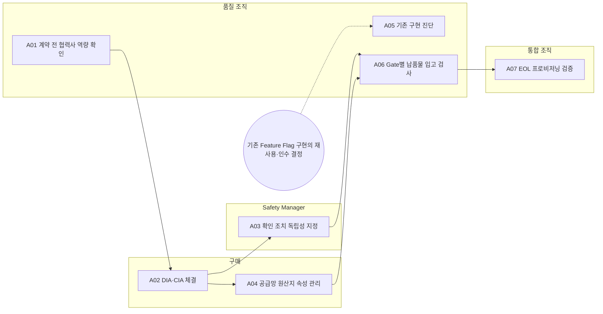

<!-- 생성물: docs/65-workflows/scripts/build_md.py — 손으로 고치지 않는다 -->

# WF-FPW-10 · FPW.10 협력사 관리 / Supplier Management

> Feature Flag 관련 SW·서비스를 공급하는 협력사를 계약 전에 평가하고, 보고서 요구를 DIA·CIA에 넣어 계약한 뒤, Gate별 납품물을 OEM 환경에서 독립적으로 입고 검사해 통합과 V&V의 입력으로 넘긴다.

보고서 Gate: – · 근거: 표준 보고서 16장(ASPICE 평가), 17장(협력사), 9.11절 FFG-VEH-016, 14·15장(원산지)

## 1. 업무 흐름

## 2. 활동

| ID | 활동 | RACI | 입력 | 출력 | 플랫폼 권한·화면 | 이행 규칙 |
|---|---|---|---|---|---|---|
| FPW.10-A01 | 계약 전 협력사 역량 확인 | R 품질 조직 · A 구매 · C CSM, Safety Manager · I 통합 조직 | WP-SUPPLIER-CANDIDATE | WP-SUPPLIER-ASSESS | 플랫폼 밖 | FFG-SUP-005, FFG-SUP-003 |
| FPW.10-A02 | DIA·CIA 체결 | R 구매, 법규 담당 · A 구매 · C 법무, Safety Manager, CSM, 품질 조직 · I 통합 조직 | WP-SUPPLIER-ASSESS | WP-DIA | 플랫폼 밖 | FFG-SUP-004, FFG-SUP-017, FFG-SUP-010 |
| FPW.10-A03 | 확인 조치 독립성 지정 | R Safety Manager · A Safety Manager · C 품질 조직 · I 구매 | WP-DIA | WP-CONFIRMATION-PLAN | 플랫폼 밖 | FFG-SUP-014 |
| FPW.10-A04 | 공급망 원산지 속성 관리 | R 구매 · A 구매 · C CSM, 법규 담당 · I 통합 조직 | WP-DIA | WP-ORIGIN-RECORD | 플랫폼 밖 | FFG-SEC-006, FFG-SBOM-007 |
| FPW.10-A05 | 기존 구현 진단 | R 품질 조직 · A 품질 조직 · C 아키텍트, 통합 조직 · I Safety Manager | WP-SUPPLIER-ASSESS | WP-SUPPLIER-DIFF | 플랫폼 밖 | FFG-SUP-016 |
| FPW.10-A06 | Gate별 납품물 입고 검사 | R 품질 조직, 시험 조직 · A 품질 조직 · C 통합 조직, Safety Manager · I 구매 | WP-DIA, WP-CONFIRMATION-PLAN | WP-INTAKE-RESULT | `judgeGate`, `/supplier/portal` | FFG-SUP-008, FFG-SUP-009, FFG-SUP-006 |
| FPW.10-A07 | EOL 프로비저닝 검증 | R 통합 조직 · A 통합 조직 · C 시험 조직, 기준정보 담당 · I 품질 조직 | WP-INTAKE-RESULT | WP-EOL-RECORD | 플랫폼 밖 | FFG-VEH-016 |

### 수행 절차와 완료 기준

#### FPW.10-A01 계약 전 협력사 역량 확인
1. 후보 협력사의 ASPICE·사이버보안 평가 결과를 계약 전에 받아 확인한다
2. 평가 계획에 Feature Flag 특화 평가 질문을 넣고 결과를 기록한다
3. ADS 관련 협력사는 SMS 역량 평가를 추가하고, 부족하면 개선 계획과 기한을 합의한다

완료 기준:
- [ ] 계약 전에 평가 결과와 부족 항목의 개선 계획이 있다

#### FPW.10-A02 DIA·CIA 체결
1. DIA·CIA에 보고서 Version과 적용 장, RASIC, Gate별 납품물, 시간 예산 부속서, 통지 기한, 현장 지원 SLA를 넣는다
2. 법규 담당이 당국 보고·리콜 판단·사건 조사에 필요한 안전 정보의 제공 범위와 기한을 정해 넣는다
3. 법무가 계약 조항을 검토하고 구매가 체결한다

완료 기준:
- [ ] 일곱 항목과 안전 정보 제공 조항이 모두 계약에 있다

#### FPW.10-A03 확인 조치 독립성 지정
1. 협력사 범위의 확인 검토·감사·기능안전 평가를 계획한다
2. 참조 ASIL에 맞는 독립성 수준을 만족하는 수행자를 지정한다
3. 협력사 자체 선언만으로 승인하지 않도록 확인 결과를 입고 판정의 조건으로 건다

완료 기준:
- [ ] 확인 조치마다 독립성을 만족하는 수행자가 지정되었다

#### FPW.10-A04 공급망 원산지 속성 관리
1. 텔레매틱스·OTA·Feature Flag SW 구성요소의 개발 주체와 원산지를 SBOM과 함께 받는다
2. 미국 시장 차량의 해당 구성요소는 개발 주체·국가·소유·통제 속성을 SBOM에 기록한다
3. 적합성 선언 근거로 10년 보존 위치를 지정한다

완료 기준:
- [ ] 대상 구성요소 모두에 원산지 속성이 있다

#### FPW.10-A05 기존 구현 진단
- 트리거: 기존 Feature Flag 구현의 재사용·인수 결정
1. 재사용·인수할 구현을 보고서 요구와 대조하는 진단을 수행한다
2. 차이마다 위험과 보완 계획을 정리한다
3. 차이 보고를 Safety Manager에게 넘겨 G2 영향 분석에 넣게 한다

완료 기준:
- [ ] 차이 보고가 G2 영향 분석의 입력으로 등록되었다

#### FPW.10-A06 Gate별 납품물 입고 검사
1. 협력사가 정한 형식으로 낸 Gate별 납품물을 협력사 이관 포털에서 받는다
2. 입고 검사 항목을 OEM 환경에서 다시 실행하고, 수정 납품이면 일부가 아니라 전 항목을 다시 검사한다
3. Safety Manual의 사용 가정 목록을 통합 조직에 넘긴다
4. 합격 기준으로 판정해 Supplier Gate 기록에 남긴다

완료 기준:
- [ ] 모든 검사 항목이 OEM 환경에서 재실행되었다
- [ ] 판정 결과가 Supplier Gate 기록에 있다

#### FPW.10-A07 EOL 프로비저닝 검증
1. EOL에서 인증된 진단 세션으로 Feature별 초기 기록을 쓰고 지울 수 없는 프로비저닝 표식을 설정한다
2. 표식이 있는 ECU에서 기록이 없을 때 첫 시동으로 보지 않는지 확인한다
3. 결과를 생산 기준정보와 함께 기록한다

완료 기준:
- [ ] 대상 ECU 모두 표식과 초기 기록이 확인되었다

## 3. 산출물

| 키 | 이름 | 종류 | 주요 내용 |
|---|---|---|---|
| WP-SUPPLIER-CANDIDATE | 협력사 후보·공급 범위 | 입력 (구매(조달 계획)) | 후보 협력사와 공급할 SW·서비스 범위(LPC, Safety Guard, 시험 도구, 운영 서비스); ADS 관련 여부와 대상 시장 |
| WP-SUPPLIER-ASSESS | 협력사 역량 평가 결과 | 산출 | ASPICE·사이버보안 평가 결과와 Feature Flag 특화 평가 질문 결과; ADS 협력사의 SMS 역량 평가, 부족 항목의 개선 계획과 기한 |
| WP-DIA | DIA·CIA 계약 부속서 | 산출 | 인용한 보고서 Version과 적용 장, RASIC, Gate별 납품물; 시간 예산 부속서, 결함·변경 통지 기한, 현장 지원 SLA; 당국 보고·리콜 판단을 위한 안전 정보 제공 범위와 기한 |
| WP-SUPPLIER-DIFF | 기존 구현 차이 보고 | 산출 | 재사용·인수한 Feature Flag 구현과 보고서 요구의 차이; 차이별 위험과 보완 계획 |
| WP-CONFIRMATION-PLAN | 확인 조치 계획 | 산출 | 협력사 범위의 확인 검토·감사·기능안전 평가와 수행자; 수행자 독립성 수준과 근거 |
| WP-INTAKE-RESULT | 입고 검사 결과 | 산출 | 검사 항목(IN-01~IN-12)별 OEM 환경 재실행 결과; Gate별 합격 판정과 Supplier Gate 기록; Safety Manual 사용 가정(AoU) 목록 |
| WP-ORIGIN-RECORD | 공급망 원산지 기록 | 산출 | 구성요소별 개발 주체·국가·소유·통제 속성(SBOM 연계); 미국 시장 적합성 선언 근거와 10년 보존 위치 |
| WP-EOL-RECORD | EOL 프로비저닝 검증 기록 | 산출 | Feature별 초기 기록 쓰기와 프로비저닝 표식 설정 결과; 표식이 있는 ECU의 기록 누락 시 동작 확인 결과 |

## 4. 진입·완료 기준

**진입**
- Feature Flag 관련 SW·서비스의 외부 조달이 결정되었다

**완료**
- 계약(DIA·CIA)이 체결되고 납품물이 Gate별 합격 기준으로 판정되었다
- 원산지 속성과 EOL 프로비저닝 검증이 기록되었다

## 5. 결과(Outcome)

- O1 협력사 역량(ASPICE·사이버보안·SMS)이 계약 전에 확인된다.
- O2 DIA·CIA에 보고서 Version·RASIC·납품물·통지 기한·안전 정보 제공 의무가 들어간다.
- O3 기존 구현을 재사용하면 차이가 진단되어 G2에 보고된다.
- O4 납품물이 독립성이 보장된 확인 조치와 OEM 입고 검사로 판정된다.
- O5 공급망 원산지와 EOL 프로비저닝이 기록·검증된다.
