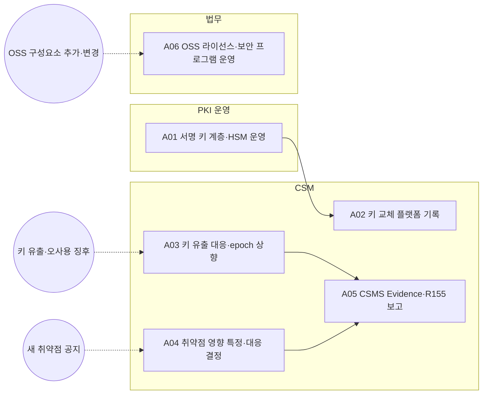

<!-- 생성물: docs/65-workflows/scripts/build_md.py — 손으로 고치지 않는다 -->

# WF-FPW-11 · FPW.11 보안·키·취약점 관리 / Security, Key & Vulnerability Management

> 명령 서명 키를 용도별로 분리해 HSM에서 운영하고, 키 유출과 새 취약점에 대해 영향 Feature·차량을 특정해 보안 사유 차단 또는 업데이트를 결정하며, 그 Evidence를 CSMS와 승인 기관 보고에 쓴다.

보고서 Gate: – · 근거: 표준 보고서 14장(서명·키·R155), 15장(SBOM·VEX·OSS), 8장 FFG-PLT-005

## 1. 업무 흐름

## 2. 활동

| ID | 활동 | RACI | 입력 | 출력 | 플랫폼 권한·화면 | 이행 규칙 |
|---|---|---|---|---|---|---|
| FPW.11-A01 | 서명 키 계층·HSM 운영 | R PKI 운영 · A CSM · C Safety Manager · I Release Manager, 운영 조직 | WP-HARA-TARA | WP-KEY-REGISTER | `/admin/security` | FFG-SEC-002 |
| FPW.11-A02 | 키 교체 플랫폼 기록 | R CSM · A CSM · C PKI 운영, Safety Manager · I 운영 조직 | WP-KEY-REGISTER | WP-KEY-REGISTER | `rotateKey`, `/admin/security` | FFG-SEC-002 |
| FPW.11-A03 | 키 유출 대응·epoch 상향 | R CSM · A CSM · C PKI 운영, Safety Manager · I 운영 조직, 법규 담당 | WP-KEY-REGISTER | WP-KEY-INCIDENT | `bumpEpoch`, `/admin/security` | FFG-SEC-002 |
| FPW.11-A04 | 취약점 영향 특정·대응 결정 | R CSM · A CSM · C 운영 조직, Safety Manager, 통합 조직 · I Release Manager | WP-RELEASE-BASELINE, WP-ORIGIN-RECORD | WP-VEX-DECISION | `recordVex`, `/admin/security` | FFG-SBOM-005, FFG-SBOM-001 |
| FPW.11-A05 | CSMS Evidence·R155 보고 | R CSM · A CSM · C 법규 담당 · I 품질 조직 | WP-HARA-TARA, WP-VEX-DECISION, WP-KEY-INCIDENT | WP-CSMS-EVIDENCE | 플랫폼 밖 | FFG-SEC-005 |
| FPW.11-A06 | OSS 라이선스·보안 프로그램 운영 | R 법무 · A 법무 · C CSM, 구매 · I 통합 조직 | WP-ORIGIN-RECORD | WP-OSS-PROGRAM | 플랫폼 밖 | FFG-SBOM-006 |

### 수행 절차와 완료 기준

#### FPW.11-A01 서명 키 계층·HSM 운영
1. 활성화·차단·복원·정책 서명 키를 용도별로 나눠 HSM에 보관하고 키 계층을 대장에 적는다
2. 서명 HSM이 승인 서명이 기준 수에 이르기 전에는 명령 키를 쓰지 않도록 정책을 설정한다
3. 정기 교체 주기와 긴급 교체 절차를 정해 운영한다

완료 기준:
- [ ] 키마다 용도·보관 위치·교체 주기가 대장에 있다

#### FPW.11-A02 키 교체 플랫폼 기록
1. PKI 운영이 HSM에서 교체한 키를 플랫폼에 등록하고 이전 키는 검증 전용으로 남긴다
2. 교체 결과를 키 대장에 반영한다
3. 교체 사유와 용도(정책·차단·복원)를 기록하고 Safety Manager에게 결과를 알린다

완료 기준:
- [ ] 이전 키가 검증 전용으로 남고 대장이 갱신되었다

#### FPW.11-A03 키 유출 대응·epoch 상향
- 트리거: 키 유출·오사용 징후
1. 유출·오사용 징후의 범위(키 용도·영향 차량)를 확인한다
2. 영향 차량의 key epoch를 올려 유출 키로 서명한 명령을 무효로 만든다
3. 보안 사유 차단이 필요하면 FPW.8 차단 판단으로 Safety Manager에게 요청한다

완료 기준:
- [ ] epoch 상향 대상과 시각이 기록되었다

#### FPW.11-A04 취약점 영향 특정·대응 결정
- 트리거: 새 취약점 공지
1. 배포 단위별 SBOM과 대조해 영향 Feature와 차량을 특정하고 VEX 판정을 기록한다
2. 위험도에 따라 보안 사유 차단 또는 업데이트를 정하고 CSMS에 대응 기한을 둔다
3. Kill 경로 구성요소의 취약점이면 최우선으로 처리하고 운영 조직과 차단 준비를 맞춘다

완료 기준:
- [ ] 공지된 취약점마다 VEX 판정과 대응 기한이 있다

#### FPW.11-A05 CSMS Evidence·R155 보고
1. 플랫폼·차량 런타임의 TARA·보안 요구·시험·모니터링 결과를 CSMS Evidence로 모은다
2. 키 사고와 취약점 대응 결과를 Evidence에 연결한다
3. 법규 담당과 승인 기관 보고 내용을 확정해 제출한다

완료 기준:
- [ ] 보고 내용의 각 항목이 Evidence ID로 연결되었다

#### FPW.11-A06 OSS 라이선스·보안 프로그램 운영
- 트리거: OSS 구성요소 추가·변경
1. 추가·변경된 OSS 구성요소의 라이선스 의무를 확인한다
2. 라이선스·보안 관리 프로그램 기준에 따라 의무 이행 상태를 기록한다
3. 이행할 수 없는 구성요소는 통합 조직에 교체를 요청한다

완료 기준:
- [ ] 모든 OSS 구성요소의 의무 이행 상태가 기록되었다

## 3. 산출물

| 키 | 이름 | 종류 | 주요 내용 |
|---|---|---|---|
| WP-KEY-REGISTER | 서명 키 대장 | 산출 | 용도별 키(활성화·차단·복원·정책 서명) 계층과 HSM 보관 위치; 승인 서명 기준 수와 긴급 절차; 교체 주기와 교체 이력 |
| WP-KEY-INCIDENT | 키 사고 대응 기록 | 산출 | 유출·오사용 징후, 영향 차량 범위; key epoch 상향 시각과 대상 차량 |
| WP-VEX-DECISION | VEX 판정·대응 결정 | 산출 | 취약점별 영향 Feature·차량(SBOM 대조)과 VEX 상태; 위험도와 대응(보안 사유 차단·업데이트)·CSMS 대응 기한 |
| WP-CSMS-EVIDENCE | CSMS Evidence·R155 보고 | 산출 | TARA·보안 요구·시험·모니터링 결과의 Evidence 목록; 승인 기관 보고 내용과 제출 시각 |
| WP-OSS-PROGRAM | OSS 관리 프로그램 기록 | 산출 | 라이선스(ISO/IEC 5230)·보안(ISO/IEC 18974) 프로그램 운영 결과; 구성요소별 라이선스 의무 이행 상태 |

## 4. 진입·완료 기준

**진입**
- 플랫폼 서명 서비스와 HSM·KMS가 구축되어 있다

**완료**
- 키 계층과 교체 이력이 최신이다
- 공지된 취약점마다 VEX 판정과 대응 결정이 있다

## 5. 결과(Outcome)

- O1 서명 키 계층·용도 분리·HSM 보관·승인 서명 기준 수가 운영된다.
- O2 키 교체와 유출 대응(차량 key epoch 상향)이 기록된다.
- O3 새 취약점의 영향 Feature·차량이 특정되고 차단 또는 업데이트가 결정된다.
- O4 사이버보안 Evidence가 CSMS로 관리되고 승인 기관 보고에 쓰인다.
- O5 OSS 라이선스·보안 관리 프로그램이 운영된다.
