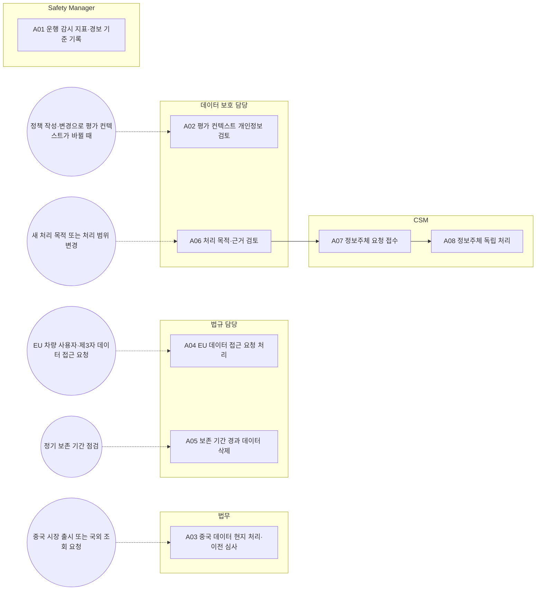

<!-- 생성물: docs/65-workflows/scripts/build_md.py — 손으로 고치지 않는다 -->

# WF-FPW-12 · FPW.12 운영 데이터·데이터 보호 / Operational Data & Data Protection

> 운행 감시에 쓰는 데이터의 범주·접근·보존을 정하고, 평가 컨텍스트에 개인정보가 들어가지 않게 하며, 시장별 데이터 이전·접근권·보존 의무를 지킨다. 처리 목적과 동의 또는 적법 근거를 검토하고 정보주체 요청의 독립 처리와 감사 연속성을 확인한다.

보고서 Gate: – · 근거: 표준 보고서 13장(텔레메트리·데이터), 11장 FFG-OFT-003

## 1. 업무 흐름

## 2. 활동

| ID | 활동 | RACI | 입력 | 출력 | 플랫폼 권한·화면 | 이행 규칙 |
|---|---|---|---|---|---|---|
| FPW.12-A01 | 운행 감시 지표·경보 기준 기록 | R Safety Manager · A Safety Manager · C 운영 조직, 데이터 보호 담당 · I 품질 조직 | WP-SAFETY-CASE | WP-KPI-PLAN | `recordSafetyKpiPlan`, `/ops/safety-kpi` | FFG-TEL-001 |
| FPW.12-A03 | 중국 데이터 현지 처리·이전 심사 | R 법무 · A 법무 · C 데이터 보호 담당, 법규 담당 · I 운영 조직 | WP-KPI-PLAN | WP-DATA-TRANSFER | 플랫폼 밖 | FFG-TEL-005 |
| FPW.12-A04 | EU 데이터 접근 요청 처리 | R 법규 담당 · A 법규 담당 · C 법무, 데이터 보호 담당 · I 운영 조직 | WP-KPI-PLAN | WP-DATA-ACCESS | `createDataAccessRequest`, `recordDataActContractBasis`, `/admin/data` | FFG-TEL-006 |
| FPW.12-A02 | 평가 컨텍스트 개인정보 검토 | R 데이터 보호 담당 · A 데이터 보호 담당 · C 아키텍트, 법무 · I 통합 조직 | WP-POLICY | WP-CONTEXT-REVIEW | `/integration/openfeature` | FFG-OFT-003 |
| FPW.12-A05 | 보존 기간 경과 데이터 삭제 | R 법규 담당 · A 법규 담당 · C 데이터 보호 담당, 운영 조직 · I 품질 조직 | WP-KPI-PLAN | WP-RETENTION-LOG | `retentionSweep`, `/admin/data` | FFG-TEL-008 |
| FPW.12-A06 | 처리 목적·근거 검토 | R 데이터 보호 담당 · A 데이터 보호 담당 · C 법무, CSM · I 운영 조직 |  | WP-PRIVACY-REVIEW | `/admin/data` | – |
| FPW.12-A07 | 정보주체 요청 접수 | R CSM · A CSM · C 데이터 보호 담당, 법무 · I 품질 조직 | WP-PRIVACY-REVIEW | WP-PRIVACY-REQ | `createPrivacyRequest`, `/admin/data` | – |
| FPW.12-A08 | 정보주체 독립 처리 | R CSM · A CSM · C 데이터 보호 담당 · I 품질 조직 | WP-PRIVACY-REQ | WP-PRIVACY-RESULT | `privacyExport`, `executePrivacyRequest`, `rejectPrivacyRequest`, `/admin/data` | – |

### 수행 절차와 완료 기준

#### FPW.12-A01 운행 감시 지표·경보 기준 기록
1. Safety Case 주장과 연결되는 운행 감시 지표를 고른다
2. 지표마다 경보 기준과 데이터 범주(목적별 접근 권한·보존 기간)를 정한다
3. 기준을 추가 기록으로 남기고 운영 조직에 감시를 맡긴다

완료 기준:
- [ ] 지표마다 경보 기준과 데이터 범주가 있다

#### FPW.12-A03 중국 데이터 현지 처리·이전 심사
- 트리거: 중국 시장 출시 또는 국외 조회 요청
1. 텔레메트리·OTA 데이터 중 중요 데이터를 식별하고 현지 처리 위치를 정한다
2. 국외 이전(국외 조회 포함) 경로마다 안전 평가·표준 계약·인증 중 하나를 거친다
3. 심사 결과를 기록하고 운영 조직에 허용 경로를 알린다

완료 기준:
- [ ] 모든 국외 이전 경로에 심사 방식과 결과가 있다

#### FPW.12-A04 EU 데이터 접근 요청 처리
- 트리거: EU 차량 사용자·제3자 데이터 접근 요청
1. 요청자와 대상 차량을 확인하고 Feature 상태·이력 데이터를 제공한다
2. 제3자 공유 요청이면 사용자 동의와 공유 절차를 확인한다
3. OEM이 비개인 데이터를 쓰는 경우 법무가 검토한 이용 계약 근거 문서 ID를 등록한다

완료 기준:
- [ ] 요청마다 제공 내용과 계약 근거가 기록되었다

#### FPW.12-A02 평가 컨텍스트 개인정보 검토
- 트리거: 정책 작성·변경으로 평가 컨텍스트가 바뀔 때
1. 정책의 targeting key가 가명 차량 ID인지 확인한다
2. 위치·운전자 식별·연락처·차량 동적 상태가 평가 컨텍스트에 들어가지 않는지 검토한다
3. 금지 속성이 들어오면 평가 전에 거부되는지 시험 결과를 확인한다

완료 기준:
- [ ] 금지 속성 거부 시험이 통과했다

#### FPW.12-A05 보존 기간 경과 데이터 삭제
- 트리거: 정기 보존 기간 점검
1. 데이터 범주별 보존 기간이 지난 행을 찾는다
2. 열린 Incident·이상 건에 연결된 데이터는 삭제에서 제외한다
3. 삭제를 실행하고 범주별 삭제 기록을 남긴다

완료 기준:
- [ ] 삭제 기록에 범주별 건수와 보류 사유가 있다

#### FPW.12-A06 처리 목적·근거 검토
- 트리거: 새 처리 목적 또는 처리 범위 변경
1. 수집·이용 목적과 최소 데이터 및 정보주체 범위를 식별한다
2. 동의 또는 적용 가능한 처리 근거의 원본과 보존·접근·이전 제한을 법무와 검토한다
3. 확정된 범위와 미확정 항목을 보안·운영 담당자에게 인계한다

완료 기준:
- [ ] 화면 조회나 데모 값으로 동의 획득을 대신하지 않는다
- [ ] 적용 시장과 실제 검토 근거를 식별한다

#### FPW.12-A07 정보주체 요청 접수
1. 요청 주체와 대상 사용자·차량 및 처리 목적을 확인한다
2. 개인정보 목록에서 대상 저장소와 예상 행 및 보존 예외를 확인한다
3. 내보내기 또는 삭제·가명화 요청과 사유를 기록하고 독립 실행자에게 인계한다

완료 기준:
- [ ] 대상 식별자와 목적을 무단 확대하지 않는다
- [ ] 요청 접수를 실제 삭제 완료로 표시하지 않는다

#### FPW.12-A08 정보주체 독립 처리
1. 삭제·가명화 실행자는 요청자와 다른 사람인지 확인한다
2. 보존 예외와 목적을 검토하여 허용된 내보내기·실행 또는 사유 있는 거절을 수행한다
3. 처리 행·Lake 위임 상태와 감사 체인을 확인하고 미완료 항목을 인계한다

완료 기준:
- [ ] 삭제·가명화 요청자 자기 실행이 차단된다
- [ ] Lake 요청 전송과 외부 삭제 완료를 구분한다

## 3. 산출물

| 키 | 이름 | 종류 | 주요 내용 |
|---|---|---|---|
| WP-KPI-PLAN | 운행 감시 지표·경보 기준 | 산출 | Safety Case 주장과 연결한 운행 감시 지표; 지표별 경보 기준과 데이터 범주 |
| WP-CONTEXT-REVIEW | 평가 컨텍스트 속성 검토 기록 | 산출 | 허용 속성(가명 차량 ID 등)과 금지 속성 목록; 금지 속성 거부 시험 결과 |
| WP-DATA-TRANSFER | 데이터 국외 이전 심사 기록 | 산출 | 중요 데이터 식별 결과와 현지 처리 위치; 이전 경로별 심사 방식(안전 평가·표준 계약·인증) |
| WP-DATA-ACCESS | 데이터 접근 요청·계약 근거 기록 | 산출 | 요청자·대상 차량·제공한 Feature 상태·이력; OEM 비개인 데이터 이용 계약 근거 문서 ID |
| WP-RETENTION-LOG | 보존·삭제 기록 | 산출 | 범주별 삭제 건수와 시각; 열린 Incident·이상 건에 연결되어 보류한 데이터 |
| WP-PRIVACY-REVIEW | 개인정보 목적·근거 검토 | 산출 | 처리 목적·최소 항목·정보주체·동의 또는 적법 근거의 원본 참조; 접근·보존·국외 이전 제한·검토 담당자·미확정 사항 |
| WP-PRIVACY-REQ | 정보주체 처리 요청 | 산출 | 검증된 요청자·대상 사용자/차량과 요청 종류; 대상 저장소·미리 집계한 행·요청 사유와 요청자 |
| WP-PRIVACY-RESULT | 정보주체 처리 결과 | 산출 | 요청자와 다른 실행자·근거·처리/거절 시각; 내보내기 또는 삭제/가명화 결과·Lake 위임 상태·감사 체인 보존 |

## 4. 진입·완료 기준

**진입**
- Feature가 운영 데이터 수집 범위에 등록되어 있다

**완료**
- 감시 지표·데이터 범주·보존 기간이 정해지고 접근·이전·삭제 기록이 남았다

## 5. 결과(Outcome)

- O1 운행 중 감시 지표와 경보 기준이 Safety Case에 맞춰 기록된다.
- O2 Flag 평가 컨텍스트에서 개인정보·위치·주행 상태가 배제된다.
- O3 중국 데이터는 현지 처리되고 국외 이전은 심사를 거친다.
- O4 EU 사용자·제3자 데이터 접근 요청과 OEM 이용 계약 근거가 처리·기록된다.
- O5 범주별 보존 기간이 지난 데이터가 삭제되고 기록된다.
- O6 개인정보 처리 목적·동의 또는 적법 근거·보존·접근 범위가 검토되고 미확정 사항이 식별된다.
- O7 정보주체 내보내기·삭제/가명화 요청과 독립 실행·거절 결과가 감사 연속성을 보존하며 추적된다.

## 6. 업무 수행 정의(Base Practices)

업무 정의 초안이다. 개인 활동 체크·서버 처리·Gate 승인 및 ASPICE 적합성 평가와 구분한다.

### FPW.12.BP1 운행 감시 지표·경보 기준 기록

Safety Case와 연결되는 운행 감시 목적과 지표·경보 기준을 정한다. 데이터 범주·접근·보존 조건을 기록하고 운영 담당자가 기준에 따라 감시하도록 인계한다.

- 기여 성과: O1
- 연결 활동: FPW.12-A01

### FPW.12.BP2 중국 데이터 현지 처리·이전 심사

적용 시장의 데이터 범주와 처리·조회·이전 경로를 식별한다. 법무가 정한 심사 방식과 결과를 기록하고 허용되지 않거나 미확정인 경로를 운영 범위에서 구분한다.

- 기여 성과: O3
- 연결 활동: FPW.12-A03
- 참고 1: 이 업무 정의는 특정 법규의 현재 적용 여부나 국외 이전 승인을 대신하지 않는다.

### FPW.12.BP3 EU 데이터 접근 요청 처리

요청자의 권한과 대상 차량·제공 범위를 확인하여 데이터 접근 요청을 처리한다. 동의·공유·이용 계약의 근거와 실제 제공 결과를 기록해 요청과 처리를 추적한다.

- 기여 성과: O4
- 연결 활동: FPW.12-A04

### FPW.12.BP4 평가 컨텍스트 개인정보 검토

평가 목적과 컨텍스트 속성을 검토하여 가명 식별과 금지 정보의 경계를 확인한다. 평가 이전의 거부 시험과 검토 근거를 보존하고 부적절한 수집·사용을 보완하도록 한다.

- 기여 성과: O2
- 연결 활동: FPW.12-A02

### FPW.12.BP5 보존 기간 경과 데이터 삭제

데이터 범주별로 정해진 보존·삭제 조건과 조사 보류 사유를 확인한다. 대상과 예외를 구분하여 처리를 수행하고 삭제 건수·보류·책임을 기록한다.

- 기여 성과: O5
- 연결 활동: FPW.12-A05

### FPW.12.BP6 처리 목적·근거 검토

개인정보의 목적·최소 항목·동의 또는 적법 근거와 보존·접근·이전 제한을 검토하여 실행 담당자에게 인계한다. 이 레퍼런스 정의는 고객 동의 수집이나 법률 적합성 승인을 생성하지 않는다.

- 기여 성과: O6
- 연결 활동: FPW.12-A06

### FPW.12.BP7 정보주체 요청 접수

정보주체 요청의 신원·대상·목적을 확인하고 저장소별 처리 범위를 집계하여 요청을 기록한다. 내보내기·삭제·가명화와 보존 예외를 구분해 실제 실행 또는 거절 판단에 인계한다.

- 기여 성과: O7
- 연결 활동: FPW.12-A07

### FPW.12.BP8 정보주체 독립 처리

허용된 내보내기와 삭제·가명화 또는 거절을 근거에 따라 수행하고 결과를 확인한다. 삭제·가명화는 요청자와 다른 보안 담당자가 실행하며 가명화 후 감사 연속성과 외부 Lake 미완료 상태를 보존한다.

- 기여 성과: O7
- 연결 활동: FPW.12-A08
- 참고 1: 같은 조직 역할의 서로 다른 사람이 요청·실행을 맡는다. 문서의 RACI만으로 사람 분리를 충족했다고 판정하지 않는다.

### BP × 성과

| BP | O1 | O2 | O3 | O4 | O5 | O6 | O7 |
|---|---|---|---|---|---|---|---|
| FPW.12.BP1 | ● | – | – | – | – | – | – |
| FPW.12.BP2 | – | – | ● | – | – | – | – |
| FPW.12.BP3 | – | – | – | ● | – | – | – |
| FPW.12.BP4 | – | ● | – | – | – | – | – |
| FPW.12.BP5 | – | – | – | – | ● | – | – |
| FPW.12.BP6 | – | – | – | – | – | ● | – |
| FPW.12.BP7 | – | – | – | – | – | – | ● |
| FPW.12.BP8 | – | – | – | – | – | – | ● |

### 출력 근거 × 성과

모델에 명시한 연결만 표시한다. 연결 존재는 실제 산출물 확보나 승인 완료의 증거가 아니다.

| 산출물 | O1 | O2 | O3 | O4 | O5 | O6 | O7 | 근거 BP |
|---|---|---|---|---|---|---|---|---|
| WP-KPI-PLAN | ● | – | – | – | – | – | – | FPW.12.BP1 |
| WP-DATA-TRANSFER | – | – | ● | – | – | – | – | FPW.12.BP2 |
| WP-DATA-ACCESS | – | – | – | ● | – | – | – | FPW.12.BP3 |
| WP-CONTEXT-REVIEW | – | ● | – | – | – | – | – | FPW.12.BP4 |
| WP-RETENTION-LOG | – | – | – | – | ● | – | – | FPW.12.BP5 |
| WP-PRIVACY-REVIEW | – | – | – | – | – | ● | – | FPW.12.BP6 |
| WP-PRIVACY-REQ | – | – | – | – | – | – | ● | FPW.12.BP7 |
| WP-PRIVACY-RESULT | – | – | – | – | – | – | ● | FPW.12.BP8 |
