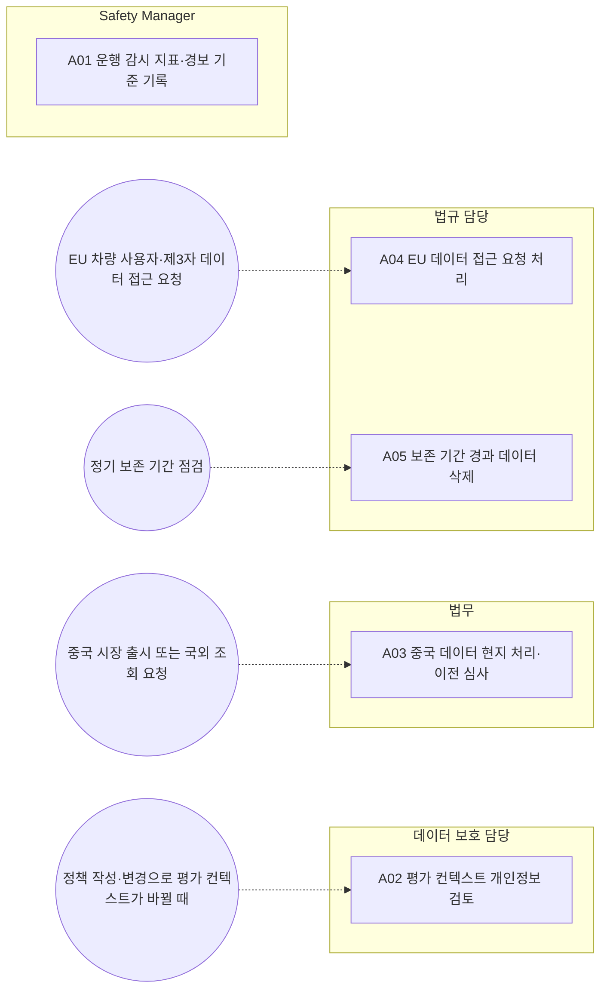

<!-- 생성물: docs/65-workflows/scripts/build_md.py — 손으로 고치지 않는다 -->

# WF-FPW-12 · FPW.12 운영 데이터·데이터 보호 / Operational Data & Data Protection

> 운행 감시에 쓰는 데이터의 범주·접근·보존을 정하고, 평가 컨텍스트에 개인정보가 들어가지 않게 하며, 시장별 데이터 이전·접근권·보존 의무를 지킨다.

보고서 Gate: – · 근거: 표준 보고서 13장(텔레메트리·데이터), 11장 FFG-OFT-003

## 1. 업무 흐름

## 2. 활동

| ID | 활동 | RACI | 입력 | 출력 | 플랫폼 권한·화면 | 이행 규칙 |
|---|---|---|---|---|---|---|
| FPW.12-A01 | 운행 감시 지표·경보 기준 기록 | R Safety Manager · A Safety Manager · C 운영 조직, 데이터 보호 담당 · I 품질 조직 | WP-SAFETY-CASE | WP-KPI-PLAN | `recordSafetyKpiPlan`, `/ops/safety-kpi` | FFG-TEL-001 |
| FPW.12-A02 | 평가 컨텍스트 개인정보 검토 | R 데이터 보호 담당 · A 데이터 보호 담당 · C 아키텍트, 법무 · I 통합 조직 | WP-POLICY | WP-CONTEXT-REVIEW | `/integration/openfeature` | FFG-OFT-003 |
| FPW.12-A03 | 중국 데이터 현지 처리·이전 심사 | R 법무 · A 법무 · C 데이터 보호 담당, 법규 담당 · I 운영 조직 | WP-KPI-PLAN | WP-DATA-TRANSFER | 플랫폼 밖 | FFG-TEL-005 |
| FPW.12-A04 | EU 데이터 접근 요청 처리 | R 법규 담당 · A 법규 담당 · C 법무, 데이터 보호 담당 · I 운영 조직 | WP-KPI-PLAN | WP-DATA-ACCESS | `createDataAccessRequest`, `recordDataActContractBasis`, `/admin/data` | FFG-TEL-006 |
| FPW.12-A05 | 보존 기간 경과 데이터 삭제 | R 법규 담당 · A 법규 담당 · C 데이터 보호 담당, 운영 조직 · I 품질 조직 | WP-KPI-PLAN | WP-RETENTION-LOG | `retentionSweep`, `/admin/data` | FFG-TEL-008 |

### 수행 절차와 완료 기준

#### FPW.12-A01 운행 감시 지표·경보 기준 기록
1. Safety Case 주장과 연결되는 운행 감시 지표를 고른다
2. 지표마다 경보 기준과 데이터 범주(목적별 접근 권한·보존 기간)를 정한다
3. 기준을 추가 기록으로 남기고 운영 조직에 감시를 맡긴다

완료 기준:
- [ ] 지표마다 경보 기준과 데이터 범주가 있다

#### FPW.12-A02 평가 컨텍스트 개인정보 검토
- 트리거: 정책 작성·변경으로 평가 컨텍스트가 바뀔 때
1. 정책의 targeting key가 가명 차량 ID인지 확인한다
2. 위치·운전자 식별·연락처·차량 동적 상태가 평가 컨텍스트에 들어가지 않는지 검토한다
3. 금지 속성이 들어오면 평가 전에 거부되는지 시험 결과를 확인한다

완료 기준:
- [ ] 금지 속성 거부 시험이 통과했다

#### FPW.12-A03 중국 데이터 현지 처리·이전 심사
- 트리거: 중국 시장 출시 또는 국외 조회 요청
1. 텔레메트리·OTA 데이터 중 중요 데이터를 식별하고 현지 처리 위치를 정한다
2. 국외 이전(국외 조회 포함) 경로마다 안전 평가·표준 계약·인증 중 하나를 거친다
3. 심사 결과를 기록하고 운영 조직에 허용 경로를 알린다

완료 기준:
- [ ] 모든 국외 이전 경로에 심사 방식과 결과가 있다

#### FPW.12-A04 EU 데이터 접근 요청 처리
- 트리거: EU 차량 사용자·제3자 데이터 접근 요청
1. 요청자와 대상 차량을 확인하고 Feature 상태·이력 데이터를 제공한다
2. 제3자 공유 요청이면 사용자 동의와 공유 절차를 확인한다
3. OEM이 비개인 데이터를 쓰는 경우 법무가 검토한 이용 계약 근거 문서 ID를 등록한다

완료 기준:
- [ ] 요청마다 제공 내용과 계약 근거가 기록되었다

#### FPW.12-A05 보존 기간 경과 데이터 삭제
- 트리거: 정기 보존 기간 점검
1. 데이터 범주별 보존 기간이 지난 행을 찾는다
2. 열린 Incident·이상 건에 연결된 데이터는 삭제에서 제외한다
3. 삭제를 실행하고 범주별 삭제 기록을 남긴다

완료 기준:
- [ ] 삭제 기록에 범주별 건수와 보류 사유가 있다

## 3. 산출물

| 키 | 이름 | 종류 | 주요 내용 |
|---|---|---|---|
| WP-KPI-PLAN | 운행 감시 지표·경보 기준 | 산출 | Safety Case 주장과 연결한 운행 감시 지표; 지표별 경보 기준과 데이터 범주 |
| WP-CONTEXT-REVIEW | 평가 컨텍스트 속성 검토 기록 | 산출 | 허용 속성(가명 차량 ID 등)과 금지 속성 목록; 금지 속성 거부 시험 결과 |
| WP-DATA-TRANSFER | 데이터 국외 이전 심사 기록 | 산출 | 중요 데이터 식별 결과와 현지 처리 위치; 이전 경로별 심사 방식(안전 평가·표준 계약·인증) |
| WP-DATA-ACCESS | 데이터 접근 요청·계약 근거 기록 | 산출 | 요청자·대상 차량·제공한 Feature 상태·이력; OEM 비개인 데이터 이용 계약 근거 문서 ID |
| WP-RETENTION-LOG | 보존·삭제 기록 | 산출 | 범주별 삭제 건수와 시각; 열린 Incident·이상 건에 연결되어 보류한 데이터 |

## 4. 진입·완료 기준

**진입**
- Feature가 운영 데이터 수집 범위에 등록되어 있다

**완료**
- 감시 지표·데이터 범주·보존 기간이 정해지고 접근·이전·삭제 기록이 남았다

## 5. 결과(Outcome)

- O1 운행 중 감시 지표와 경보 기준이 Safety Case에 맞춰 기록된다.
- O2 Flag 평가 컨텍스트에서 개인정보·위치·주행 상태가 배제된다.
- O3 중국 데이터는 현지 처리되고 국외 이전은 심사를 거친다.
- O4 EU 사용자·제3자 데이터 접근 요청과 OEM 이용 계약 근거가 처리·기록된다.
- O5 범주별 보존 기간이 지난 데이터가 삭제되고 기록된다.
