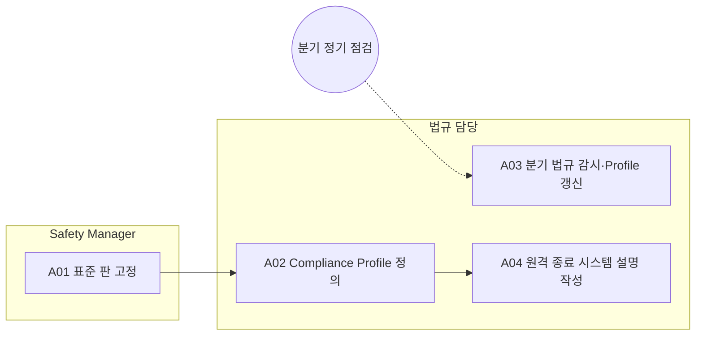

<!-- 생성물: docs/65-workflows/scripts/build_md.py — 손으로 고치지 않는다 -->

# WF-FPW-13 · FPW.13 규정·Compliance Profile 관리 / Regulatory & Compliance Profile Management

> 프로젝트가 따를 표준 판을 고정하고, 시장별 적용 법규·필수 Evidence·게이트 파라미터를 버전 관리되는 Compliance Profile로 운영하며, 원격 종료 절차를 시스템 설명 문서에 운영 절차와 같은 내용으로 적는다.

보고서 Gate: – · 근거: 표준 보고서 2장(규정·표준 관리), 3장(ADS 규정), 7.10절(거버넌스)

## 1. 업무 흐름

## 2. 활동

| ID | 활동 | RACI | 입력 | 출력 | 플랫폼 권한·화면 | 이행 규칙 |
|---|---|---|---|---|---|---|
| FPW.13-A01 | 표준 판 고정 | R Safety Manager · A Safety Manager · C CSM, 법규 담당 · I 품질 조직 | WP-REG-SOURCES | WP-STANDARD-EDITIONS | 플랫폼 밖 | FFG-GEN-002 |
| FPW.13-A02 | Compliance Profile 정의 | R 법규 담당 · A 법규 담당 · C Safety Manager, CSM, 법무 · I Feature Owner, 운영 조직 | WP-STANDARD-EDITIONS, WP-REG-SOURCES | WP-COMPLIANCE-PROFILE | `/verify/compliance` | FFG-GEN-001, FFG-ADS-001 |
| FPW.13-A03 | 분기 법규 감시·Profile 갱신 | R 법규 담당, Safety Manager, CSM · A 법규 담당 · C 법무 · I Feature Owner, 운영 조직, 품질 조직 | WP-REG-SOURCES, WP-COMPLIANCE-PROFILE | WP-COMPLIANCE-PROFILE | `/verify/compliance` | FFG-GEN-004 |
| FPW.13-A04 | 원격 종료 시스템 설명 작성 | R 법규 담당, 운영 조직 · A 법규 담당 · C Safety Manager, CSM · I 품질 조직 | WP-COMPLIANCE-PROFILE, WP-DRILL-REPORT | WP-SYSTEM-DESCRIPTION | 플랫폼 밖 | FFG-ADS-006 |

### 수행 절차와 완료 기준

#### FPW.13-A01 표준 판 고정
1. 프로젝트가 따를 ISO 26262·ISO 21448·ISO/SAE 21434의 판을 정해 Safety Plan에 적는다
2. 정식 발행 전 개정판의 요구는 참고로만 두고 Gate 판정 기준에서 뺀다
3. 고정한 판을 법규 담당과 CSM에게 알려 Profile과 CSMS에 맞춘다

완료 기준:
- [ ] Safety Plan에 세 표준의 적용 판이 적혀 있다

#### FPW.13-A02 Compliance Profile 정의
1. 시장별 적용 법규·의무 기능·필수 Evidence·게이트 파라미터를 Profile로 정의하고 버전을 붙인다
2. ADS 관련 시장은 UN 규정·GTR의 국내 도입·발효 상태를 따로 적고, 제안문 조항은 최종 법문과 대조한 뒤에만 기준으로 쓴다
3. 정책과 명령이 생성 시점의 Profile 버전을 기록하는지 플랫폼 컴플라이언스 화면에서 확인한다

완료 기준:
- [ ] 대상 시장마다 Profile 버전이 있고 ADS 조항의 대조 결과가 있다

#### FPW.13-A03 분기 법규 감시·Profile 갱신
- 트리거: 분기 정기 점검
1. 법규 담당·Safety Manager·CSM이 분기마다 표준·법규 개정을 각자 범위에서 점검한다
2. 개정 사항을 Profile 새 버전에 반영하고 영향 받는 Feature를 Feature Owner에게 알린다
3. 검증이 필요하다고 표시된 항목은 해당 시장 SOP 전까지 해소 기한과 담당을 정한다

완료 기준:
- [ ] 분기 점검 기록과 Profile 새 버전(또는 무변경 확인)이 있다

#### FPW.13-A04 원격 종료 시스템 설명 작성
1. 원격 종료·복원 방법을 시스템 설명 문서에 적는다
2. 발동 사유·승인자·긴급 권한·해제 기준·시장별 차이를 운영 절차(FPW.8)와 같은 내용으로 맞춘다
3. 운영 조직이 드릴 결과로 실제 운영과 문서가 같은지 확인한다

완료 기준:
- [ ] 시스템 설명과 FPW.8 운영 절차의 승인자·기준이 일치한다

## 3. 산출물

| 키 | 이름 | 종류 | 주요 내용 |
|---|---|---|---|
| WP-REG-SOURCES | 법규·표준 원문 | 입력 (승인 기관 공보, 표준 기구, 법규 DB) | 시장별 법규 최종 법문과 발효·적용일; 표준 판과 개정 예고 |
| WP-STANDARD-EDITIONS | 표준 판 고정 기록(Safety Plan) | 산출 | ISO 26262·ISO 21448·ISO/SAE 21434의 적용 판; 정식 발행 전 개정 요구를 Gate 판정 기준에서 뺀다는 표시 |
| WP-COMPLIANCE-PROFILE | 시장별 Compliance Profile | 산출 | 시장별 적용 법규·의무 기능·필수 Evidence·게이트 파라미터; ADS 규정의 국내 도입·발효 상태와 최종 법문 대조 결과; Profile 버전과 갱신 이력, '검증 필요' 항목과 해소 기한 |
| WP-SYSTEM-DESCRIPTION | 원격 종료 시스템 설명 | 산출 | 원격 종료·복원 방법과 발동 사유·승인자·긴급 권한·해제 기준; 시장별 차이와 운영 절차(FPW.8)와의 대응 |

## 4. 진입·완료 기준

**진입**
- 프로젝트의 대상 시장과 차종이 정해졌다

**완료**
- 표준 판·Compliance Profile·시스템 설명이 최신 버전으로 승인되어 있다

## 5. 결과(Outcome)

- O1 ISO 26262·21448·21434의 판이 프로젝트 단위로 고정된다.
- O2 시장별 Compliance Profile이 정의되고 모든 정책·명령이 그 버전을 기록한다.
- O3 분기마다 표준·법규 개정이 점검되어 Profile이 갱신된다.
- O4 원격 종료·복원 절차가 시스템 설명 문서에 운영 절차와 같게 적힌다.
