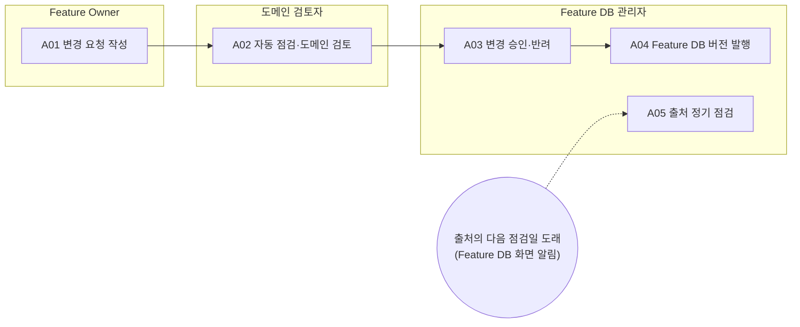

<!-- 생성물: docs/65-workflows/scripts/build_md.py — 손으로 고치지 않는다 -->

# WF-FPW-14 · FPW.14 Feature DB 운영 / Feature DB Operation

> Feature 등록의 원천인 Feature DB 기준 행을 변경 요청으로만 바꾸고, 등록 기준 자동 점검과 담당 도메인 검토를 거쳐 Feature DB 관리자가 승인한 변경을 번호 붙은 버전으로 발행해 모든 등록 화면이 같은 기준을 쓰게 한다.

보고서 Gate: – · 근거: Feature DB 설계(30-95) 6.4절(추가 요청), 8장(운영 — 변경 요청·도메인 검토·승인·버전 발행·정기 점검)

## 1. 업무 흐름

## 2. 활동

| ID | 활동 | RACI | 입력 | 출력 | 플랫폼 권한·화면 | 이행 규칙 |
|---|---|---|---|---|---|---|
| FPW.14-A01 | 변경 요청 작성 | R Feature Owner · A Feature Owner · C 아키텍트 · I Feature DB 관리자, 도메인 검토자 | WP-REF-LINK | WP-REF-CHANGE-REQ | `createRefChange`, `/master/feature-db/:refId` | – |
| FPW.14-A02 | 자동 점검·도메인 검토 | R 도메인 검토자 · A 도메인 검토자 · C Safety Manager · I Feature DB 관리자, Feature Owner | WP-REF-CHANGE-REQ, WP-REF-ADD-REQ | WP-REF-REVIEW | `reviewRefChange`, `/master/feature-db/changes/:id`, `/master/feature-db/changes` | – |
| FPW.14-A03 | 변경 승인·반려 | R Feature DB 관리자 · A Feature DB 관리자 · C 도메인 검토자 · I Feature Owner | WP-REF-CHANGE-REQ, WP-REF-ADD-REQ, WP-REF-REVIEW | WP-REF-DECISION | `decideRefChange`, `/master/feature-db/changes/:id`, `/master/feature-db/changes` | – |
| FPW.14-A04 | Feature DB 버전 발행 | R Feature DB 관리자 · A Feature DB 관리자 · I Feature Owner, 도메인 검토자, 기준정보 담당 | WP-REF-DECISION | WP-REFDB-RELEASE | `publishRefRelease`, `/master/feature-db/changes` | – |
| FPW.14-A05 | 출처 정기 점검 | R Feature DB 관리자 · A Feature DB 관리자 · C 법규 담당, 도메인 검토자 · I Feature Owner | WP-REFDB-RELEASE | WP-REF-SOURCE-REVIEW | `recordSourceReview`, `/master/feature-db` | – |

### 수행 절차와 완료 기준

#### FPW.14-A01 변경 요청 작성
1. Feature DB 상세에서 바꿀 기준 행을 열고 요청 종류(추가·수정·폐기 예정·폐기)를 고른다
2. 바꿀 필드의 새 값과 사유, 근거가 되는 1차 출처 위치를 적는다
3. 출처 정기 점검에서 넘어온 개정 대상 행이면 그 점검 기록을 사유에 인용한다
4. 영향 표시에서 이 행을 쓰는 Feature와 진행 중 산정 과제를 확인하고, 대표 ASIL·T-shirt 변경이면 재계산 필요를 알린다
5. 폐기 예정·폐기 요청이면 대체 행을 함께 지정한다

완료 기준:
- [ ] 변경 요청에 필드별 변경 전후 값과 사유·출처가 있다
- [ ] 폐기 예정·폐기 요청에 대체 행 또는 대체 없음 사유가 있다

#### FPW.14-A02 자동 점검·도메인 검토
1. 자동 점검 결과에서 ID 형식·필수 정보·출처·규모 근거·중복·선행 관계 항목을 확인한다
2. 필수 정보 누락은 요청자에게 보완을 요청하고, 그 밖의 실패 항목은 보완 필요로 표시한다
3. 담당 도메인의 기준으로 변경 내용을 검토해 동의·보완·반대 의견과 근거를 남긴다
4. 대표 ASIL을 바꾸는 요청이면 Safety Manager 의견을 받아 함께 적는다

완료 기준:
- [ ] 검토 의견이 비어 있지 않고 검토자가 요청자와 다른 사람이다
- [ ] 필수 정보 누락 항목이 남아 있지 않다

#### FPW.14-A03 변경 승인·반려
1. 변경 요청·자동 점검 결과·도메인 검토 의견을 함께 보고 승인 또는 반려를 정한다
2. 마지막 검토 의견이 반대·보완이면 승인하지 않고, 반려하거나 요청자에게 보완을 맡긴다
3. 판정 사유를 남긴다 — 요청 중 행의 상태 확정(활성·검토 필요·폐기)과 연결 Feature 알림은 다음 발행 때 이루어진다

완료 기준:
- [ ] 승인자가 요청자와도, 그 요청의 도메인 검토자와도 다른 사람이고 판정 사유가 있다
- [ ] 승인된 변경은 발행 전까지 발행 대기로 표시되어 등록 화면에 반영되지 않았다

#### FPW.14-A04 Feature DB 버전 발행
1. 발행 대기인 승인 요청을 모아 다음 발행 번호로 묶는다
2. 품질 지표(상태 미입력·출처 없는 행·12개월 경과 행)를 확인하고 발행 노트에 적는다
3. 발행해 전체 정규화 해시를 기록하고 등록 화면이 새 버전을 쓰는지 확인한다
4. 승인된 추가 요청의 요청 중 행이 활성(근거 부족이면 검토 필요)이 되고, 반려된 추가 요청의 요청 중 행이 폐기와 사유로 확정되었는지 확인한다
5. 폐기로 확정된 행에 연결된 Feature의 Feature Owner에게 다른 행으로 다시 연결하라는 알림이 갔는지 확인한다
6. 바뀐 기준 행을 쓰는 Feature에 '기준 행이 바뀜' 표시가 붙었는지 확인한다

완료 기준:
- [ ] 발행 번호·묶인 요청 목록·정규화 해시가 발행 기록에 있다
- [ ] 발행 대기 요청 수가 0이다
- [ ] 반려된 추가 요청의 요청 중 행이 남아 있지 않다

#### FPW.14-A05 출처 정기 점검
- 트리거: 출처의 다음 점검일 도래(Feature DB 화면 알림)
1. 기한이 지난 출처(AUTOSAR·VSS·ISO·UN 규정·Euro NCAP 등) 목록을 Feature DB 화면 알림에서 연다
2. 출처마다 새 판·개정 여부를 확인하고, 규정 출처는 법규 담당 의견을 받는다
3. 개정이 기준 행에 영향을 주면 해당 행의 변경 요청이 나오도록 담당 도메인 검토자에게 넘긴다
4. 점검 결과와 새 다음 점검일을 기록한다

완료 기준:
- [ ] 기한이 지난 출처마다 점검 결과와 새 다음 점검일이 있다

## 3. 산출물

| 키 | 이름 | 종류 | 주요 내용 |
|---|---|---|---|
| WP-REF-CHANGE-REQ | 기준 행 변경 요청 | 산출 | 요청 종류(추가·수정·폐기 예정·폐기)와 대상 기준 행 ID; 필드별 변경 전후 값과 사유·1차 출처 위치; 이 행을 쓰는 FF Feature와 진행 중 산정 과제 목록(영향 표시) |
| WP-REF-REVIEW | 자동 점검·도메인 검토 기록 | 산출 | 등록 기준 점검 결과(통과·보완 필요·필수 정보 누락) 항목별 표시; 도메인 검토자 의견(동의·보완·반대)과 근거; 검토자가 요청자와 다른 사람이라는 확인 |
| WP-REF-DECISION | 변경 승인·반려 기록 | 산출 | 승인·반려 판정과 사유, 판정자와 시각; 승인된 필드 차이의 적용 결과(발행 대기 표시); 반려된 추가 요청의 요청 중 행(발행 때 폐기·알림 대상) |
| WP-REFDB-RELEASE | Feature DB 발행본 | 산출 | 발행 번호(v1.4 등)와 묶인 승인 요청 목록; 요청 중 행의 확정 상태(활성·검토 필요, 반려된 추가 요청은 폐기와 사유)와 알림 받은 Feature Owner; 전체 기준 행 정규화 해시와 상태별 행 수; 품질 지표(출처 없는 행·근거 확인 12개월 경과 행·규모 근거 D 비중·발행 대기 요청 수); 분류 체계(도메인·클러스터·컴포넌트)와 출처 목록 |
| WP-REF-SOURCE-REVIEW | 출처 정기 점검 기록 | 산출 | 다음 점검일이 지난 출처와 점검 결과(변경 없음·개정 있음); 개정이 있는 출처에서 나온 후속 변경 요청 대상 행; 출처별 새 다음 점검일 |

## 4. 진입·완료 기준

**진입**
- Feature DB 첫 발행본(엑셀 1회 이전 v1.3)이 설치되어 있다
- Feature DB 관리자와 도메인별 검토자가 계정에 지정되어 있다

**완료**
- 승인된 변경이 새 발행 버전에 묶이고 전체 정규화 해시가 기록되었다
- 반려되어 폐기된 요청 중 행에 연결된 Feature의 Feature Owner가 알림을 받았다
- 다음 점검일이 지난 출처가 남아 있지 않다

## 5. 결과(Outcome)

- O1 기준 행의 추가·수정·폐기 예정·폐기가 필드 단위 차이를 가진 변경 요청으로 남는다.
- O2 변경 요청마다 등록 기준 자동 점검 결과와 담당 도메인 검토 의견이 남는다.
- O3 요청자·검토자와 다른 사람이 근거를 남기고 변경을 승인·반려한다.
- O4 승인된 변경이 정규화 해시가 기록된 발행 버전으로 묶여 등록 화면에 반영되고
- O5 출처마다 다음 점검일이 관리되고 기한이 지난 출처가 점검된다.
