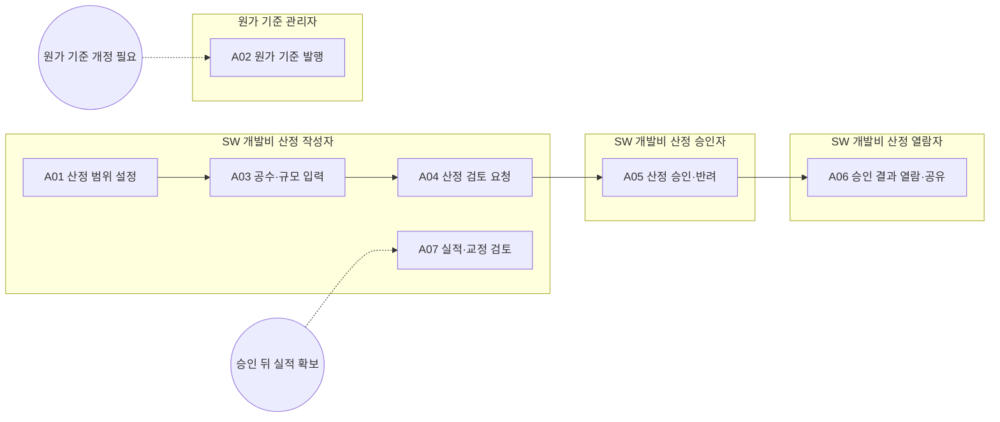

<!-- 생성물: docs/65-workflows/scripts/build_md.py — 손으로 고치지 않는다 -->

# WF-FPW-15 · FPW.15 SW 개발비·원가 기준 관리 / Software Cost and Cost Basis Management

> Feature·기준 행·적용 범위를 산정 근거로 고정하고 공수·계수·단가의 출처와 검토 책임을 분리하여 재현 가능한 SW 개발비를 산정하며, 승인 결과를 보존한 채 실적을 다음 원가 기준 개정에 반영한다.

보고서 Gate: – · 근거: 업무 레퍼런스 모델 요구(WF-REFERENCE-REQUIREMENTS)·현행 플랫폼 계약/화면; 조직 검토 전 초안

## 1. 업무 흐름

## 2. 활동

| ID | 활동 | RACI | 입력 | 출력 | 플랫폼 권한·화면 | 이행 규칙 |
|---|---|---|---|---|---|---|
| FPW.15-A01 | 산정 범위 설정 | R SW 개발비 산정 작성자 · A SW 개발비 산정 작성자 · C Feature Owner, 구매 · I SW 개발비 산정 승인자 | WP-REF-LINK | WP-COST-SCOPE | `costProjectCreate`, `costFeatureAdd`, `costProjectUpdate`, `/procurement/sw-cost`, `/procurement/sw-cost/:estId` | – |
| FPW.15-A02 | 원가 기준 발행 | R 원가 기준 관리자 · A 원가 기준 관리자 · C SW 개발비 산정 작성자, 구매 · I SW 개발비 산정 승인자 |  | WP-COST-BASIS | `costBasisDraft`, `costBasisPublish`, `/procurement/sw-cost/basis` | – |
| FPW.15-A03 | 공수·규모 입력 | R SW 개발비 산정 작성자 · A SW 개발비 산정 작성자 · C 아키텍트, 통합 조직 · I SW 개발비 산정 승인자 | WP-COST-SCOPE, WP-COST-BASIS | WP-COST-CALC | `costLineUpdate`, `costMbdPut`, `/procurement/sw-cost/:estId` | – |
| FPW.15-A04 | 산정 검토 요청 | R SW 개발비 산정 작성자 · A SW 개발비 산정 작성자 · C 구매 · I SW 개발비 산정 승인자 | WP-COST-CALC | WP-COST-REVIEW | `costCheckPut`, `costTransition`, `/procurement/sw-cost/:estId` | – |
| FPW.15-A05 | 산정 승인·반려 | R SW 개발비 산정 승인자 · A SW 개발비 산정 승인자 · C 구매 · I SW 개발비 산정 작성자, SW 개발비 산정 열람자 | WP-COST-REVIEW, WP-COST-CALC | WP-COST-REVIEW | `costCheckPut`, `costTransition`, `/procurement/sw-cost/:estId` | – |
| FPW.15-A06 | 승인 결과 열람·공유 | R SW 개발비 산정 열람자 · A 구매 · C SW 개발비 산정 작성자 · I SW 개발비 산정 승인자 | WP-COST-REVIEW | WP-COST-SHARE | `/procurement/sw-cost`, `/procurement/sw-cost/:estId` | – |
| FPW.15-A07 | 실적·교정 검토 | R SW 개발비 산정 작성자 · A 원가 기준 관리자 · C 구매 · I SW 개발비 산정 승인자 | WP-COST-REVIEW | WP-COST-ACTUAL | `costActualPut`, `/procurement/sw-cost/:estId`, `/procurement/sw-cost/basis` | – |

### 수행 절차와 완료 기준

#### FPW.15-A01 산정 범위 설정
1. 대상 Feature와 기준 행의 버전을 확인한다
2. 차량·시장 범위와 포함·제외 및 가정을 적어 과제를 만든다
3. 작성 책임자와 산정에 사용할 기준 버전을 확인한다

완료 기준:
- [ ] 대상과 가정이 과제 설정에 남는다

#### FPW.15-A02 원가 기준 발행
- 트리거: 원가 기준 개정 필요
1. 현행 단가·계수와 출처 및 통화를 확인한다
2. 변경 항목을 새 기준 초안으로 작성한다
3. 사유를 적어 새 기준 버전을 발행하고 적용 대상을 알린다

완료 기준:
- [ ] 과거 승인 산정은 발행 전 스냅샷을 유지한다
- [ ] 기준 버전과 변경 사유가 남는다

#### FPW.15-A03 공수·규모 입력
1. 과제에 대상 Feature를 담고 입력 행과 중복을 확인한다
2. 규모·복잡도·재사용과 MBD 작업별 공수 근거를 입력한다
3. 오류와 합계를 계산해 기준 버전 및 제외 항목을 재확인한다

완료 기준:
- [ ] 필수 입력 오류가 해소되거나 보류 사유가 남는다
- [ ] 줄별 입력과 계산 기준을 재현할 수 있다

#### FPW.15-A04 산정 검토 요청
1. 범위·기준 버전·계산 오류와 검토 체크를 확인한다
2. 불확실한 가정과 제외 항목을 검토 설명에 남긴다
3. 제출 전이를 요청하고 제출 상태와 시각을 확인한다

완료 기준:
- [ ] 제출과 미해결 항목이 기록된다

#### FPW.15-A05 산정 승인·반려
1. 작성자와 자신이 다른 사람인지 확인한다
2. 범위·공수·단가와 검토 체크를 근거로 승인 또는 반려를 판단한다
3. 사유를 남겨 전이하고 승인 스냅샷 또는 보완 요청을 확인한다

완료 기준:
- [ ] 자기 작성 과제의 승인이 차단된다
- [ ] 판정자·사유와 승인 스냅샷이 추적된다

#### FPW.15-A06 승인 결과 열람·공유
1. 자신의 금액 열람 권한과 공유 목적을 확인한다
2. 승인 버전과 금액·가정을 조회하고 필요하면 허용된 내보내기를 사용한다
3. 내보내기 감사와 전달 범위를 확인하고 승인 원본을 보존한다

완료 기준:
- [ ] 조회가 작성·승인 권한으로 확대되지 않는다
- [ ] 공유한 버전과 대상이 식별된다

#### FPW.15-A07 실적·교정 검토
- 트리거: 승인 뒤 실적 확보
1. 승인된 기준 버전과 실적 공수의 수집 범위를 확인한다
2. 실적과 출처를 기록하고 산정 오차 및 교정 제안을 검토한다
3. 다음 기준 개정에 반영할 항목과 보류 사유를 기준 관리자에게 전달한다

완료 기준:
- [ ] 실적 입력이 승인 금액을 소급 변경하지 않는다
- [ ] 교정 제안은 기준 개정 전 자동 적용되지 않는다

## 3. 산출물

| 키 | 이름 | 종류 | 주요 내용 |
|---|---|---|---|
| WP-COST-SCOPE | 산정 범위·과제 | 산출 | 대상 Feature/버전·기준 행·작성자; 차량/시장·포함/제외·가정과 과제 설정 |
| WP-COST-BASIS | 발행 원가 기준 | 산출 | 단가·계수·통화·근거 출처와 버전; 초안과 발행자·사유·적용 시점 |
| WP-COST-CALC | 산정 입력·계산 결과 | 산출 | 줄별 규모·공수·MBD 입력과 근거; 계산 오류·합계·적용 기준 버전 |
| WP-COST-REVIEW | 산정 검토·승인 기록 | 산출 | 검토 체크·제출·승인/반려 사유와 사람·시각; 승인 스냅샷과 개정 관계 |
| WP-COST-SHARE | 산정 결과 공유 기록 | 산출 | 열람/내보내기 대상·권한·버전; 내보내기 감사 기록과 공유 제한 |
| WP-COST-ACTUAL | 실적·오차 검토 | 산출 | 승인 뒤 실적 공수·출처·편차; 교정 제안과 다음 기준 개정의 채택/보류 근거 |

## 4. 진입·완료 기준

**진입**
- 산정 대상 Feature 또는 Feature DB 기준 행과 담당자가 식별되어 있다
- 산정 역할과 금액 열람 권한이 기존 IAM에 부여되어 있다

**완료**
- 승인 또는 반려 결과와 계산 기준 버전이 추적된다
- 승인된 과거 금액을 덮어쓰지 않고 실적과 새 기준 버전이 분리된다

## 5. 결과(Outcome)

- O1 산정 대상과 Feature·기준 행 버전, 제외 범위 및 가정이 식별된다.
- O2 공수·MBD 작업·계수·단가 버전과 계산 오류가 검토되어 산정 결과가 재현된다.
- O3 작성자와 다른 승인자가 검토한 제출·승인·반려 이력이 남고 승인 스냅샷이 보존된다.
- O4 금액 열람 권한을 지켜 승인 결과가 공유되며 실적 오차가 다음 기준 개정의 근거가 된다.

## 6. 업무 수행 정의(Base Practices)

업무 정의 초안이다. 개인 활동 체크·서버 처리·Gate 승인 및 ASPICE 적합성 평가와 구분한다.

### FPW.15.BP1 산정 범위 설정

산정 과제의 목적·범위·책임을 정하고 산정 대상 Feature와 기준 행을 특정 버전으로 식별한다. 구입 계약 확정이나 Feature 출시 승인과 구분한다.

- 기여 성과: O1
- 연결 활동: FPW.15-A01

### FPW.15.BP2 원가 기준 발행

단가와 계수의 출처·적용 조건을 관리하고 개정된 값을 번호가 있는 새 기준으로 발행한다. 발행이 과거 승인 과제의 금액을 바꾸지 않도록 승인 스냅샷과 분리한다.

- 기여 성과: O2
- 연결 활동: FPW.15-A02

### FPW.15.BP3 공수·규모 입력

Feature별 규모·공수·재사용과 MBD 작업을 출처에 따라 입력하고 계산 오류·합계를 검토한다. 자동 채운 값도 추정 가정으로 확인하며 산정 금액을 사업 승인으로 취급하지 않는다.

- 기여 성과: O2
- 연결 활동: FPW.15-A03

### FPW.15.BP4 산정 검토 요청

재현 가능한 산정 입력과 검토 체크를 갖춰 독립 승인자에게 제출한다. 제출 응답만으로 승인되었다고 표시하지 않고 과제의 실제 상태와 보완 요구를 확인한다.

- 기여 성과: O3
- 연결 활동: FPW.15-A04

### FPW.15.BP5 산정 승인·반려

작성자와 다른 승인자가 산정 근거와 불확실성을 검토해 승인 또는 반려한다. 승인 뒤 입력 변경은 개정 절차로 분리하고 같은 과제의 승인 증거를 덮어쓰지 않는다.

- 기여 성과: O3
- 연결 활동: FPW.15-A05

### FPW.15.BP6 승인 결과 열람·공유

금액 열람 권한을 가진 사람이 승인 결과와 가정을 조회하고 허용된 범위로 공유한다. 열람자는 산정 입력이나 승인 상태를 바꾸지 않으며 내보내기 감사와 전달 제한을 확인한다.

- 기여 성과: O4
- 연결 활동: FPW.15-A06

### FPW.15.BP7 실적·교정 검토

승인 이후 실적을 별도 기록하여 추정 오차를 분석하고 단가·계수 개정의 근거를 제시한다. 제안의 수용은 새 기준 발행에서 결정하며 과거 승인 결과와 구분한다.

- 기여 성과: O4
- 연결 활동: FPW.15-A07

### BP × 성과

| BP | O1 | O2 | O3 | O4 |
|---|---|---|---|---|
| FPW.15.BP1 | ● | – | – | – |
| FPW.15.BP2 | – | ● | – | – |
| FPW.15.BP3 | – | ● | – | – |
| FPW.15.BP4 | – | – | ● | – |
| FPW.15.BP5 | – | – | ● | – |
| FPW.15.BP6 | – | – | – | ● |
| FPW.15.BP7 | – | – | – | ● |

### 출력 근거 × 성과

모델에 명시한 연결만 표시한다. 연결 존재는 실제 산출물 확보나 승인 완료의 증거가 아니다.

| 산출물 | O1 | O2 | O3 | O4 | 근거 BP |
|---|---|---|---|---|---|
| WP-COST-SCOPE | ● | – | – | – | FPW.15.BP1 |
| WP-COST-BASIS | – | ● | – | – | FPW.15.BP2 |
| WP-COST-CALC | – | ● | – | – | FPW.15.BP3 |
| WP-COST-REVIEW | – | – | ● | – | FPW.15.BP4, FPW.15.BP5 |
| WP-COST-SHARE | – | – | – | ● | FPW.15.BP6 |
| WP-COST-ACTUAL | – | – | – | ● | FPW.15.BP7 |
