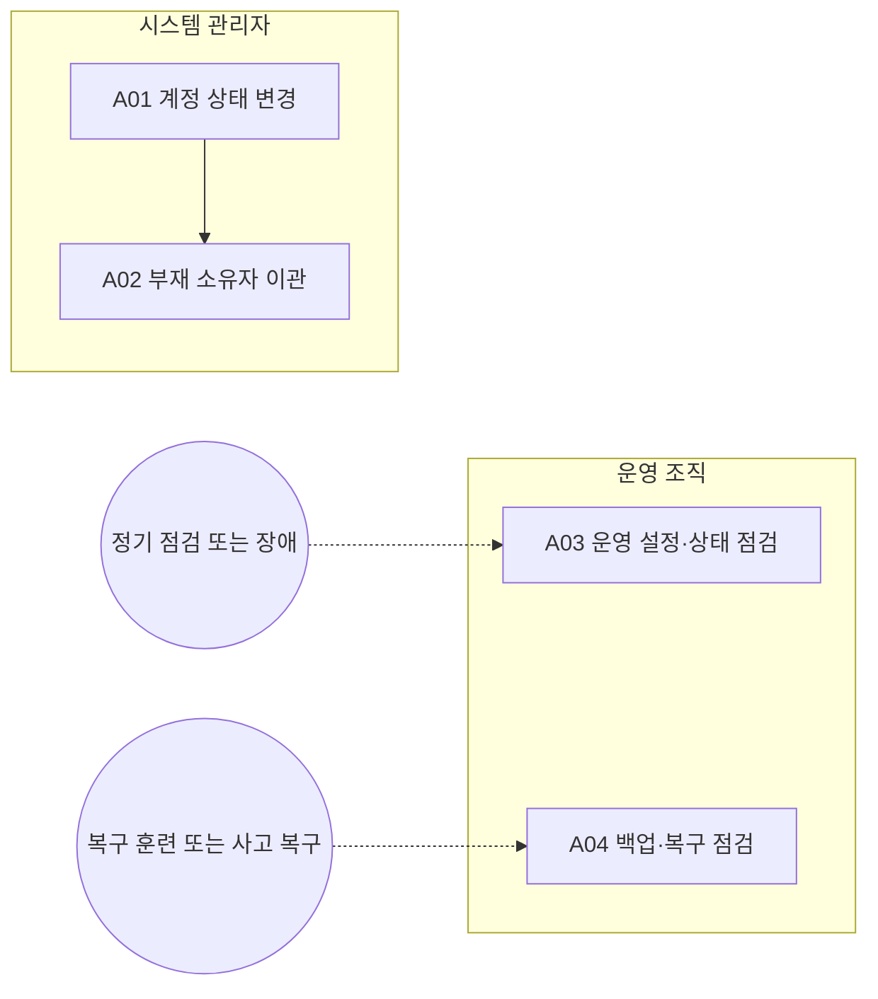

<!-- 생성물: docs/65-workflows/scripts/build_md.py — 손으로 고치지 않는다 -->

# WF-FPW-16 · FPW.16 플랫폼 접근·운영·복구 / Platform Access Operations and Recovery

> 업무 수행자의 접근 상태와 기록 소유권을 통제하고 플랫폼 운영·복구 근거를 보존하여 담당자 변경 또는 서비스 장애 중에도 권한 범위를 넘지 않는 업무 연속성을 유지한다.

보고서 Gate: – · 근거: 업무 레퍼런스 모델 요구(WF-REFERENCE-REQUIREMENTS)·현행 플랫폼 계약/화면; 조직 검토 전 초안

## 1. 업무 흐름

## 2. 활동

| ID | 활동 | RACI | 입력 | 출력 | 플랫폼 권한·화면 | 이행 규칙 |
|---|---|---|---|---|---|---|
| FPW.16-A01 | 계정 상태 변경 | R 시스템 관리자 · A 시스템 관리자 · C CSM · I 품질 조직, 운영 조직 |  | WP-ACCESS-CHANGE | `deactivateAccount`, `reactivateAccount`, `/admin/iam` | – |
| FPW.16-A02 | 부재 소유자 이관 | R 시스템 관리자 · A 시스템 관리자 · C 법규 담당 · I 품질 조직 | WP-ACCESS-CHANGE | WP-OWNER-HANDOVER | `transferComplianceRuleOwner`, `/admin/iam`, `/verify/compliance` | – |
| FPW.16-A03 | 운영 설정·상태 점검 | R 운영 조직 · A 운영 조직 · C 시스템 관리자, CSM · I 품질 조직 |  | WP-PLATFORM-OPS | `/admin/settings`, `/events`, `/notifications/rules` | – |
| FPW.16-A04 | 백업·복구 점검 | R 운영 조직 · A 운영 조직 · C 시스템 관리자, CSM, 데이터 보호 담당 · I 품질 조직 | WP-PLATFORM-OPS | WP-RECOVERY-DRILL | `/admin/settings` | – |

### 수행 절차와 완료 기준

#### FPW.16-A01 계정 상태 변경
1. 입퇴사·전보 근거와 대상 계정 및 영향 업무를 확인한다
2. 자기 계정을 제외하고 사유를 적어 비활성 또는 재활성 처리를 수행한다
3. 응답 상태와 감사 이력을 확인하고 권한 변경이 필요한 사항은 외부 IdP 담당자에게 인계한다

완료 기준:
- [ ] 미확인 또는 실패 응답을 변경 완료로 기록하지 않는다
- [ ] 계정 상태 기록이 역할 부여 권한으로 확대되지 않는다

#### FPW.16-A02 부재 소유자 이관
1. 원소유자가 없거나 비활성인 기록과 미결 업무를 확인한다
2. 기록 담당 역할을 가진 새 계정을 지정하고 이관 사유를 적는다
3. 소유자 이관 뒤 기록 내용·버전·상태와 감사 흔적이 보존됐는지 확인한다

완료 기준:
- [ ] 활성 소유자의 기록이나 부적격 새 소유자 이관이 차단된다
- [ ] 기록 본문을 고치지 않고 소유권만 변경한다

#### FPW.16-A03 운영 설정·상태 점검
- 트리거: 정기 점검 또는 장애
1. 현재 운영 모드와 연결 대상 및 설정 변경 근거를 확인한다
2. 설정·상태 화면과 운영 환경의 관측 자료로 연결·오류·보존 상태를 점검한다
3. 비밀 값을 본문에 옮기지 않고 장애와 담당자 및 후속 조치를 기록한다

완료 기준:
- [ ] 개발 PC 설정을 원격 운영 확인 근거로 쓰지 않는다
- [ ] 관측 실패와 미확인 연결은 정상 완료와 구분한다

#### FPW.16-A04 백업·복구 점검
- 트리거: 복구 훈련 또는 사고 복구
1. 운영 환경의 백업 범위·보관 정책과 복구 책임자를 확인한다
2. 승인된 격리 환경에서 복구 절차를 실행하고 데이터 및 감사 연속성을 대조한다
3. 실측 시간·검증 결과·미실행 항목을 구분해 기록하고 개선을 인계한다

완료 기준:
- [ ] 계획서 존재만으로 복구 성공을 판정하지 않는다
- [ ] 실제 실행 환경과 증거 위치가 기록된다

## 3. 산출물

| 키 | 이름 | 종류 | 주요 내용 |
|---|---|---|---|
| WP-ACCESS-CHANGE | 계정 상태 변경 기록 | 산출 | 입퇴사·전보 근거·대상 계정·변경 사유; 비활성/재활성 결과·실행자·시각·미확인 상태 |
| WP-OWNER-HANDOVER | 기록 소유자 이관 | 산출 | 부재/비활성 원소유자·새 적격 소유자·대상 기록; 이관 사유·전후 소유자·내용/버전/상태 보존 확인 |
| WP-PLATFORM-OPS | 플랫폼 운영 점검 | 산출 | 서버 운영 설정의 변경 승인 근거·연결 상태; 관측 지표·장애·담당자와 외부 운영 증거 |
| WP-RECOVERY-DRILL | 백업·복구 점검 기록 | 산출 | 백업 범위·식별자·보관 정책과 복구 절차; 격리된 복구 실행 시각·정합성·복구 시간·미해결 항목 |

## 4. 진입·완료 기준

**진입**
- 기존 IAM·외부 IdP의 책임 경계와 운영 담당자가 식별되어 있다

**완료**
- 접근 변경·이관 사유와 변경 결과가 남는다
- 운영 점검과 복구 증거를 실제 실행 여부와 구분하여 인계한다

## 5. 결과(Outcome)

- O1 계정 상태 변경의 근거·책임자와 영향 업무가 식별되고 계정 상태가 확인된다.
- O2 소유자가 없거나 비활성인 기록만 적격 담당자에게 이관되고 내용·버전·상태는 유지된다.
- O3 운영 설정·관측·백업 및 복구 점검 근거와 미해결 장애가 인계된다.

## 6. 업무 수행 정의(Base Practices)

업무 정의 초안이다. 개인 활동 체크·서버 처리·Gate 승인 및 ASPICE 적합성 평가와 구분한다.

### FPW.16.BP1 계정 상태 변경

근거가 있는 계정의 비활성·재활성을 기록하고 실제 응답 및 감사 이력을 확인한다. 이 활동은 계정 상태 통제이며 임의 역할 부여나 모든 업무 데이터 편집을 허용하지 않는다.

- 기여 성과: O1
- 연결 활동: FPW.16-A01
- 참고 1: 정적 미리보기의 로컬 모의 처리와 실제 IdP·서버 상태 변경은 별도 검증 대상이다.

### FPW.16.BP2 부재 소유자 이관

소유자가 없거나 비활성인 컴플라이언스 룰의 책임을 적격한 담당 계정에 인계한다. 이관과 내용 변경을 분리하고 원소유자 상태·새 소유자의 담당 역할·사유를 확인한다.

- 기여 성과: O2
- 연결 활동: FPW.16-A02

### FPW.16.BP3 운영 설정·상태 점검

설정·이벤트·관측 자료를 사용하여 플랫폼의 연결과 서비스 상태를 점검하고 장애 대응을 인계한다. 서버 설정 변경은 승인된 운영 환경의 절차로 수행하며 브라우저 조회 권한을 서버 관리자 권한으로 간주하지 않는다.

- 기여 성과: O3
- 연결 활동: FPW.16-A03

### FPW.16.BP4 백업·복구 점검

서비스·데이터·감사 기록의 복구 가능성을 격리된 실행으로 점검하고 결과와 미해결 위험을 보존한다. 플랫폼 화면은 근거를 참조하는 곳이며 외부 인프라 백업이나 재해 복구를 자동 실행한 것으로 표시하지 않는다.

- 기여 성과: O3
- 연결 활동: FPW.16-A04
- 참고 1: 백업·복원은 승인된 서버/DB 운영 절차에서 수행한다. 이 업무 모델을 등록해도 백업이 생성되거나 복구 승인이 발생하지 않는다.

### BP × 성과

| BP | O1 | O2 | O3 |
|---|---|---|---|
| FPW.16.BP1 | ● | – | – |
| FPW.16.BP2 | – | ● | – |
| FPW.16.BP3 | – | – | ● |
| FPW.16.BP4 | – | – | ● |

### 출력 근거 × 성과

모델에 명시한 연결만 표시한다. 연결 존재는 실제 산출물 확보나 승인 완료의 증거가 아니다.

| 산출물 | O1 | O2 | O3 | 근거 BP |
|---|---|---|---|---|
| WP-ACCESS-CHANGE | ● | – | – | FPW.16.BP1 |
| WP-OWNER-HANDOVER | – | ● | – | FPW.16.BP2 |
| WP-PLATFORM-OPS | – | – | ● | FPW.16.BP3 |
| WP-RECOVERY-DRILL | – | – | ● | FPW.16.BP4 |
