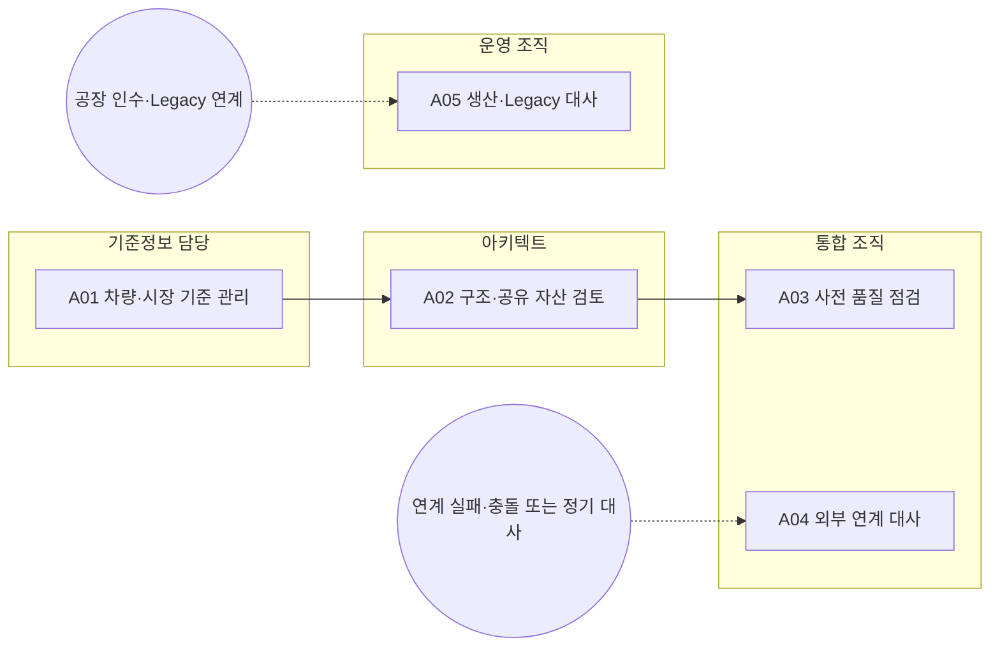

<!-- 생성물: docs/65-workflows/scripts/build_md.py — 손으로 고치지 않는다 -->

# WF-FPW-17 · FPW.17 기준정보·공유 자산·연계 품질 / Master Data Shared Assets and Integration Quality

> 차량·시장 기준 값과 SW 구조·공유 자산의 출처 및 영향 관계를 관리하고 사전 점검과 외부 연계 대사를 통해 일관된 식별자와 버전으로 후속 업무에 인계한다.

보고서 Gate: – · 근거: 업무 레퍼런스 모델 요구(WF-REFERENCE-REQUIREMENTS)·현행 플랫폼 계약/화면; 조직 검토 전 초안

## 1. 업무 흐름

## 2. 활동

| ID | 활동 | RACI | 입력 | 출력 | 플랫폼 권한·화면 | 이행 규칙 |
|---|---|---|---|---|---|---|
| FPW.17-A01 | 차량·시장 기준 관리 | R 기준정보 담당 · A 기준정보 담당 · C Feature Owner, 법규 담당 · I 통합 조직 |  | WP-MASTER-VALUES | `createReferenceValue`, `retireReferenceValue`, `/master/reference-values` | – |
| FPW.17-A02 | 구조·공유 자산 검토 | R 아키텍트 · A 아키텍트 · C 통합 조직, 기준정보 담당 · I Feature Owner | WP-MASTER-VALUES | WP-ASSET-TRACE | `/master/taxonomy`, `/master/upg`, `/master/structure`, `/features/shared-assets`, `/change/eo` | – |
| FPW.17-A03 | 사전 품질 점검 | R 통합 조직 · A 통합 조직 · C 기준정보 담당, 아키텍트 · I 품질 조직 | WP-ASSET-TRACE | WP-DATA-QUALITY | `/precheck`, `/trace/coverage` | – |
| FPW.17-A04 | 외부 연계 대사 | R 통합 조직 · A 통합 조직 · C 아키텍트, Release Manager · I 품질 조직 | WP-DATA-QUALITY | WP-INTEGRATION-RECON | `resolveExtConflict`, `drainExtSync`, `/integration/connectors` | – |
| FPW.17-A05 | 생산·Legacy 대사 | R 운영 조직 · A 운영 조직 · C 기준정보 담당, 통합 조직 · I 품질 조직 | WP-MASTER-VALUES, WP-DATA-QUALITY | WP-INTEGRATION-RECON | `runSync`, `importPlantOrders`, `translateLegacy`, `/integration/sync`, `/integration/legacy`, `/field`, `/baselines/eol` | – |

### 수행 절차와 완료 기준

#### FPW.17-A01 차량·시장 기준 관리
1. 원천 코드와 상위 판매국·차종 및 중복 여부를 확인한다
2. 근거에 따라 기준 값을 등록하거나 사용 중지한다
3. 사용 중지의 기존 기록 보존과 신규 선택지 제외를 확인한다

완료 기준:
- [ ] 하위 기준 값이 올바른 상위 코드에 연결된다
- [ ] 기존 차량·Feature 이력을 소급 삭제하지 않는다

#### FPW.17-A02 구조·공유 자산 검토
1. ECU·SW·Function·Feature와 UPG 및 제어점 연결을 조회한다
2. 공유 자산을 사용하는 Feature와 EO 변경의 영향 범위를 대조한다
3. 누락·불일치와 설계 또는 원천 시스템의 변경 요청을 기록한다

완료 기준:
- [ ] 공유 자산 한 곳의 변경이 영향을 주는 Feature를 식별한다
- [ ] 조회 결과를 원천 구조의 변경 완료로 간주하지 않는다

#### FPW.17-A03 사전 품질 점검
1. 등록·설계·출고에 사용할 데이터 범위를 식별한다
2. 사전 점검과 추적 커버리지에서 오류·누락·경고를 확인한다
3. 원천 담당자에게 수정을 요청하고 재점검 결과 또는 승인된 보류 근거를 남긴다

완료 기준:
- [ ] 점검 범위와 미해결 오류의 담당자가 있다
- [ ] 커버리지 비율만으로 설계 일관성이나 안전 승인을 대신하지 않는다

#### FPW.17-A04 외부 연계 대사
- 트리거: 연계 실패·충돌 또는 정기 대사
1. 원천 소유자 규칙과 외부 요구·변경·배포 식별자 연결을 확인한다
2. 보낸 함·받은 함·충돌과 거부 원인을 대조한다
3. 허용된 재전송 또는 충돌 처리를 실행하고 실제 반영 결과를 확인한다

완료 기준:
- [ ] 외부 상태를 플랫폼 Guard를 우회하여 덮어쓰지 않는다
- [ ] 재전송 요청과 외부 반영 완료를 구분한다

#### FPW.17-A05 생산·Legacy 대사
- 트리거: 공장 인수·Legacy 연계
1. 대상 공장·차량과 옵션 코드 및 변환 규칙을 확인한다
2. 허용된 동기화·주문 가져오기 또는 코딩 변환을 수행한다
3. 출고 구성·수신 상태와 실패 사유를 대조해 현장 담당자에게 인계한다

완료 기준:
- [ ] Legacy 경로가 F2 이상 제한을 우회하지 않는다
- [ ] 변환 계획과 실차 적용 결과를 구분한다

## 3. 산출물

| 키 | 이름 | 종류 | 주요 내용 |
|---|---|---|---|
| WP-MASTER-VALUES | 기준 값 관리 기록 | 산출 | 판매국·지역·차종·트림 코드와 상위 관계; 등록/사용 중지 사유·영향 기록과 새 선택지 제외 |
| WP-ASSET-TRACE | 구조·공유 자산 추적 | 산출 | ECU·SW·Function·Feature·제어점·UPG 연결; 공유 자산 영향 범위·EO 변경 근거·누락 관계 |
| WP-DATA-QUALITY | 데이터 사전 점검 | 산출 | 점검 범위·오류·경고와 원천 소유자; 수정 또는 예외 사유·재점검 결과 |
| WP-INTEGRATION-RECON | 연계·대사 처리 기록 | 산출 | 연계 시스템·주소 참조·변환 규칙 버전; 보낸/받은 함·충돌·거부·재시도 결과와 원천 책임 |

## 4. 진입·완료 기준

**진입**
- 외부 원천 시스템과 데이터 소유자 및 식별자 체계가 식별되어 있다

**완료**
- 적용 기준과 미해결 품질 항목이 후속 등록·설계·출고 업무에 인계된다

## 5. 결과(Outcome)

- O1 차종·시장·사양 기준 값의 유효 범위와 사용 중지 영향이 식별된다.
- O2 ECU·SW·Function·Feature·공유 자산 및 EO 변경의 추적 관계가 검토된다.
- O3 사전 점검 오류와 외부 연계 충돌이 원소유자 규칙에 따라 처리되고 대사 근거가 보존된다.

## 6. 업무 수행 정의(Base Practices)

업무 정의 초안이다. 개인 활동 체크·서버 처리·Gate 승인 및 ASPICE 적합성 평가와 구분한다.

### FPW.17.BP1 차량·시장 기준 관리

판매국·지역·차종·트림의 식별자와 상위 관계를 관리하고 신규 사용 가능 여부를 통제한다. 사용 중지와 기존 기록 삭제를 분리하여 과거 추적을 보존한다.

- 기여 성과: O1
- 연결 활동: FPW.17-A01

### FPW.17.BP2 구조·공유 자산 검토

SW 구조·사양·제어점과 공유 자산의 생산자 및 소비 Feature를 대조하여 변경 영향을 식별한다. 플랫폼 조회와 외부 PLM·ALM 원천 수정의 책임을 구분한다.

- 기여 성과: O2
- 연결 활동: FPW.17-A02

### FPW.17.BP3 사전 품질 점검

데이터 사전 점검과 추적 커버리지에서 후속 업무를 막는 오류를 식별하고 원소유자에게 인계한다. 링크 존재 여부와 의미 일관성을 구분하여 점검 결과를 기록한다.

- 기여 성과: O3
- 연결 활동: FPW.17-A03

### FPW.17.BP4 외부 연계 대사

ALM·JIRA·GitLab 등 연계의 대기·실패·충돌을 원소유자 규칙으로 조정하고 양측 결과를 대사한다. 외부 반영 요청과 실제 반영 완료를 별도 증거로 확인한다.

- 기여 성과: O3
- 연결 활동: FPW.17-A04

### FPW.17.BP5 생산·Legacy 대사

공장·Legacy 시스템의 주문·사양·코딩과 SDV 기준을 대사하고 원천 식별자와 변환 결과를 보존한다. 단순 변환 계획이나 전송 성공을 차량 적용 완료로 보고하지 않는다.

- 기여 성과: O3
- 연결 활동: FPW.17-A05

### BP × 성과

| BP | O1 | O2 | O3 |
|---|---|---|---|
| FPW.17.BP1 | ● | – | – |
| FPW.17.BP2 | – | ● | – |
| FPW.17.BP3 | – | – | ● |
| FPW.17.BP4 | – | – | ● |
| FPW.17.BP5 | – | – | ● |

### 출력 근거 × 성과

모델에 명시한 연결만 표시한다. 연결 존재는 실제 산출물 확보나 승인 완료의 증거가 아니다.

| 산출물 | O1 | O2 | O3 | 근거 BP |
|---|---|---|---|---|
| WP-MASTER-VALUES | ● | – | – | FPW.17.BP1 |
| WP-ASSET-TRACE | – | ● | – | FPW.17.BP2 |
| WP-DATA-QUALITY | – | – | ● | FPW.17.BP3 |
| WP-INTEGRATION-RECON | – | – | ● | FPW.17.BP4, FPW.17.BP5 |
