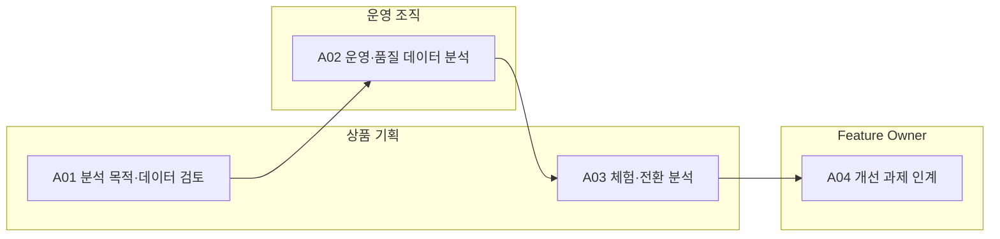

<!-- 생성물: docs/65-workflows/scripts/build_md.py — 손으로 고치지 않는다 -->

# WF-FPW-18 · FPW.18 운영 분석·상품 개선 / Operational Analytics and Product Improvement

> 허용된 목적·범주·보존 범위 안에서 운영 및 체험 데이터를 해석하여 상품·품질 개선 가설을 도출하고, 편향·불확실성과 책임자를 명시한 후속 변경으로 인계한다.

보고서 Gate: – · 근거: 업무 레퍼런스 모델 요구(WF-REFERENCE-REQUIREMENTS)·현행 플랫폼 계약/화면; 조직 검토 전 초안

## 1. 업무 흐름

## 2. 활동

| ID | 활동 | RACI | 입력 | 출력 | 플랫폼 권한·화면 | 이행 규칙 |
|---|---|---|---|---|---|---|
| FPW.18-A01 | 분석 목적·데이터 검토 | R 상품 기획 · A 상품 기획 · C 데이터 보호 담당, 법무, 운영 조직 · I 품질 조직 |  | WP-ANALYSIS-SCOPE | `/data/workbench`, `/biz/trials` | – |
| FPW.18-A02 | 운영·품질 데이터 분석 | R 운영 조직 · A 운영 조직 · C 품질 조직, 시험 조직 · I Feature Owner | WP-ANALYSIS-SCOPE | WP-OPS-ANALYSIS | `/data/workbench`, `/ops/telemetry`, `/fleet/map`, `/fleet/vehicles`, `/fleet/vehicles/:vin` | – |
| FPW.18-A03 | 체험·전환 분석 | R 상품 기획 · A 상품 기획 · C 상품 Owner, 데이터 보호 담당 · I Feature Owner | WP-ANALYSIS-SCOPE | WP-OPS-ANALYSIS | `/biz/trials`, `/products`, `/entitlements` | – |
| FPW.18-A04 | 개선 과제 인계 | R Feature Owner · A Feature Owner · C 상품 기획, 품질 조직, Safety Manager, CSM · I 상품 Owner | WP-OPS-ANALYSIS | WP-IMPROVEMENT-HANDOFF | `/data/workbench`, `/products` | – |

### 수행 절차와 완료 기준

#### FPW.18-A01 분석 목적·데이터 검토
1. 분석하려는 질문·대상 집단·기간과 필요한 데이터 범주를 정한다
2. DPO·법무와 목적 적합성·가명화·보존 및 국외 이전 근거를 검토한다
3. 확인되지 않은 이용 목적과 접근 제한을 기록하고 허용된 데이터만 요청한다

완료 기준:
- [ ] 접근 가능하다는 이유만으로 새로운 이용 목적을 허용하지 않는다
- [ ] 외부 검토의 담당자와 근거가 식별된다

#### FPW.18-A02 운영·품질 데이터 분석
1. 허용된 데이터 범위와 수집 지연·결측을 확인한다
2. 차량군·기간별 운영 지표와 품질 사건을 분석한다
3. 분모·쿼리·출처 및 불확실성을 기록해 품질 담당자에게 인계한다

완료 기준:
- [ ] 수신 없음과 정상 0건을 구분한다
- [ ] 차량 회신과 실제 적용 근거를 구분한다

#### FPW.18-A03 체험·전환 분석
1. 상품·제안 출처·기간과 집단별 분모를 확인한다
2. 수락·거절·만료·구매 전환 지표와 차이를 분석한다
3. 선택 편향·결측과 재현 조건을 적어 개선 가설을 만든다

완료 기준:
- [ ] 제안 수와 수락 수 및 구매 수를 혼동하지 않는다
- [ ] 상관관계만으로 인과 효과를 확정하지 않는다

#### FPW.18-A04 개선 과제 인계
1. 분석 근거와 고객·안전·보안 영향 및 우선순위를 검토한다
2. 검증 방법과 담당 부서를 정하고 Feature·정책·상품의 후속 변경 요청에 연결한다
3. 기존 Gate와 독립 승인 경로가 유지되는지 확인하고 결과를 추적한다

완료 기준:
- [ ] 분석 결과만으로 승인·배포·활성화하지 않는다
- [ ] 개선 과제와 근거 및 책임자가 연결된다

## 3. 산출물

| 키 | 이름 | 종류 | 주요 내용 |
|---|---|---|---|
| WP-ANALYSIS-SCOPE | 분석 목적·데이터 검토 | 산출 | 목적·모집단·기간·데이터 범주와 처리 근거; 가명화·접근·보존 및 국외 이전 검토와 미확정 사항 |
| WP-OPS-ANALYSIS | 운영·전환 분석 결과 | 산출 | 쿼리·기간·분모·누락·출처와 결과; 품질·사용·체험 수락/전환 지표와 해석 한계 |
| WP-IMPROVEMENT-HANDOFF | 상품·품질 개선 인계 | 산출 | 가설·우선순위·고객/안전/보안 영향; 담당 부서·검증 방법·후속 Feature/정책/상품 요청 참조 |

## 4. 진입·완료 기준

**진입**
- 운영·체험 데이터의 출처와 접근 권한이 식별되어 있다

**완료**
- 분석 결과·한계와 후속 책임자가 기록된다
- 가설이 곧바로 안전 분류·정책 또는 상품 승인으로 반영되지 않는다

## 5. 결과(Outcome)

- O1 분석 목적·모집단·기간·데이터 범주와 개인정보 처리 근거가 검토된다.
- O2 품질·사용·체험 전환 지표가 분모와 결측을 포함해 재현 가능한 근거로 분석된다.
- O3 개선 가설과 위험·검증 방법이 담당 부서에 인계되고 승인된 별도 변경 절차로 연결된다.

## 6. 업무 수행 정의(Base Practices)

업무 정의 초안이다. 개인 활동 체크·서버 처리·Gate 승인 및 ASPICE 적합성 평가와 구분한다.

### FPW.18.BP1 분석 목적·데이터 검토

분석 질문과 필요한 최소 데이터를 정하고 개인정보 처리 목적·보존·이전 제한을 관계 담당자와 검토한다. 이 업무 정의 자체를 개인정보 동의나 법무 승인으로 간주하지 않는다.

- 기여 성과: O1
- 연결 활동: FPW.18-A01
- 참고 1: DPO·법무의 검토는 플랫폼 밖 증거를 참조한다. 데모 조회는 고객 동의 획득이나 실제 외부 데이터 수신의 증거가 아니다.

### FPW.18.BP2 운영·품질 데이터 분석

운영 데이터와 차량군별 품질 신호를 분석하여 이상과 개선 기회를 도출한다. 미수신·지연·누락을 정상 0건과 구분하고 분석 조건 및 출처를 보존한다.

- 기여 성과: O2
- 연결 활동: FPW.18-A02

### FPW.18.BP3 체험·전환 분석

체험의 제안·수락·거절·만료·구매 전환을 구분하여 상품별·집단별 지표를 해석한다. 추천이나 전환율을 자동 출시 승인으로 사용하지 않고 편향과 불확실성을 기록한다.

- 기여 성과: O2
- 연결 활동: FPW.18-A03

### FPW.18.BP4 개선 과제 인계

분석 결과를 검증 가능한 개선 가설로 정리하고 기존 Feature·정책·상품 변경 절차에 인계한다. 안전·보안·규정 검토와 승인 범위를 그대로 유지한다.

- 기여 성과: O3
- 연결 활동: FPW.18-A04

### BP × 성과

| BP | O1 | O2 | O3 |
|---|---|---|---|
| FPW.18.BP1 | ● | – | – |
| FPW.18.BP2 | – | ● | – |
| FPW.18.BP3 | – | ● | – |
| FPW.18.BP4 | – | – | ● |

### 출력 근거 × 성과

모델에 명시한 연결만 표시한다. 연결 존재는 실제 산출물 확보나 승인 완료의 증거가 아니다.

| 산출물 | O1 | O2 | O3 | 근거 BP |
|---|---|---|---|---|
| WP-ANALYSIS-SCOPE | ● | – | – | FPW.18.BP1 |
| WP-OPS-ANALYSIS | – | ● | – | FPW.18.BP2, FPW.18.BP3 |
| WP-IMPROVEMENT-HANDOFF | – | – | ● | FPW.18.BP4 |
