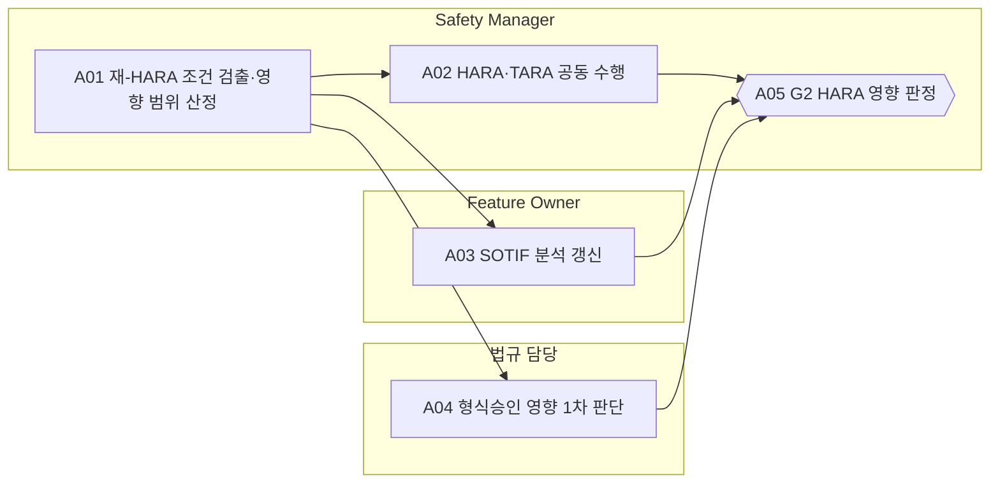

<!-- 생성물: docs/65-workflows/scripts/build_md.py — 손으로 고치지 않는다 -->

# WF-FPW-2 · FPW.2 HARA·변경 영향 판단 / HARA & Change Impact

> 등록·분류된 Feature Version이나 그 변경이 차량 위험에 어떤 영향을 주는지 HARA·TARA·SOTIF로 분석하고, Topology의 위험 전파 범위와 형식승인 영향을 확정해 안전요구 작성(G3)의 입력을 만든다.

보고서 Gate: G2 · 근거: 표준 보고서 6.1절 G2·6.4절 재-HARA 조건, 3장(ADS), 14장(HARA·TARA·SOTIF)

## 1. 업무 흐름

## 2. 활동

| ID | 활동 | RACI | 입력 | 출력 | 플랫폼 권한·화면 | 이행 규칙 |
|---|---|---|---|---|---|---|
| FPW.2-A01 | 재-HARA 조건 검출·영향 범위 산정 | R Safety Manager · A Safety Manager · C 아키텍트, Feature Owner · I 요구 Owner, 시험 조직 | WP-G1-DECISION, WP-FEAT-SCOPE, WP-SAFETY-PROFILE, WP-SUPPLIER-DIFF | WP-IMPACT-ANALYSIS | `/analysis/impact`, `/arch/topology` | FFG-LCY-003, FFG-CLS-004 |
| FPW.2-A02 | HARA·TARA 공동 수행 | R Safety Manager, CSM · A Safety Manager · C 아키텍트, Feature Owner · I 요구 Owner, 법규 담당 | WP-IMPACT-ANALYSIS | WP-HARA-TARA | 플랫폼 밖 | FFG-SEC-001, FFG-ADS-002 |
| FPW.2-A03 | SOTIF 분석 갱신 | R Feature Owner · A Safety Manager · C 아키텍트, 시험 조직 · I 요구 Owner | WP-IMPACT-ANALYSIS | WP-SOTIF-ANALYSIS | 플랫폼 밖 | FFG-SOT-001 |
| FPW.2-A04 | 형식승인 영향 1차 판단 | R 법규 담당 · A 법규 담당 · C Safety Manager, Feature Owner · I Release Manager | WP-IMPACT-ANALYSIS | WP-HOMOLOGATION-IMPACT | 플랫폼 밖 | FFG-GEN-006 |
| FPW.2-A05 | G2 HARA 영향 판정 (G2 판정) | R Safety Manager · A Safety Manager · C CSM, 법규 담당 · I Feature Owner, 요구 Owner, 품질 조직 | WP-HARA-TARA, WP-SOTIF-ANALYSIS, WP-HOMOLOGATION-IMPACT | WP-G2-DECISION | `judgeGate`, `/features/:id/:ver`, `/admin/approval` | FFG-LCY-001 |

### 수행 절차와 완료 기준

#### FPW.2-A01 재-HARA 조건 검출·영향 범위 산정
1. 이전 Version과 Registry 속성·Topology 관계를 비교한 변경 영향 분석 결과를 연다
2. 재-HARA 조건(비활성화 등급·Safe State 변경, 위험 전파 관계 추가 등)에 걸리는 변경을 표시한다
3. 비활성화 등급이나 Safe State를 바꾸는 변경이면 새 Version과 G2~G5 재수행을 요구한다
4. 협력사 기존 구현을 재사용하면 차이 보고를 영향 분석에 반영한다

완료 기준:
- [ ] 재-HARA 조건 해당 여부가 근거와 함께 기록되었다
- [ ] 영향 받는 Feature와 회귀 시험 범위가 산정되었다

#### FPW.2-A02 HARA·TARA 공동 수행
1. Safety Manager와 CSM이 같은 Item 정의를 기준으로 Kill·활성화 경로의 HARA와 TARA를 진행한다
2. 각 분석의 결과(위험 사건·위협 시나리오)를 상대 분석에 넘겨 교차 검토하고 반영 내용을 기록한다
3. ADS Feature는 원격 종료가 가능한 비활성화 등급과 요청 경로(봉투·명령 인증·Guard)를 갖췄는지 확인한다

완료 기준:
- [ ] 교차 검토 기록이 양쪽 분석에 남았다
- [ ] ADS Feature가 원격 종료 불가 등급으로 분류되지 않았다

#### FPW.2-A03 SOTIF 분석 갱신
1. 거동을 바꾸는 Version이면 기능 사양과 성능 한계를 이 Version 기준으로 다시 쓴다
2. 알려진 트리거 조건과 운영에서 들어온 새 트리거 조건을 반영해 위험 시나리오를 평가한다
3. 평가 결과를 Safety Manager에게 넘겨 안전 판단에 쓰게 한다

완료 기준:
- [ ] SOTIF 분석의 대상 Version이 현재 Version과 같다

#### FPW.2-A04 형식승인 영향 1차 판단
1. 변경이 대상 시장 형식승인 범위(RXSWIN)에 영향을 주는지 조항별로 판단한다
2. 영향이 있으면 승인 기관에 필요한 개정·확장 절차와 예상 시점을 정한다
3. 판단 결과에 서명하고 Feature Owner와 Release Manager에게 활성화 조건을 알린다

완료 기준:
- [ ] 판단서에 법규 담당 서명과 대상 RXSWIN이 있다

#### FPW.2-A05 G2 HARA 영향 판정
1. HARA·TARA·SOTIF·형식승인 판단이 모두 현재 Version 기준인지 확인하고, 빠진 것이 있으면 FAIL로 판정한다
2. 판정과 근거 Evidence ID를 정리해 플랫폼 Safety/Security Gate에 개인 서명으로 등록한다
3. 판정 결과를 요구 Owner에게 넘겨 안전요구 작성을 시작하게 한다

완료 기준:
- [ ] Decision Record에 판정·근거 Evidence·판정자 역할·시각이 모두 있다

## 3. 산출물

| 키 | 이름 | 종류 | 주요 내용 |
|---|---|---|---|
| WP-IMPACT-ANALYSIS | 변경 영향 분석서 | 산출 | 이전 Version과 바뀐 Registry 속성·Topology 관계; 재-HARA 조건 해당 여부와 근거; 영향 받는 Feature·차량 사양·회귀 시험 범위 |
| WP-HARA-TARA | HARA·TARA 결과 | 산출 | Item 정의와 위험 사건·ASIL·Safety Goal; 위협 시나리오·위험 값·보안 목표; 두 분석의 교차 검토 결과와 반영 내용; ADS Feature면 원격 종료 경로와 비활성화 등급 확인 결과 |
| WP-SOTIF-ANALYSIS | SOTIF 분석 | 산출 | 기능 사양과 성능 한계; 트리거 조건과 위험 시나리오 평가 |
| WP-HOMOLOGATION-IMPACT | 형식승인 영향 판단서 | 산출 | 영향 여부와 근거 조항, 대상 RXSWIN; 승인 기관 결정(개정·확장)이 필요한 경우 그 목록; 법규 담당 서명과 판단 시각 |
| WP-G2-DECISION | G2 Decision Record | 산출 | 판정과 근거 Evidence ID(HARA·TARA·SOTIF·영향 분석); Safety Manager 서명·시각, 조건부 통과 시 기한과 책임자 |

## 4. 진입·완료 기준

**진입**
- G1 판정이 PASS 또는 기한이 있는 CONDITIONAL PASS다
- Feature Version의 대상 차량 사양과 의존 관계가 Topology에 등록되어 있다

**완료**
- HARA·TARA 결과와 교차 검토 기록이 Feature Version에 연결되었다
- SOTIF 분석이 이 Version 기준으로 갱신되었다
- G2 Decision Record가 Safety Manager 서명으로 남았다

## 5. 결과(Outcome)

- O1 재-HARA가 필요한 변경이 자동 검출되어 Safety Manager에게 요청된다.
- O2 같은 Item 정의 위에서 HARA와 TARA가 수행되고 서로 교차 검토된다.
- O3 거동을 바꾸는 Version의 SOTIF 분석(성능 한계·트리거 조건)이 갱신된다.
- O4 형식승인 영향 1차 판단과 G2 판정이 기록된다.
