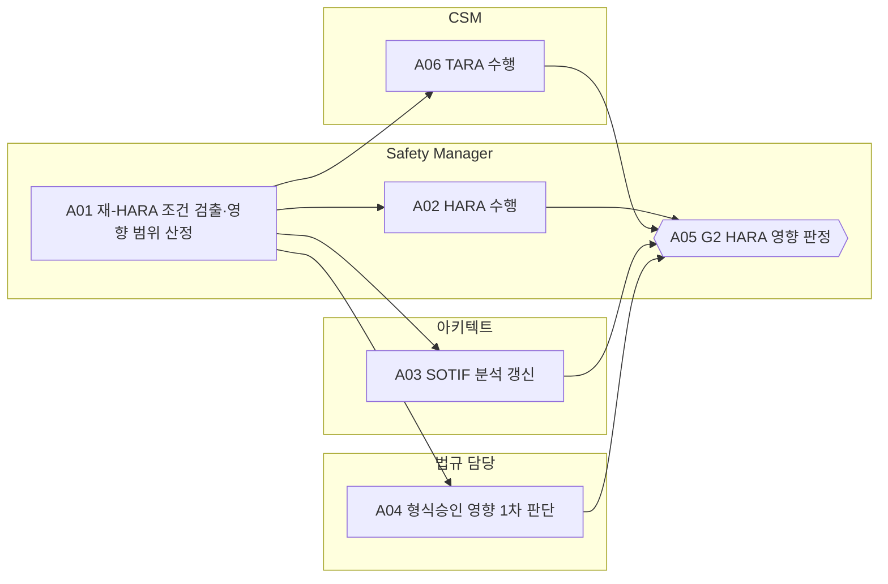

<!-- 생성물: docs/65-workflows/scripts/build_md.py — 손으로 고치지 않는다 -->

# WF-FPW-2 · FPW.2 HARA·변경 영향 판단 / HARA & Change Impact

> 등록·분류된 Feature Version이나 그 변경이 차량 위험에 어떤 영향을 주는지 HARA·TARA·SOTIF로 분석하고, Topology의 위험 전파 범위와 형식승인 영향을 확정해 안전요구 작성(G3)의 입력을 만든다.

보고서 Gate: G2 · 근거: 표준 보고서 6.1절 G2·6.4절 재-HARA 조건, 3장(ADS), 14장(HARA·TARA·SOTIF)

## 1. 업무 흐름

## 2. 활동

| ID | 활동 | RACI | 입력 | 출력 | 플랫폼 권한·화면 | 이행 규칙 |
|---|---|---|---|---|---|---|
| FPW.2-A01 | 재-HARA 조건 검출·영향 범위 산정 | R Safety Manager · A Safety Manager · C 아키텍트, Feature Owner, 구매 · I 요구 Owner, 시험 조직 | WP-G1-DECISION, WP-FEAT-SCOPE, WP-SAFETY-PROFILE, WP-SUPPLIER-DIFF | WP-IMPACT-ANALYSIS | `/analysis/impact`, `/arch/topology` | FFG-LCY-003, FFG-CLS-004 |
| FPW.2-A02 | HARA 수행 | R Safety Manager · A Safety Manager · C CSM, 아키텍트, Feature Owner · I 요구 Owner, 법규 담당 | WP-IMPACT-ANALYSIS | WP-HARA-TARA | 플랫폼 밖 | FFG-ADS-002 |
| FPW.2-A06 | TARA 수행 | R CSM · A CSM · C Safety Manager, 아키텍트 · I 요구 Owner | WP-IMPACT-ANALYSIS | WP-TARA | 플랫폼 밖 | FFG-SEC-001 |
| FPW.2-A03 | SOTIF 분석 갱신 | R 아키텍트 · A Safety Manager · C Feature Owner, 시험 조직 · I 요구 Owner | WP-IMPACT-ANALYSIS | WP-SOTIF-ANALYSIS | 플랫폼 밖 | FFG-SOT-001 |
| FPW.2-A04 | 형식승인 영향 1차 판단 | R 법규 담당 · A 법규 담당 · C Safety Manager, Feature Owner · I Release Manager | WP-IMPACT-ANALYSIS | WP-HOMOLOGATION-IMPACT | 플랫폼 밖 | FFG-GEN-006 |
| FPW.2-A05 | G2 HARA 영향 판정 | R Safety Manager · A Safety Manager · C CSM, 법규 담당 · I Feature Owner, 요구 Owner, 품질 조직 | WP-HARA-TARA, WP-TARA, WP-SOTIF-ANALYSIS, WP-HOMOLOGATION-IMPACT, WP-REF-LINK | WP-G2-DECISION | `judgeGate`, `/features/:id/:ver`, `/admin/approval` | FFG-LCY-001 |

### 수행 절차와 완료 기준

#### FPW.2-A01 재-HARA 조건 검출·영향 범위 산정
1. 이전 Version과 Registry 속성·Topology 관계를 비교한 변경 영향 분석 결과를 연다
2. 재-HARA 조건(비활성화 등급·Safe State 변경, 위험 전파 관계 추가 등)에 걸리는 변경을 표시한다
3. 비활성화 등급이나 Safe State를 바꾸는 변경이면 새 Version과 G2~G5 재수행을 요구한다
4. 협력사 기존 구현을 재사용하면 차이 보고를 영향 분석에 반영한다

완료 기준:
- [ ] 재-HARA 조건 해당 여부가 근거와 함께 기록되었다
- [ ] 영향 받는 Feature와 회귀 시험 범위가 산정되었다

#### FPW.2-A02 HARA 수행
1. Safety Manager가 Item 정의를 기준으로 Kill·활성화 경로의 위험 사건과 ASIL을 평가한다
2. CSM의 TARA 결과(위협 시나리오)를 받아 위험 사건에 반영하고 교차 검토 내용을 기록한다
3. ADS Feature는 원격 종료가 가능한 비활성화 등급과 요청 경로(봉투·명령 인증·Guard)를 갖췄는지 확인한다

완료 기준:
- [ ] TARA와의 교차 검토 기록이 HARA 결과에 남았다
- [ ] ADS Feature가 원격 종료 불가 등급으로 분류되지 않았다

#### FPW.2-A06 TARA 수행
1. CSM이 같은 Item 정의로 Kill·활성화 명령 경로의 위협 시나리오와 공격 경로를 찾는다
2. 위험 값을 매기고 보안 목표와 사이버보안 요구 후보를 정한다
3. 결과를 Safety Manager에게 넘겨 HARA 교차 검토에 쓰게 한다

완료 기준:
- [ ] 위협 시나리오마다 위험 값과 보안 목표가 있다
- [ ] Kill·활성화 명령 경로가 평가 범위에 들어 있다

#### FPW.2-A03 SOTIF 분석 갱신
1. 거동을 바꾸는 Version이면 기능 사양과 성능 한계를 이 Version 기준으로 다시 쓴다
2. 알려진 트리거 조건과 운영에서 들어온 새 트리거 조건을 반영해 위험 시나리오를 평가한다
3. 평가 결과를 Safety Manager에게 넘겨 안전 판단에 쓰게 한다

완료 기준:
- [ ] SOTIF 분석의 대상 Version이 현재 Version과 같다

#### FPW.2-A04 형식승인 영향 1차 판단
1. 변경이 대상 시장 형식승인 범위(RXSWIN)에 영향을 주는지 조항별로 판단한다
2. 영향이 있으면 승인 기관에 필요한 개정·확장 절차와 예상 시점을 정한다
3. 판단 결과에 서명하고 Feature Owner와 Release Manager에게 활성화 조건을 알린다

완료 기준:
- [ ] 판단서에 법규 담당 서명과 대상 RXSWIN이 있다

#### FPW.2-A05 G2 HARA 영향 판정
1. HARA·TARA·SOTIF·형식승인 판단이 모두 현재 Version 기준인지 확인하고, 빠진 것이 있으면 FAIL로 판정한다
2. 등록 때 Feature DB 대표 ASIL을 바꿨다면 그 사유를 HARA에서 평가한 ASIL과 대조해 판정 근거에 남긴다
3. 판정과 근거 Evidence ID를 정리해 플랫폼 Safety/Security Gate에 개인 서명으로 등록한다
4. 판정 결과를 요구 Owner에게 넘겨 안전요구 작성을 시작하게 한다

완료 기준:
- [ ] Decision Record에 판정·근거 Evidence·판정자 역할·시각이 모두 있다

## 3. 산출물

| 키 | 이름 | 종류 | 주요 내용 |
|---|---|---|---|
| WP-IMPACT-ANALYSIS | 변경 영향 분석서 | 산출 | 이전 Version과 바뀐 Registry 속성·Topology 관계; 재-HARA 조건 해당 여부와 근거; 영향 받는 Feature·차량 사양·회귀 시험 범위 |
| WP-HARA-TARA | HARA·TARA 결과 | 산출 | Item 정의와 위험 사건·ASIL·Safety Goal; TARA 결과를 받아 반영한 교차 검토 내용; ADS Feature면 원격 종료 경로와 비활성화 등급 확인 결과 |
| WP-TARA | TARA 결과 | 산출 | 위협 시나리오·공격 경로·위험 값; 보안 목표와 사이버보안 요구 후보; Kill·활성화 명령 경로(봉투·명령 인증)의 위협 평가 |
| WP-SOTIF-ANALYSIS | SOTIF 분석 | 산출 | 기능 사양과 성능 한계; 트리거 조건과 위험 시나리오 평가 |
| WP-HOMOLOGATION-IMPACT | 형식승인 영향 판단서 | 산출 | 영향 여부와 근거 조항, 대상 RXSWIN; 승인 기관 결정(개정·확장)이 필요한 경우 그 목록; 법규 담당 서명과 판단 시각 |
| WP-G2-DECISION | G2 Decision Record | 산출 | 판정과 근거 Evidence ID(HARA·TARA·SOTIF·영향 분석); Safety Manager 서명·시각, 조건부 통과 시 기한과 책임자 |

## 4. 진입·완료 기준

**진입**
- G1 판정이 PASS 또는 기한이 있는 CONDITIONAL PASS다
- Feature Version의 대상 차량 사양과 의존 관계가 Topology에 등록되어 있다

**완료**
- HARA·TARA 결과와 교차 검토 기록이 Feature Version에 연결되었다
- SOTIF 분석이 이 Version 기준으로 갱신되었다
- G2 Decision Record가 Safety Manager 서명으로 남았다

## 5. 결과(Outcome)

- O1 재-HARA가 필요한 변경이 자동 검출되어 Safety Manager에게 요청된다.
- O2 같은 Item 정의 위에서 HARA와 TARA가 수행되고 서로 교차 검토된다.
- O3 거동을 바꾸는 Version의 SOTIF 분석(성능 한계·트리거 조건)이 갱신된다.
- O4 형식승인 영향 1차 판단과 G2 판정이 기록된다.

## 6. 업무 수행 정의(Base Practices)

업무 정의 초안이다. 개인 활동 체크·서버 처리·Gate 승인 및 ASPICE 적합성 평가와 구분한다.

### FPW.2.BP1 재-HARA 조건 검출·영향 범위 산정

이전 구성과 제안 변경을 비교하여 재-HARA 조건과 영향을 받는 기능·차량·시험 범위를 식별한다. 재사용 구현의 차이와 위험 전파를 분석하고 재수행할 안전 활동을 결정한다.

- 기여 성과: O1
- 연결 활동: FPW.2-A01

### FPW.2.BP2 HARA 수행

정의된 Item과 변경 범위의 위험 사건을 분석하여 안전 목표와 ASIL의 근거를 마련한다. 명령 경로와 종료 동작을 포함하고 보안 분석과의 교차 검토 결과를 보존한다.

- 기여 성과: O2
- 연결 활동: FPW.2-A02

### FPW.2.BP3 TARA 수행

같은 Item 범위에서 자산·위협 시나리오·공격 경로를 분석하여 보안 위험과 요구 후보를 도출한다. 안전 사건과 연결되는 결과를 안전 담당자에게 전달하고 상호 영향을 검토한다.

- 기여 성과: O2
- 연결 활동: FPW.2-A06

### FPW.2.BP4 SOTIF 분석 갱신

기능 사양과 성능 한계 및 알려진·새로운 트리거 조건을 현재 Version 기준으로 평가한다. 안전한 사용 범위와 필요한 시나리오의 변경을 기록하여 안전 판단과 검증 계획에 반영한다.

- 기여 성과: O3
- 연결 활동: FPW.2-A03

### FPW.2.BP5 형식승인 영향 1차 판단

변경 내용이 적용 시장의 형식승인 범위와 소프트웨어 식별에 미치는 영향을 판단한다. 필요한 기관 결정과 일정·활성화 조건을 정리하고 출시 책임자에게 전달한다.

- 기여 성과: O4
- 연결 활동: FPW.2-A04

### FPW.2.BP6 G2 HARA 영향 판정

현재 Version의 HARA·TARA·SOTIF·형식승인 판단을 함께 검토하여 변경 영향의 수용 가능성을 결정한다. 기준 ASIL과 다른 지정의 근거도 검토하고 판정 Evidence를 후속 요구 작성에 인계한다.

- 기여 성과: O4
- 연결 활동: FPW.2-A05

### BP × 성과

| BP | O1 | O2 | O3 | O4 |
|---|---|---|---|---|
| FPW.2.BP1 | ● | – | – | – |
| FPW.2.BP2 | – | ● | – | – |
| FPW.2.BP3 | – | ● | – | – |
| FPW.2.BP4 | – | – | ● | – |
| FPW.2.BP5 | – | – | – | ● |
| FPW.2.BP6 | – | – | – | ● |

### 출력 근거 × 성과

모델에 명시한 연결만 표시한다. 연결 존재는 실제 산출물 확보나 승인 완료의 증거가 아니다.

| 산출물 | O1 | O2 | O3 | O4 | 근거 BP |
|---|---|---|---|---|---|
| WP-IMPACT-ANALYSIS | ● | – | – | – | FPW.2.BP1 |
| WP-HARA-TARA | – | ● | – | – | FPW.2.BP2 |
| WP-TARA | – | ● | – | – | FPW.2.BP3 |
| WP-SOTIF-ANALYSIS | – | – | ● | – | FPW.2.BP4 |
| WP-HOMOLOGATION-IMPACT | – | – | – | ● | FPW.2.BP5 |
| WP-G2-DECISION | – | – | – | ● | FPW.2.BP6 |
