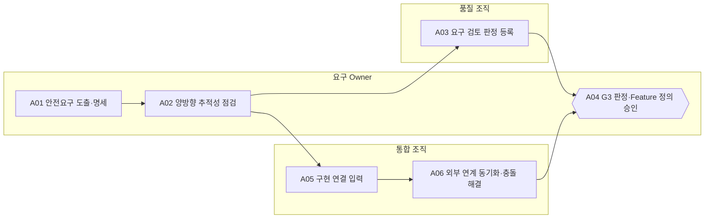

<!-- 생성물: docs/65-workflows/scripts/build_md.py — 손으로 고치지 않는다 -->

# WF-FPW-3 · FPW.3 안전요구 확정 / Safety Requirements Baseline

> HARA 결과로부터 검증 가능한 안전요구를 확정하고, Safety Goal부터 출시 Baseline까지 끊김 없이 추적되게 한 뒤, Feature 정의(G1~G3)를 승인해 개발 단계로 넘긴다.

보고서 Gate: G3 · 근거: 표준 보고서 6.1절 G3, 6장 FFG-LCY-004·005, 16장(ASPICE SYS.2·SWE.1)

## 1. 업무 흐름

## 2. 활동

| ID | 활동 | RACI | 입력 | 출력 | 플랫폼 권한·화면 | 이행 규칙 |
|---|---|---|---|---|---|---|
| FPW.3-A01 | 안전요구 도출·명세 | R 요구 Owner · A 요구 Owner · C Safety Manager, 아키텍트 · I 시험 조직, Feature Owner | WP-HARA-TARA, WP-SOTIF-ANALYSIS, WP-G2-DECISION | WP-SAFETY-REQ | `/trace/design`, `/change/cr` | FFG-LCY-005, FFG-LCY-012 |
| FPW.3-A02 | 양방향 추적성 점검 | R 요구 Owner · A 요구 Owner · C 아키텍트, 시험 조직 · I Safety Manager | WP-SAFETY-REQ | WP-TRACE-REPORT | `/trace/design` | FFG-LCY-004 |
| FPW.3-A03 | 요구 검토 판정 등록 | R 품질 조직 · A 요구 Owner · C Safety Manager · I Feature Owner | WP-SAFETY-REQ, WP-TRACE-REPORT | WP-REQ-REVIEW | `judgeGate`, `/features/:id/:ver` | FFG-LCY-001 |
| FPW.3-A05 | 구현 연결 입력 | R 통합 조직, Feature Owner · A 통합 조직 · C 아키텍트, 기준정보 담당 · I 요구 Owner, 시험 조직 | WP-SAFETY-REQ | WP-IMPL-LINK | `updateDraft`, `/features/:id/:ver`, `/master/artifacts`, `/integration/connectors` | – |
| FPW.3-A06 | 외부 연계 동기화·충돌 해결 | R 통합 조직 · A 통합 조직 · C 요구 Owner, Feature Owner · I Safety Manager | WP-IMPL-LINK | WP-EXT-SYNC | `resolveExtConflict`, `/integration/connectors`, `/features/:id/:ver` | – |
| FPW.3-A04 | G3 판정·Feature 정의 승인 | R 요구 Owner · A 요구 Owner · C Safety Manager, Feature Owner · I 아키텍트, 기준정보 담당, 시험 조직 | WP-REQ-REVIEW, WP-G1-DECISION, WP-G2-DECISION, WP-REF-LINK, WP-IMPL-LINK | WP-G3-DECISION | `transition`, `/features/:id/:ver`, `/admin/approval` | FFG-LCY-001, FFG-LCY-002 |

### 수행 절차와 완료 기준

#### FPW.3-A01 안전요구 도출·명세
1. Safety Goal별로 기능·기술 안전요구를 도출하고 SW에 할당된 요구를 SW 안전요구로 나눈다
2. F2 이상 Feature는 비활성화 등급·경고·인계·감소 시간·Safe State·끝 상태·운전자 정보를 요구로 쓴다
3. 안전 관련 Flag·파라미터·임계값 변경은 소스 변경이 없어도 변경요청과 영향 분석을 붙인다
4. 요구마다 검증 기준을 적고 ALM 요구 ID로 등록한다

완료 기준:
- [ ] 모든 Safety Goal에 하나 이상의 안전요구가 있고 요구마다 검증 기준이 있다

#### FPW.3-A02 양방향 추적성 점검
1. 요구·안전 추적 화면에서 Safety Goal→요구→설계→시험→Baseline 연결을 양방향으로 확인한다
2. 끊긴 연결마다 조치 담당과 기한을 지정한다
3. F2 이상 Feature에 연결되지 않은 요구가 남아 있으면 판정 요청을 보류한다

완료 기준:
- [ ] F2 이상 Feature의 끊긴 연결이 0건이다

#### FPW.3-A03 요구 검토 판정 등록
1. 요구 특성(검증 가능성·일관성·완전성)을 체크리스트로 검토한다
2. 결과를 플랫폼 Requirement Gate에 판정으로 등록한다
3. 결함이 있으면 요구 Owner에게 돌려보내고 재검토 일정을 잡는다

완료 기준:
- [ ] 검토자가 요구 작성자와 다른 조직이다

#### FPW.3-A05 구현 연결 입력
1. 정의 승인 전에 Feature 설계 담당 또는 SW 통합 담당이 PROPOSED 초안에서 Function → SW·Version → 제어기 P/N을 SW·ECU 기준정보에서 골라 연결한다
2. Feature 상세 → 초안 수정 → 구현 연결에서 입력한다. 서버는 기준정보에 없는 짝을 거부한다
3. 승인된 Version에 구현 연결이 빠져 있으면 새 Version에서 넣고 정의 승인을 다시 받는다
4. 외부 연계 현황에서 codeBeamer 요구·JIRA Epic·GitLab MR이 이 Version에 연결되고 상태가 맞는지 확인한다

완료 기준:
- [ ] VERIFIED 필수 입력(functions·swIds·swVersions·ecuPnos)이 모두 기준정보에 있는 짝이다

#### FPW.3-A06 외부 연계 동기화·충돌 해결
1. 외부 연계 현황의 연계 동기화 탭에서 이 Version의 codeBeamer 요구·JIRA Epic 연결과 받은 함·보낼 함·열린 충돌을 확인한다
2. codeBeamer 요구가 개정되어 G2 재검토 표시가 붙었으면 요구 담당과 안전 담당에게 재검토를 요청한다
3. JIRA에서 들어온 Epic·변경요청 상태 변경이 거부되었으면 받은 함의 사유(권한·전이 규칙·계정 매핑)를 외부 담당에게 알린다
4. 실패한 보낼 함 작업은 연결 설정·워크플로 전이·권한 원인을 고치고 다음 재시도에서 보내졌는지 확인한다
5. 충돌은 플랫폼 값 다시 보내기와 외부 값 다시 시도 중 하나를 사유와 함께 고른다. 외부 값은 플랫폼 가드를 다시 거친다
6. 정의 승인 뒤에도 외부 요구 개정·상태 변경·충돌이 생기면 같은 확인을 다시 한다

완료 기준:
- [ ] 열린 충돌이 0건이고 실패한 보낼 함 작업마다 조치 담당이 있다
- [ ] Feature Version의 codeBeamer 요구·JIRA Epic 상태가 플랫폼 Lifecycle과 맞다

#### FPW.3-A04 G3 판정·Feature 정의 승인
1. G1·G2·Requirement Gate 판정이 모두 PASS(또는 기한 있는 조건부)인지 확인하고 하나라도 없으면 승인하지 않는다
2. 판정 근거를 정리해 G3 판정을 남긴다
3. Lifecycle을 PROPOSED에서 APPROVED로 전이한다. 작성자는 이 전이를 할 수 없다
4. 승인 서랍이 구현 연결 미입력을 경고한다(막지는 않는다) — 빠졌으면 승인 대신 보완을 요청할 수 있다
5. 아키텍트와 기준정보 담당에게 설계·Control Point 작업 시작을 알린다

완료 기준:
- [ ] Feature Version이 APPROVED이고 승인자가 Feature 작성자와 다르다
- [ ] 연결된 기준 행에 요청 중(PENDING)·폐기 행이 없다. 요청 중 행은 Feature DB 관리자 승인 뒤에만 전이한다

## 3. 산출물

| 키 | 이름 | 종류 | 주요 내용 |
|---|---|---|---|
| WP-SAFETY-REQ | 안전요구·추적 연결 | 산출 | Safety Goal부터 기능·기술·SW 안전요구까지의 도출 관계; 비활성화 등급·경고·인계·감소 시간·Safe State·끝 상태·운전자 정보 요구; 요구별 검증 기준과 ALM 요구 ID |
| WP-TRACE-REPORT | 추적성 점검 결과 | 산출 | 요구↔설계↔시험↔Baseline 양방향 연결 현황; 끊긴 연결과 조치 담당 |
| WP-REQ-REVIEW | 요구 검토 판정 기록 | 산출 | 요구 특성(검증 가능성·일관성·완전성) 검토 결과; Requirement Gate 판정과 판정자 서명 |
| WP-G3-DECISION | G3 Decision Record·정의 승인 | 산출 | G3 판정과 근거 Evidence ID; PROPOSED→APPROVED 전이 기록과 승인자(작성자와 다른 사람) |
| WP-IMPL-LINK | 구현 연결(Function·SW·제어기) | 산출 | Function → SW ID·Version → 제어기(ECU) P/N 짝 — SW·ECU 기준정보에서 고른 값; VERIFIED 전이의 필수 입력(functions·swIds·swVersions·ecuPnos) |
| WP-EXT-SYNC | 외부 연계 동기화·충돌 처리 기록 | 산출 | codeBeamer 요구·JIRA Epic·GitLab MR과 Feature Version의 연결·상태 대조 결과; 받은 함에서 거부된 외부 변경과 사유(권한·전이 규칙·계정 매핑); 충돌마다 고른 값(플랫폼 값·외부 값)과 처리자·사유 |

## 4. 진입·완료 기준

**진입**
- G2 판정이 PASS이고 HARA·TARA·SOTIF 결과가 현재 Version 기준이다

**완료**
- 안전요구가 Feature Version에 연결되고 추적 단절이 없다
- G3 판정과 정의 승인(PROPOSED→APPROVED)이 남았다

## 5. 결과(Outcome)

- O1 비활성화 동작을 포함한 안전요구가 Safety Goal에서 도출된다.
- O2 F2 이상 Feature의 안전요구가 양방향으로 빠짐없이 추적된다.
- O3 요구 검토가 판정되고 Feature 정의가 승인되어 APPROVED로 전이된다.

## 6. 업무 수행 정의(Base Practices)

업무 정의 초안이다. 개인 활동 체크·서버 처리·Gate 승인 및 ASPICE 적합성 평가와 구분한다.

### FPW.3.BP1 안전요구 도출·명세

안전 목표와 영향 분석을 검증 가능한 기능·기술·SW 안전요구로 구체화한다. 종료 동작과 시간·운전자 정보 등 필요한 조건을 명시하고 요구 ID와 검증 기준을 관리한다.

- 기여 성과: O1
- 연결 활동: FPW.3-A01

### FPW.3.BP2 양방향 추적성 점검

안전 목표부터 요구·설계·시험·Baseline까지 추적 연결과 내용의 일관성을 양방향으로 확인한다. 공백의 조치 담당과 기한을 정하고 해결되지 않은 안전 관련 공백을 판정에 반영한다.

- 기여 성과: O2
- 연결 활동: FPW.3-A02
- 참고 1: 연결선이 존재하는 것만으로 요구와 결과의 내용이 일치한다고 판정하지 않는다.

### FPW.3.BP3 요구 검토 판정 등록

요구의 완전성·일관성·검증 가능성을 작성과 구분된 관점에서 검토한다. 발견 사항의 보완과 재검토를 추적하고 요구 검토 판정을 근거와 함께 기록한다.

- 기여 성과: O3
- 연결 활동: FPW.3-A03

### FPW.3.BP4 구현 연결 입력

요구를 구현할 기능·SW Version·제어기 부품의 조합을 기준정보에서 식별한다. 정확한 짝을 Feature Version과 외부 개발 항목에 연결하고 연결이 빠졌거나 확정 구성이 다른 경우 보완 경로를 정한다.

- 기여 성과: O3
- 연결 활동: FPW.3-A05

### FPW.3.BP5 외부 연계 동기화·충돌 해결

요구·Epic·변경요청·개발 상태의 동기화 결과를 확인하고 충돌의 원인과 주인을 식별한다. 선택한 해결 근거와 재시도 결과를 기록하며 외부 상태 변경에도 플랫폼 권한과 전이 규칙을 적용한다.

- 기여 성과: O2
- 연결 활동: FPW.3-A06
- 참고 1: 외부 시스템의 상태 수신은 플랫폼 승인 가드를 생략하는 수단이 아니다.

### FPW.3.BP6 G3 판정·Feature 정의 승인

등록·영향 분석·요구 검토와 기준 연결의 승인 준비 상태를 확인한다. 작성자와 다른 승인자가 현재 근거로 정의 승인 여부를 결정하고 후속 설계·구현 작업을 인계한다.

- 기여 성과: O3
- 연결 활동: FPW.3-A04

### BP × 성과

| BP | O1 | O2 | O3 |
|---|---|---|---|
| FPW.3.BP1 | ● | – | – |
| FPW.3.BP2 | – | ● | – |
| FPW.3.BP3 | – | – | ● |
| FPW.3.BP4 | – | – | ● |
| FPW.3.BP5 | – | ● | – |
| FPW.3.BP6 | – | – | ● |

### 출력 근거 × 성과

모델에 명시한 연결만 표시한다. 연결 존재는 실제 산출물 확보나 승인 완료의 증거가 아니다.

| 산출물 | O1 | O2 | O3 | 근거 BP |
|---|---|---|---|---|
| WP-SAFETY-REQ | ● | – | – | FPW.3.BP1 |
| WP-TRACE-REPORT | – | ● | – | FPW.3.BP2 |
| WP-REQ-REVIEW | – | – | ● | FPW.3.BP3 |
| WP-IMPL-LINK | – | – | ● | FPW.3.BP4 |
| WP-EXT-SYNC | – | ● | – | FPW.3.BP5 |
| WP-G3-DECISION | – | – | ● | FPW.3.BP6 |
