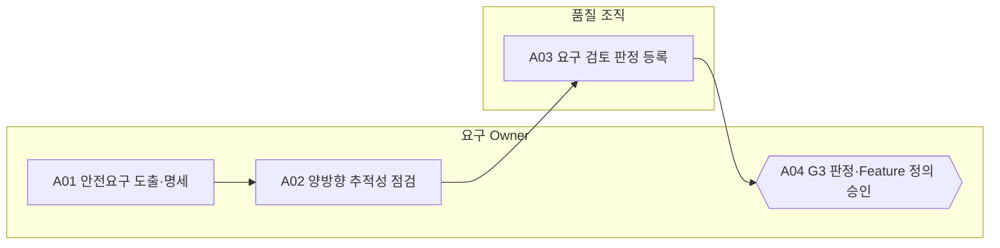

<!-- 생성물: docs/65-workflows/scripts/build_md.py — 손으로 고치지 않는다 -->

# WF-FPW-3 · FPW.3 안전요구 확정 / Safety Requirements Baseline

> HARA 결과로부터 검증 가능한 안전요구를 확정하고, Safety Goal부터 출시 Baseline까지 끊김 없이 추적되게 한 뒤, Feature 정의(G1~G3)를 승인해 개발 단계로 넘긴다.

보고서 Gate: G3 · 근거: 표준 보고서 6.1절 G3, 6장 FFG-LCY-004·005, 16장(ASPICE SYS.2·SWE.1)

## 1. 업무 흐름

## 2. 활동

| ID | 활동 | RACI | 입력 | 출력 | 플랫폼 권한·화면 | 이행 규칙 |
|---|---|---|---|---|---|---|
| FPW.3-A01 | 안전요구 도출·명세 | R 요구 Owner · A 요구 Owner · C Safety Manager, 아키텍트 · I 시험 조직, Feature Owner | WP-G2-DECISION, WP-HARA-TARA, WP-SOTIF-ANALYSIS | WP-SAFETY-REQ | `/trace/design`, `/change/cr` | FFG-LCY-005, FFG-LCY-012 |
| FPW.3-A02 | 양방향 추적성 점검 | R 요구 Owner · A 요구 Owner · C 아키텍트, 시험 조직 · I Safety Manager | WP-SAFETY-REQ | WP-TRACE-REPORT | `/trace/design` | FFG-LCY-004 |
| FPW.3-A03 | 요구 검토 판정 등록 | R 품질 조직 · A 요구 Owner · C Safety Manager · I Feature Owner | WP-SAFETY-REQ, WP-TRACE-REPORT | WP-REQ-REVIEW | `judgeGate`, `/features/:id/:ver` | FFG-LCY-001 |
| FPW.3-A04 | G3 판정·Feature 정의 승인 (G3 판정) | R 요구 Owner · A 요구 Owner · C Safety Manager, Feature Owner · I 아키텍트, 기준정보 담당, 시험 조직 | WP-REQ-REVIEW, WP-G1-DECISION, WP-G2-DECISION | WP-G3-DECISION | `transition`, `/features/:id/:ver`, `/admin/approval` | FFG-LCY-001, FFG-LCY-002 |

### 수행 절차와 완료 기준

#### FPW.3-A01 안전요구 도출·명세
1. Safety Goal별로 기능·기술 안전요구를 도출하고 SW에 할당된 요구를 SW 안전요구로 나눈다
2. F2 이상 Feature는 비활성화 등급·경고·인계·감소 시간·Safe State·끝 상태·운전자 정보를 요구로 쓴다
3. 안전 관련 Flag·파라미터·임계값 변경은 소스 변경이 없어도 변경요청과 영향 분석을 붙인다
4. 요구마다 검증 기준을 적고 ALM 요구 ID로 등록한다

완료 기준:
- [ ] 모든 Safety Goal에 하나 이상의 안전요구가 있고 요구마다 검증 기준이 있다

#### FPW.3-A02 양방향 추적성 점검
1. 요구·안전 추적 화면에서 Safety Goal→요구→설계→시험→Baseline 연결을 양방향으로 확인한다
2. 끊긴 연결마다 조치 담당과 기한을 지정한다
3. F2 이상 Feature에 연결되지 않은 요구가 남아 있으면 판정 요청을 보류한다

완료 기준:
- [ ] F2 이상 Feature의 끊긴 연결이 0건이다

#### FPW.3-A03 요구 검토 판정 등록
1. 요구 특성(검증 가능성·일관성·완전성)을 체크리스트로 검토한다
2. 결과를 플랫폼 Requirement Gate에 판정으로 등록한다
3. 결함이 있으면 요구 Owner에게 돌려보내고 재검토 일정을 잡는다

완료 기준:
- [ ] 검토자가 요구 작성자와 다른 조직이다

#### FPW.3-A04 G3 판정·Feature 정의 승인
1. G1·G2·Requirement Gate 판정이 모두 PASS(또는 기한 있는 조건부)인지 확인하고 하나라도 없으면 승인하지 않는다
2. 판정 근거를 정리해 G3 판정을 남긴다
3. Lifecycle을 PROPOSED에서 APPROVED로 전이한다. 작성자는 이 전이를 할 수 없다
4. 아키텍트와 기준정보 담당에게 설계·Control Point 작업 시작을 알린다

완료 기준:
- [ ] Feature Version이 APPROVED이고 승인자가 Feature 작성자와 다르다

## 3. 산출물

| 키 | 이름 | 종류 | 주요 내용 |
|---|---|---|---|
| WP-SAFETY-REQ | 안전요구·추적 연결 | 산출 | Safety Goal부터 기능·기술·SW 안전요구까지의 도출 관계; 비활성화 등급·경고·인계·감소 시간·Safe State·끝 상태·운전자 정보 요구; 요구별 검증 기준과 ALM 요구 ID |
| WP-TRACE-REPORT | 추적성 점검 결과 | 산출 | 요구↔설계↔시험↔Baseline 양방향 연결 현황; 끊긴 연결과 조치 담당 |
| WP-REQ-REVIEW | 요구 검토 판정 기록 | 산출 | 요구 특성(검증 가능성·일관성·완전성) 검토 결과; Requirement Gate 판정과 판정자 서명 |
| WP-G3-DECISION | G3 Decision Record·정의 승인 | 산출 | G3 판정과 근거 Evidence ID; PROPOSED→APPROVED 전이 기록과 승인자(작성자와 다른 사람) |

## 4. 진입·완료 기준

**진입**
- G2 판정이 PASS이고 HARA·TARA·SOTIF 결과가 현재 Version 기준이다

**완료**
- 안전요구가 Feature Version에 연결되고 추적 단절이 없다
- G3 판정과 정의 승인(PROPOSED→APPROVED)이 남았다

## 5. 결과(Outcome)

- O1 비활성화 동작을 포함한 안전요구가 Safety Goal에서 도출된다.
- O2 F2 이상 Feature의 안전요구가 양방향으로 빠짐없이 추적된다.
- O3 요구 검토가 판정되고 Feature 정의가 승인되어 APPROVED로 전이된다.
