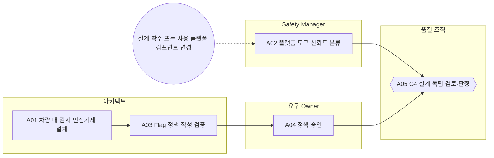

<!-- 생성물: docs/65-workflows/scripts/build_md.py — 손으로 고치지 않는다 -->

# WF-FPW-4 · FPW.4 안전 설계·정책 설계 / Safety Design & Policy Design

> 안전요구를 차량 내 감시·Safety Guard 동작·플랫폼 정책과 Control Point 설계로 구현하고, 정책을 분야별로 검증·승인한 뒤 독립 검토자가 설계 적합성(G4)을 판정하게 한다.

보고서 Gate: G4 · 근거: 표준 보고서 6.1절 G4, 6장 FFG-LCY-006, 7.7절 FFG-DEAC-001, 8장(정책·TCL), 13장 FFG-TEL-007

## 1. 업무 흐름

## 2. 활동

| ID | 활동 | RACI | 입력 | 출력 | 플랫폼 권한·화면 | 이행 규칙 |
|---|---|---|---|---|---|---|
| FPW.4-A01 | 차량 내 감시·안전기제 설계 | R 아키텍트 · A 아키텍트 · C Safety Manager, 통합 조직 · I 시험 조직, 요구 Owner | WP-G3-DECISION, WP-SAFETY-REQ | WP-SAFETY-DESIGN | `/master/control-points`, `/trace/design` | FFG-LCY-006, FFG-DEAC-001, FFG-TEL-007, FFG-CLS-002 |
| FPW.4-A02 | 플랫폼 도구 신뢰도 분류 | R Safety Manager · A Safety Manager · C 아키텍트, CSM · I 품질 조직 | WP-SAFETY-REQ | WP-TCL-RECORD | `/arch/components` | FFG-PLT-013 |
| FPW.4-A03 | Flag 정책 작성·검증 | R 아키텍트 · A 아키텍트 · C 기준정보 담당, Feature Owner · I 요구 Owner | WP-SAFETY-DESIGN, WP-FEAT-SCOPE | WP-POLICY | `createPolicy`, `updatePolicy`, `validatePolicy`, `/policies/new`, `/policies` | FFG-CLS-002 |
| FPW.4-A04 | 정책 승인 | R 요구 Owner · A 요구 Owner · C Safety Manager · I 아키텍트, Release Manager | WP-POLICY | WP-POLICY | `decidePolicy`, `/policies/:id` | – |
| FPW.4-A05 | G4 설계 독립 검토·판정 (G4 판정) | R 품질 조직 · A 아키텍트 · C Safety Manager, CSM · I 시험 조직, Feature Owner | WP-SAFETY-DESIGN, WP-TCL-RECORD, WP-POLICY | WP-G4-DECISION | `judgeGate`, `/features/:id/:ver`, `/admin/approval` | FFG-LCY-001 |

### 수행 절차와 완료 기준

#### FPW.4-A01 차량 내 감시·안전기제 설계
1. F2 이상 Feature가 FTTI 안에서 자기 고장을 감지해 Safety Guard에 보고하는 감시 구조를 설계한다
2. 원격 Kill은 FTTI 밖의 요청 경로로만 두고 FTTI 안의 대응은 차량 내부 안전기제로 설계한다
3. 텔레메트리가 늦거나 오지 않아도 차량 안전 판정이 바뀌지 않게 데이터 경로를 분리한다
4. 안전 거동을 바꾸는 Flag와 전달 경로가 사용 SW의 최고 ASIL을 상속하도록 Control Point를 정의한다

완료 기준:
- [ ] 안전요구마다 설계 요소가 연결되었다
- [ ] 원격 Kill이 안전기제로 쓰인 곳이 없다

#### FPW.4-A02 플랫폼 도구 신뢰도 분류
- 트리거: 설계 착수 또는 사용 플랫폼 컴포넌트 변경
1. 이 Feature가 쓰는 플랫폼 컴포넌트마다 오류 출력 유형과 TI·TD를 정해 TCL을 기록한다
2. TD1은 출력 유형별 검출 수단을 지정할 수 있을 때만 주장하고, 서명 서비스에는 쓰지 않는다
3. TCL2 이상 컴포넌트의 신뢰도 확보 방법을 Safety Plan에 넣는다

완료 기준:
- [ ] 사용 컴포넌트 모두에 TCL과 확보 방법이 있다

#### FPW.4-A03 Flag 정책 작성·검증
1. 대상 규칙·Variant 조건·기본값을 정책으로 작성한다
2. 분야별 검증 8종을 실행해 배포 안전성 판정을 받는다
3. 수정하면 새 개정본이 되므로 다시 검증한다

완료 기준:
- [ ] 최신 개정본의 분야별 검증이 모두 통과했다

#### FPW.4-A04 정책 승인
1. 승인 대상 개정본의 해시와 배포 안전성 판정(GO)을 확인한다
2. 정책 작성자가 아닌 사람이 승인 또는 반려한다
3. 반려하면 사유를 남겨 아키텍트에게 돌려보낸다

완료 기준:
- [ ] 승인자가 정책 작성자와 다르고 승인 해시가 최신 개정본과 같다

#### FPW.4-A05 G4 설계 독립 검토·판정
1. 설계·정책·인터페이스가 안전요구를 충족하는지 설계 작성자와 다른 검토자가 확인한다
2. 판정을 플랫폼 Control Gate와 Safety/Security Gate에 개인 서명으로 등록한다
3. 아키텍트가 판정에 대한 설계 책임을 확인하고, FAIL이면 수정 항목을 설계로 돌려보낸다

완료 기준:
- [ ] 검토자가 설계·정책 작성자와 다른 조직이다
- [ ] Decision Record에 판정·근거 Evidence·판정자 역할·시각이 모두 있다

## 3. 산출물

| 키 | 이름 | 종류 | 주요 내용 |
|---|---|---|---|
| WP-SAFETY-DESIGN | 안전 설계서 | 산출 | FTTI 안의 차량 내 고장 감지(독립 센서 plausibility 등)와 Safety Guard 보고 경로; 원격 Kill을 안전기제에 넣지 않았다는 근거와 차량 내부 안전기제; 텔레메트리 도착 여부가 안전 판정에 영향을 주지 않는 구조; Control Point와 Flag가 상속하는 ASIL |
| WP-TCL-RECORD | 플랫폼 도구 신뢰도(TCL) 기록 | 산출 | 컴포넌트별 오류 출력 유형과 TI·TD·TCL; TD1 주장 시 출력 유형별 검출 수단; TCL2 이상 컴포넌트의 신뢰도 확보 방법 |
| WP-POLICY | Flag 정책(검증·승인본) | 산출 | 대상 규칙·Variant 조건·기본값과 개정 번호; 분야별 검증 8종 결과와 배포 안전성 판정; 승인자·정책 해시·승인 시각 |
| WP-G4-DECISION | G4 Decision Record | 산출 | 설계 적합성 판정과 근거 Evidence ID; 독립 검토자 서명과 아키텍트 책임 확인 |

## 4. 진입·완료 기준

**진입**
- Feature Version이 APPROVED이고 안전요구가 추적 연결되어 있다

**완료**
- 설계서·정책이 승인되고 정책 해시가 고정되었다
- G4 Decision Record가 독립 검토자 판정으로 남았다

## 5. 결과(Outcome)

- O1 F2 이상 Feature의 고장 대응이 차량 내부 감시와 안전기제로 설계된다.
- O2 플랫폼 컴포넌트의 도구 신뢰도(TCL)와 확보 방법이 정해진다.
- O3 Flag 정책이 작성·검증되고 작성자가 아닌 승인자가 승인한다.
- O4 독립 검토로 G4 설계 판정이 남는다.
