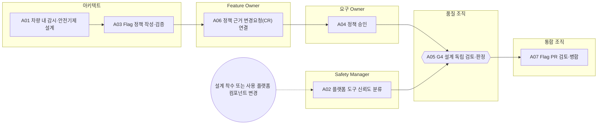

<!-- 생성물: docs/65-workflows/scripts/build_md.py — 손으로 고치지 않는다 -->

# WF-FPW-4 · FPW.4 안전 설계·정책 설계 / Safety Design & Policy Design

> 안전요구를 차량 내 감시·Safety Guard 동작·플랫폼 정책과 Control Point 설계로 구현하고, 정책을 분야별로 검증·승인한 뒤 독립 검토자가 설계 적합성(G4)을 판정하게 한다.

보고서 Gate: G4 · 근거: 표준 보고서 6.1절 G4, 6장 FFG-LCY-006, 7.7절 FFG-DEAC-001, 8장(정책·TCL), 13장 FFG-TEL-007

## 1. 업무 흐름

## 2. 활동

| ID | 활동 | RACI | 입력 | 출력 | 플랫폼 권한·화면 | 이행 규칙 |
|---|---|---|---|---|---|---|
| FPW.4-A01 | 차량 내 감시·안전기제 설계 | R 아키텍트 · A 아키텍트 · C Safety Manager, 통합 조직 · I 시험 조직, 요구 Owner | WP-G3-DECISION, WP-SAFETY-REQ | WP-SAFETY-DESIGN | `/master/control-points`, `/trace/design` | FFG-LCY-006, FFG-DEAC-001, FFG-TEL-007, FFG-CLS-002 |
| FPW.4-A03 | Flag 정책 작성·검증 | R 아키텍트 · A 아키텍트 · C 기준정보 담당, Feature Owner · I 요구 Owner | WP-SAFETY-DESIGN, WP-FEAT-SCOPE | WP-POLICY | `createPolicy`, `updatePolicy`, `validatePolicy`, `/policies/new`, `/policies`, `/config/odd` | FFG-CLS-002 |
| FPW.4-A06 | 정책 근거 변경요청(CR) 연결 | R Feature Owner · A Feature Owner · C 아키텍트 · I 요구 Owner, Release Manager |  | WP-POLICY-CR | `linkPolicyChangeRequest`, `/policies/:id`, `/integration/connectors` | – |
| FPW.4-A04 | 정책 승인 | R 요구 Owner · A 요구 Owner · C Safety Manager · I 아키텍트, Release Manager | WP-POLICY | WP-POLICY | `decidePolicy`, `/policies/:id` | – |
| FPW.4-A02 | 플랫폼 도구 신뢰도 분류 | R Safety Manager · A Safety Manager · C 아키텍트, CSM · I 품질 조직 | WP-SAFETY-REQ | WP-TCL-RECORD | `/arch/components` | FFG-PLT-013 |
| FPW.4-A05 | G4 설계 독립 검토·판정 | R 품질 조직 · A 아키텍트 · C Safety Manager, CSM · I 시험 조직, Feature Owner | WP-SAFETY-DESIGN, WP-TCL-RECORD, WP-POLICY | WP-G4-DECISION | `judgeGate`, `/features/:id/:ver`, `/admin/approval` | FFG-LCY-001 |
| FPW.4-A07 | Flag PR 검토·병합 | R 통합 조직 · A 아키텍트 · C Feature Owner · I Release Manager, 시험 조직 | WP-G4-DECISION | WP-FLAG-PR-RESULT | `createFlagPr`, `demoMergeFlagPr`, `/flag-code`, `/flag-code/flags/:flagKey` | FFG-LCY-011 |

### 수행 절차와 완료 기준

#### FPW.4-A01 차량 내 감시·안전기제 설계
1. F2 이상 Feature가 FTTI 안에서 자기 고장을 감지해 Safety Guard에 보고하는 감시 구조를 설계한다
2. 원격 Kill은 FTTI 밖의 요청 경로로만 두고 FTTI 안의 대응은 차량 내부 안전기제로 설계한다
3. 텔레메트리가 늦거나 오지 않아도 차량 안전 판정이 바뀌지 않게 데이터 경로를 분리한다
4. 안전 거동을 바꾸는 Flag와 전달 경로가 사용 SW의 최고 ASIL을 상속하도록 Control Point를 정의한다

완료 기준:
- [ ] 안전요구마다 설계 요소가 연결되었다
- [ ] 원격 Kill이 안전기제로 쓰인 곳이 없다

#### FPW.4-A03 Flag 정책 작성·검증
1. 대상 규칙·Variant 조건·기본값을 정책으로 작성한다
2. 분야별 검증 8종을 실행해 배포 안전성 판정을 받는다
3. 수정하면 새 개정본이 되므로 다시 검증한다

완료 기준:
- [ ] 최신 개정본의 분야별 검증이 모두 통과했다

#### FPW.4-A06 정책 근거 변경요청(CR) 연결
1. 정책 상세의 변경요청 패널에서 근거 JIRA 변경요청(CR) 키를 골라 정책에 연결한다. 근거 CR이 없으면 JIRA에 만든 뒤 연결한다
2. 외부 연계 현황에서 CR 상태와 연결된 정책·Feature Version을 확인한다
3. 승인자에게 CR을 알린다. JIRA에서 CR을 승인·반려해도 검증 GO 정책이고 정책 승인 권한이 있는 매핑된 계정일 때만 정책 결정으로 반영된다
4. 거부되어 CR 상태가 되돌아가면 받은 함의 사유를 CR 담당에게 알리고 플랫폼에서 승인하도록 안내한다

완료 기준:
- [ ] 승인 대상 정책에 근거 CR이 연결되어 있고 CR 상태가 정책 결정과 맞다

#### FPW.4-A04 정책 승인
1. 승인 대상 개정본의 해시와 배포 안전성 판정(GO)을 확인한다
2. 정책 작성자가 아닌 사람이 승인 또는 반려한다
3. 반려하면 사유를 남겨 아키텍트에게 돌려보낸다

완료 기준:
- [ ] 승인자가 정책 작성자와 다르고 승인 해시가 최신 개정본과 같다

#### FPW.4-A02 플랫폼 도구 신뢰도 분류
- 트리거: 설계 착수 또는 사용 플랫폼 컴포넌트 변경
1. 이 Feature가 쓰는 플랫폼 컴포넌트마다 오류 출력 유형과 TI·TD를 정해 TCL을 기록한다
2. TD1은 출력 유형별 검출 수단을 지정할 수 있을 때만 주장하고, 서명 서비스에는 쓰지 않는다
3. TCL2 이상 컴포넌트의 신뢰도 확보 방법을 Safety Plan에 넣는다

완료 기준:
- [ ] 사용 컴포넌트 모두에 TCL과 확보 방법이 있다

#### FPW.4-A05 G4 설계 독립 검토·판정
1. 설계·정책·인터페이스가 안전요구를 충족하는지 설계 작성자와 다른 검토자가 확인한다
2. 판정을 플랫폼 Control Gate와 Safety/Security Gate에 개인 서명으로 등록한다
3. 아키텍트가 판정에 대한 설계 책임을 확인하고, FAIL이면 수정 항목을 설계로 돌려보낸다

완료 기준:
- [ ] 검토자가 설계·정책 작성자와 다른 조직이다
- [ ] Decision Record에 판정·근거 Evidence·판정자 역할·시각이 모두 있다

#### FPW.4-A07 Flag PR 검토·병합
1. Feature Version 승인 뒤 FF가 연 Flag PR에서 상수·호출 뼈대와 기본값 OFF를 확인한다
2. 기능 분기를 구현하고 FF Flag 검사가 통과한 뒤 병합한다
3. PR 생성이 실패했으면 Flag 코드 연결 화면에서 PR 다시 만들기를 요청한다

완료 기준:
- [ ] 해당 Version의 Flag가 모두 코드 연결 정상 또는 검토 중이다

## 3. 산출물

| 키 | 이름 | 종류 | 주요 내용 |
|---|---|---|---|
| WP-SAFETY-DESIGN | 안전 설계서 | 산출 | FTTI 안의 차량 내 고장 감지(독립 센서 plausibility 등)와 Safety Guard 보고 경로; 원격 Kill을 안전기제에 넣지 않았다는 근거와 차량 내부 안전기제; 텔레메트리 도착 여부가 안전 판정에 영향을 주지 않는 구조; Control Point와 Flag가 상속하는 ASIL |
| WP-TCL-RECORD | 플랫폼 도구 신뢰도(TCL) 기록 | 산출 | 컴포넌트별 오류 출력 유형과 TI·TD·TCL; TD1 주장 시 출력 유형별 검출 수단; TCL2 이상 컴포넌트의 신뢰도 확보 방법 |
| WP-POLICY | Flag 정책(검증·승인본) | 산출 | 대상 규칙·Variant 조건·기본값과 개정 번호; 분야별 검증 8종 결과와 배포 안전성 판정; 승인자·정책 해시·승인 시각 |
| WP-G4-DECISION | G4 Decision Record | 산출 | 설계 적합성 판정과 근거 Evidence ID; 독립 검토자 서명과 아키텍트 책임 확인 |
| WP-POLICY-CR | 정책 근거 변경요청(CR) 연결 | 산출 | 정책 ID와 근거 JIRA 변경요청(CR) 키·상태; JIRA에서 CR 승인·반려가 정책 결정으로 반영되거나 거부된 기록과 사유 |
| WP-FLAG-PR-RESULT | Flag 코드 변경 검토·병합 기록 | 산출 | 대상 Feature Version·Flag와 저장소 PR; 기본값·호출 구조 검토와 검사 결과; 병합 상태·스캔 참조·담당과 시각 |

## 4. 진입·완료 기준

**진입**
- Feature Version이 APPROVED이고 안전요구가 추적 연결되어 있다

**완료**
- 설계서·정책이 승인되고 정책 해시가 고정되었다
- G4 Decision Record가 독립 검토자 판정으로 남았다

## 5. 결과(Outcome)

- O1 F2 이상 Feature의 고장 대응이 차량 내부 감시와 안전기제로 설계된다.
- O2 플랫폼 컴포넌트의 도구 신뢰도(TCL)와 확보 방법이 정해진다.
- O3 Flag 정책이 작성·검증되고 작성자가 아닌 승인자가 승인한다.
- O4 독립 검토로 G4 설계 판정이 남는다.

## 6. 업무 수행 정의(Base Practices)

업무 정의 초안이다. 개인 활동 체크·서버 처리·Gate 승인 및 ASPICE 적합성 평가와 구분한다.

### FPW.4.BP1 차량 내 감시·안전기제 설계

안전요구를 차량 내부의 감시·Guard·안전 기제와 제어점 설계에 할당한다. 차량의 시간 예산 안에서 동작할 경로와 원격 요청·늦은 관측의 경계를 분리하여 요구와 설계의 대응을 보존한다.

- 기여 성과: O1
- 연결 활동: FPW.4-A01
- 참고 1: 원격 통신이나 플랫폼 화면을 차량의 FTTI 안 안전 기제의 대체로 정의하지 않는다.

### FPW.4.BP2 Flag 정책 작성·검증

적용 대상·Variant·기본값을 명시한 정책을 작성하고 현재 개정본을 분야별 검증으로 평가한다. 수정으로 근거가 달라지면 재검증하여 승인 대상 내용과 결과를 일치시킨다.

- 기여 성과: O3
- 연결 활동: FPW.4-A03

### FPW.4.BP3 정책 근거 변경요청(CR) 연결

정책 변경의 이유와 범위를 외부 변경요청에 연결하여 의사결정의 근거를 추적한다. 외부 결정의 반영 여부와 거부 사유를 확인하고 플랫폼 정책 상태와 불일치를 해소한다.

- 기여 성과: O3
- 연결 활동: FPW.4-A06

### FPW.4.BP4 정책 승인

최신 정책 내용의 해시와 검증 결과를 확인하여 승인 또는 반려를 결정한다. 작성자와 구분된 승인자가 결정 근거를 남기고 수정이 필요한 경우 작성자에게 인계한다.

- 기여 성과: O3
- 연결 활동: FPW.4-A04

### FPW.4.BP5 플랫폼 도구 신뢰도 분류

플랫폼 도구의 오류 출력과 검출 수단을 분석하여 신뢰도 분류와 확보 방법을 결정한다. 사용 범위와 분류 근거를 기록하고 필요한 확인 활동을 Safety Plan에 반영한다.

- 기여 성과: O2
- 연결 활동: FPW.4-A02

### FPW.4.BP6 G4 설계 독립 검토·판정

설계·정책·인터페이스가 안전요구를 충족하는지 독립적으로 검토한다. 발견 사항과 근거를 기록하고 설계 책임자의 확인 및 판정 결과에 따라 수정·재검토를 관리한다.

- 기여 성과: O4
- 연결 활동: FPW.4-A05

### FPW.4.BP7 Flag PR 검토·병합

승인된 Version의 Flag 코드 변경을 검토하고 기본값·호출 구조·검사 결과를 확인한다. 병합 결과와 코드 연결 상태를 추적하여 정의와 구현이 어긋난 채 후속 출시로 넘어가지 않게 한다.

- 기여 성과: O3
- 연결 활동: FPW.4-A07

### BP × 성과

| BP | O1 | O2 | O3 | O4 |
|---|---|---|---|---|
| FPW.4.BP1 | ● | – | – | – |
| FPW.4.BP2 | – | – | ● | – |
| FPW.4.BP3 | – | – | ● | – |
| FPW.4.BP4 | – | – | ● | – |
| FPW.4.BP5 | – | ● | – | – |
| FPW.4.BP6 | – | – | – | ● |
| FPW.4.BP7 | – | – | ● | – |

### 출력 근거 × 성과

모델에 명시한 연결만 표시한다. 연결 존재는 실제 산출물 확보나 승인 완료의 증거가 아니다.

| 산출물 | O1 | O2 | O3 | O4 | 근거 BP |
|---|---|---|---|---|---|
| WP-SAFETY-DESIGN | ● | – | – | – | FPW.4.BP1 |
| WP-POLICY | – | – | ● | – | FPW.4.BP2, FPW.4.BP4 |
| WP-POLICY-CR | – | – | ● | – | FPW.4.BP3 |
| WP-TCL-RECORD | – | ● | – | – | FPW.4.BP5 |
| WP-G4-DECISION | – | – | – | ● | FPW.4.BP6 |
| WP-FLAG-PR-RESULT | – | – | ● | – | FPW.4.BP7 |
