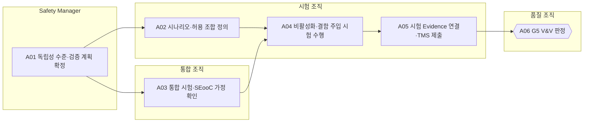

<!-- 생성물: docs/65-workflows/scripts/build_md.py — 손으로 고치지 않는다 -->

# WF-FPW-5 · FPW.5 검증·V&V / Verification & Validation

> Feature Version이 안전요구와 비활성화 동작을 충족한다는 객관적 Evidence를 만들고, 그 Evidence를 Feature Version에 연결해 독립 V&V가 G5를 판정하게 한다.

보고서 Gate: G5 · 근거: 표준 보고서 12장(시험), 6.1절 G5, 6.3절 독립성

## 1. 업무 흐름

## 2. 활동

| ID | 활동 | RACI | 입력 | 출력 | 플랫폼 권한·화면 | 이행 규칙 |
|---|---|---|---|---|---|---|
| FPW.5-A01 | 독립성 수준·검증 계획 확정 | R Safety Manager · A Safety Manager · C 시험 조직, 품질 조직 · I Feature Owner, 통합 조직 | WP-G4-DECISION, WP-SAFETY-PROFILE, WP-SAFETY-REQ | WP-VV-PLAN | 플랫폼 밖 | FFG-LCY-007 |
| FPW.5-A02 | 시나리오·허용 조합 정의 | R 시험 조직 · A 시험 조직 · C 아키텍트, Safety Manager · I 통합 조직 | WP-VV-PLAN, WP-FEAT-SCOPE | WP-TEST-SPEC | `/arch/topology`, `/validations` | FFG-TST-003, FFG-TST-006, FFG-TST-007 |
| FPW.5-A03 | 통합 시험·SEooC 가정 확인 | R 통합 조직 · A 통합 조직 · C 아키텍트, 시험 조직 · I 품질 조직 | WP-VV-PLAN, WP-INTAKE-RESULT | WP-INTEGRATION-REC | `registerChangeRecord`, `/master/artifacts` | FFG-VEH-012 |
| FPW.5-A04 | 비활성화·결함 주입 시험 수행 | R 시험 조직 · A 시험 조직 · C 통합 조직, Safety Manager · I 품질 조직, Feature Owner | WP-TEST-SPEC, WP-INTEGRATION-REC, WP-POLICY | WP-TEST-RESULT | `runVirtual`, `/validations/virtual` | FFG-TST-001, FFG-TST-004, FFG-TST-005, FFG-TST-011 |
| FPW.5-A05 | 시험 Evidence 연결·TMS 제출 | R 시험 조직 · A 시험 조직 · C 통합 조직 · I 품질 조직, Safety Manager | WP-TEST-RESULT, WP-TEST-SPEC | WP-G5-EVIDENCE | `submitTms`, `/verify/evidence` | FFG-TST-009, FFG-ADS-009 |
| FPW.5-A06 | G5 V&V 판정 (G5 판정) | R 품질 조직 · A 시험 조직 · C Safety Manager · I Feature Owner, Release Manager, 아키텍트 | WP-G5-EVIDENCE, WP-VV-PLAN | WP-G5-DECISION | `judgeGate`, `/verify/evidence`, `/admin/approval` | FFG-LCY-001, FFG-LCY-002 |

### 수행 절차와 완료 기준

#### FPW.5-A01 독립성 수준·검증 계획 확정
1. 안전 분류와 안전요구에서 참조 ASIL을 확인한다
2. 확인 검토·감사·평가의 독립성 수준을 참조 ASIL 기준으로 정하고, 시험·검토의 독립성은 Safety Plan에 따로 적는다
3. 시험 수준별 범위와 판정 기준을 시험 조직·품질 조직과 합의한다

완료 기준:
- [ ] 확인 조치마다 독립성 수준과 수행 주체가 지정되었다

#### FPW.5-A02 시나리오·허용 조합 정의
1. 시나리오와 ODD를 정의하고 Version을 붙인다
2. Topology의 의존·충돌 관계로 허용 조합을 정하고, 안전 관련 Flag가 상호작용하면 3-way 이상 covering array를 만든다
3. 허용되지 않는 조합에는 거부를 확인하는 부정 시험을 넣는다
4. 시뮬레이션 결과를 판정 근거로 쓸 경우 도구 분류와, 시뮬레이션이 판정하지 못하는 항목의 실차·HIL 대체 시험을 정한다

완료 기준:
- [ ] 모든 시나리오에 Version이 있고 허용 조합 정의가 Topology와 일치한다

#### FPW.5-A03 통합 시험·SEooC 가정 확인
1. 협력사가 문서화한 SEooC 사용 가정을 통합 대상 차량 SW 구성과 대조한다
2. 가정이 맞지 않는 항목은 협력사와 아키텍트에게 넘기고 통합 시험 항목으로 추가한다
3. 통합 빌드와 변경 기록을 CI/CD에서 플랫폼으로 등록한다

완료 기준:
- [ ] 모든 SEooC 가정이 충족 또는 조치 중으로 기록되었다

#### FPW.5-A04 비활성화·결함 주입 시험 수행
1. F2 이상 Feature의 비활성화 등급별 동작을 단위·HIL·차량 수준에서 작동 중·비작동 중·운전자 개입·전원 주기 상황으로 시험한다
2. 저장 장치 손상, 쓰기 실패, 비트 반전, 신뢰 시간 상실, HSM 오류를 주입하고 Safe State 수렴을 확인한다
3. LPC가 장악되었다고 가정한 위조 프레임·변조 요청·위조 상태 보고가 Guard와 플랫폼에서 거부되는지 확인한다
4. ADS 기능이면 원격 종료 시나리오(인계 성공·실패 후 MRC·ODD 이탈)를 HIL과 시험장에서 수행한다
5. 정책을 CARLA 가상 차량에 적용해 시나리오를 실행하되, 결과는 TMS 제출 전까지 G5 근거로 쓰지 않는다

완료 기준:
- [ ] 시험 명세의 모든 항목에 결과가 있고 실패 항목은 결함으로 등록되었다

#### FPW.5-A05 시험 Evidence 연결·TMS 제출
1. 시험 명세와 결과를 시험관리 도구에서 Feature ID·Version과 연결한다
2. 결과마다 환경·도구 Version·입력·시나리오 Version 같은 재현 정보를 넣는다
3. TMS 연계(IF-09)로 플랫폼 검증 이력에 제출하고 연결되지 않은 시험이 없는지 확인한다

완료 기준:
- [ ] 제출한 모든 시험이 Feature Version에 연결되고 재현 정보가 비어 있지 않다

#### FPW.5-A06 G5 V&V 판정
1. 검증 계획의 판정 기준과 제출된 Evidence를 대조하고, 연결되지 않은 시험이나 빠진 항목이 있으면 FAIL로 판정한다
2. 미해결 결함의 잔여 위험을 Safety Manager와 검토해 수용 여부를 기록한다
3. Gate G5(Verification)·G6(Supplier)를 개인 서명으로 판정 등록한다
4. FAIL이면 결함 목록을 통합·시험 조직에 돌려보내 재시험을 요청한다

완료 기준:
- [ ] 판정자가 시험 수행·통합 담당과 다른 조직이다
- [ ] Decision Record에 판정·근거 Evidence·판정자 역할·시각이 모두 있다

## 3. 산출물

| 키 | 이름 | 종류 | 주요 내용 |
|---|---|---|---|
| WP-VV-PLAN | 검증 계획(독립성 수준) | 산출 | 참조 ASIL과 확인 조치별 독립성 수준; 시험 수준(단위·HIL·차량)과 판정 기준; 시뮬레이션 도구 사용 범위와 도구 분류 |
| WP-TEST-SPEC | 시험 명세(시나리오·허용 조합) | 산출 | 시나리오·ODD 정의와 Version; Topology 의존·충돌로 정한 허용 조합과 covering array, 부정 시험; 결함 주입·LPC 장악 가정 시험 항목 |
| WP-INTEGRATION-REC | 통합 검증 기록 | 산출 | 협력사 SEooC 사용 가정과 통합 대상의 대조 결과; CI/CD 변경 기록(IF-13)과 통합 빌드 식별 |
| WP-TEST-RESULT | 시험 결과 | 산출 | 등급별 시나리오(작동 중·비작동 중·운전자 개입·전원 주기) 결과; 결함 주입별 수렴 상태와 기대 결과 대조; 가상검증(CARLA) 실행 결과와 재현 정보 |
| WP-G5-EVIDENCE | G5 시험 Evidence 묶음 | 산출 | TMS에 제출된 시험 명세·결과와 Feature ID·Version 연결; 시험 재현 정보(환경·도구·입력·Version) |
| WP-G5-DECISION | G5 Decision Record | 산출 | 판정과 근거 Evidence ID, 독립 V&V 서명; 미해결 결함과 잔여 위험 수용 근거 |

## 4. 진입·완료 기준

**진입**
- G4 설계 판정이 PASS(또는 기한이 있는 CONDITIONAL PASS)이고 정책·Control Point가 확정되었다
- 안전요구가 Feature Version에 추적 연결되어 있다

**완료**
- 모든 필수 시험이 TMS를 거쳐 Feature Version에 연결되었다
- 미해결 결함이 없거나 잔여 위험이 Safety Manager에게 수용되었다
- G5 Decision Record가 독립 V&V 서명으로 남았다

## 5. 결과(Outcome)

- O1 참조 ASIL에 맞는 독립성 수준과 검증 범위가 정해진다.
- O2 시나리오·허용 조합·통합 가정이 정의되고 Version으로 관리된다.
- O3 비활성화 등급별 동작·결함 주입·장악 가정 시험이 수행된다.
- O4 재현 정보를 갖춘 시험 Evidence가 Feature Version과 연결되어 G5 판정을 받는다.
