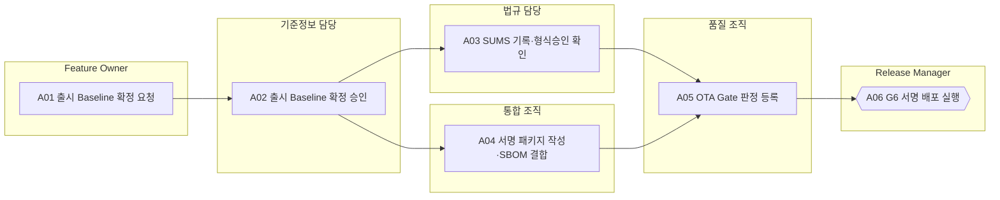

<!-- 생성물: docs/65-workflows/scripts/build_md.py — 손으로 고치지 않는다 -->

# WF-FPW-6 · FPW.6 서명 배포 / Signed Deployment

> 검증을 마친 Feature Version의 출시 Baseline을 확정하고, 서명된 패키지를 SUMS 기록과 함께 대상 차량에 전달할 수 있는 상태로 배포한다. 패키지 전달(G6)은 차량 내 효력(G7)과 따로 승인한다.

보고서 Gate: G6 · 근거: 표준 보고서 6.1절 G6, 6장 FFG-LCY-008·009, 8장(보안 배포), 15장(SBOM)

## 1. 업무 흐름

## 2. 활동

| ID | 활동 | RACI | 입력 | 출력 | 플랫폼 권한·화면 | 이행 규칙 |
|---|---|---|---|---|---|---|
| FPW.6-A01 | 출시 Baseline 확정 요청 | R Feature Owner · A Feature Owner · C Release Manager, 아키텍트 · I 기준정보 담당 | WP-G5-DECISION, WP-POLICY | WP-BASELINE-REQ | `requestBaseline`, `/baselines` | – |
| FPW.6-A02 | 출시 Baseline 확정 승인 | R 기준정보 담당 · A 기준정보 담당 · C Release Manager · I Feature Owner, 법규 담당 | WP-BASELINE-REQ | WP-RELEASE-BASELINE | `decideBaseline`, `/baselines` | – |
| FPW.6-A03 | SUMS 기록·형식승인 확인 | R 법규 담당 · A 법규 담당 · C Release Manager · I Feature Owner, 운영 조직 | WP-RELEASE-BASELINE, WP-HOMOLOGATION-IMPACT | WP-SUMS-RECORD | 플랫폼 밖 | FFG-LCY-008, FFG-GEN-006 |
| FPW.6-A04 | 서명 패키지 작성·SBOM 결합 | R 통합 조직 · A Release Manager · C PKI 운영, CSM · I 품질 조직 | WP-RELEASE-BASELINE | WP-SIGNED-PACKAGE | `registerChangeRecord`, `/deployments`, `/master/artifacts` | – |
| FPW.6-A05 | OTA Gate 판정 등록 | R 품질 조직 · A Release Manager · C 법규 담당, CSM · I 운영 조직 | WP-SIGNED-PACKAGE, WP-SUMS-RECORD | WP-OTA-GATE | `judgeGate`, `/features/:id/:ver` | FFG-LCY-001 |
| FPW.6-A06 | G6 서명 배포 실행 (G6 판정) | R Release Manager · A Release Manager · C 운영 조직 · I Feature Owner, Safety Manager, 품질 조직 | WP-OTA-GATE, WP-RELEASE-BASELINE | WP-G6-DECISION | `deployPolicy`, `syncUnleash`, `/deployments`, `/integration/connectors` | FFG-LCY-009 |

### 수행 절차와 완료 기준

#### FPW.6-A01 출시 Baseline 확정 요청
1. G5 판정을 받은 Feature Version과 승인된 정책 개정본으로 출시 구성을 정한다
2. BOM 기준선 화면에서 Baseline 확정을 요청한다
3. 요청자는 같은 Baseline의 승인자로 지정하지 않는다

완료 기준:
- [ ] 요청에 포함 Version·정책 개정본·Artifact가 빠짐없이 있다

#### FPW.6-A02 출시 Baseline 확정 승인
1. 요청된 구성이 PLM 기준정보(차종·Variant·SW)와 일치하는지 대조한다
2. 일치하면 확정 승인하고, 다르면 사유를 남겨 반려한다
3. 확정된 Baseline 해시를 Release Manager에게 알린다

완료 기준:
- [ ] 승인자가 요청자와 다르고 Baseline 해시가 고정되었다

#### FPW.6-A03 SUMS 기록·형식승인 확인
1. Flag·파라미터를 바꾸는 명령을 SW 업데이트로 보고 대상 RXSWIN과 형식승인 영향 평가를 SUMS에 기록한다
2. 형식승인 영향이 있으면 승인 기관의 개정·확장 결정이 나왔는지 확인하고, 없으면 배포를 보류시킨다
3. 사용자 고지 내용과 가장 긴 시장 요건의 보존 기간을 기록한다

완료 기준:
- [ ] SUMS 기록에 RXSWIN·영향 평가·고지 내용·보존 기간이 있다

#### FPW.6-A04 서명 패키지 작성·SBOM 결합
1. 확정 Baseline의 정책·설정 Artifact를 묶어 대상 해시를 계산한다
2. PKI 운영이 관리하는 배포 용도 서명 키로 서명을 요청하고, 다른 용도의 키는 쓰지 않는다
3. SBOM을 결합하고 CI/CD 변경 기록을 플랫폼에 등록한다

완료 기준:
- [ ] 패키지 서명이 배포 용도 키로 검증되고 SBOM이 결합되었다

#### FPW.6-A05 OTA Gate 판정 등록
1. R156 사전조건(대상 식별·호환성·사용자 고지 준비)을 확인한다
2. 서명·해시 검증 결과와 SUMS 기록을 근거로 OTA Gate를 판정 등록한다
3. FAIL이면 사유를 Release Manager에게 돌려보낸다

완료 기준:
- [ ] 판정 근거에 서명 검증·SUMS 기록 ID가 있다

#### FPW.6-A06 G6 서명 배포 실행
1. OTA Gate PASS를 확인하고 정책을 서버에 배포해 평가 기준을 전환한다
2. Unleash와 flag·태그·의존·전략·환경을 동기화하고 결과를 확인한다
3. 이 배포는 패키지 전달까지이며, 차량 내 효력은 G7 승인 뒤 Canary부터 낸다고 운영 조직에 알린다

완료 기준:
- [ ] 게시본 ID와 Unleash 동기화 결과가 G6 배포 기록에 있다

## 3. 산출물

| 키 | 이름 | 종류 | 주요 내용 |
|---|---|---|---|
| WP-BASELINE-REQ | Baseline 확정 요청 | 산출 | 포함 Feature Version·정책 개정본·Artifact 목록; 요청자와 요청 사유 |
| WP-RELEASE-BASELINE | 출시 Baseline | 산출 | 확정된 BOM 구성(Feature·SW·Variant)과 해시; 승인자(요청자와 다른 사람)·승인 시각 |
| WP-SUMS-RECORD | SUMS 업데이트 기록 | 산출 | 대상 RXSWIN과 형식승인 영향 평가 결과; 사용자 고지 내용과 시장별 보존 기간 |
| WP-SIGNED-PACKAGE | 서명 배포 패키지 | 산출 | 정책·설정 Artifact와 서명, 대상 해시; 결합된 SBOM과 패키지 식별자 |
| WP-OTA-GATE | OTA Gate 판정 기록 | 산출 | R156 사전조건·대상·호환성 확인 결과; 판정자 서명과 시각 |
| WP-G6-DECISION | G6 배포 기록 | 산출 | 서버 배포(평가 기준 전환) 시각과 게시본 ID; Unleash 동기화 결과(flag·전략·환경); Release Manager 판정과 근거 Evidence ID |

## 4. 진입·완료 기준

**진입**
- G5 판정이 PASS이고 승인된 정책 개정본이 있다
- 형식승인 영향 판단이 끝났다

**완료**
- 출시 Baseline이 확정되고 SUMS 기록이 남았다
- 서명된 정책이 서버에 배포되고 Unleash와 동기화되었다(차량 내 효력은 아직 없음)

## 5. 결과(Outcome)

- O1 출시 Baseline이 요청자와 다른 승인자에 의해 확정된다.
- O2 Flag·파라미터 변경 명령이 SW 업데이트로 SUMS에 기록된다.
- O3 서명·SBOM이 결합된 패키지가 OTA Gate를 거쳐 서버에 배포된다.
