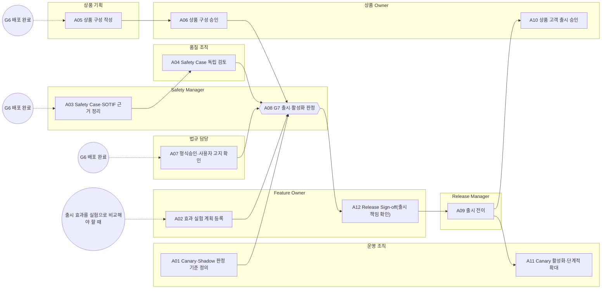

<!-- 생성물: docs/65-workflows/scripts/build_md.py — 손으로 고치지 않는다 -->

# WF-FPW-7 · FPW.7 출시·활성화·단계적 확대 / Release, Activation & Staged Rollout

> 배포된 Feature Version을 차량 안에서 효력을 내도록 허가한다. SOTIF 출시 기준과 Safety Case 독립 검토, Canary·Shadow 판정 기준, 상품 구성 승인, 형식승인·사용자 고지 조건을 확인한 뒤 Canary Cohort부터 단계적으로 넓힌다.

보고서 Gate: G7 · 근거: 표준 보고서 6.1절 G7, 6장 FFG-LCY-009·010, 12장 FFG-TST-010, 14장(SOTIF), 3장(ADS Safety Case), 5장 FFG-CLS-006

## 1. 업무 흐름

## 2. 활동

| ID | 활동 | RACI | 입력 | 출력 | 플랫폼 권한·화면 | 이행 규칙 |
|---|---|---|---|---|---|---|
| FPW.7-A01 | Canary·Shadow 판정 기준 정의 | R 운영 조직 · A 운영 조직 · C Safety Manager, 시험 조직 · I Feature Owner, Release Manager | WP-G6-DECISION, WP-SAFETY-PROFILE | WP-CANARY-PLAN | `/activation/decide` | FFG-TST-010, FFG-LCY-009 |
| FPW.7-A02 | 효과 실험 계획 등록 | R Feature Owner · A Feature Owner · C Safety Manager, 운영 조직 · I Release Manager | WP-SAFETY-PROFILE | WP-EXPERIMENT-PLAN | `createExperiment`, `/experiments` | FFG-CLS-006 |
| FPW.7-A03 | Safety Case·SOTIF 근거 정리 | R Safety Manager · A Safety Manager · C Feature Owner, 시험 조직 · I 품질 조직 | WP-SOTIF-ANALYSIS, WP-G5-EVIDENCE, WP-HARA-TARA | WP-SAFETY-CASE | `/verify/evidence`, `/verify/compliance` | FFG-SOT-004, FFG-ADS-008 |
| FPW.7-A04 | Safety Case 독립 검토 | R 품질 조직 · A Safety Manager · C 시험 조직 · I Feature Owner, 법규 담당 | WP-SAFETY-CASE | WP-SC-REVIEW | 플랫폼 밖 | FFG-ADS-012 |
| FPW.7-A05 | 상품 구성 작성 | R 상품 기획 · A 상품 기획 · C Feature Owner · I 상품 Owner | WP-G6-DECISION | WP-PRODUCT | `createProduct`, `validateComposition`, `offerTrials`, `/products/new`, `/entitlements` | – |
| FPW.7-A06 | 상품 구성 승인 | R 상품 Owner · A 상품 Owner · C Feature Owner · I 상품 기획 | WP-PRODUCT | WP-PRODUCT-APPROVAL | `productTransition`, `/products/:id/:ver` | – |
| FPW.7-A07 | 형식승인·사용자 고지 확인 | R 법규 담당 · A 법규 담당 · C 법무, Feature Owner · I 운영 조직 | WP-HOMOLOGATION-IMPACT, WP-SUMS-RECORD | WP-ACTIVATION-PRECHECK | 플랫폼 밖 | FFG-GEN-006, FFG-LCY-010 |
| FPW.7-A08 | G7 출시·활성화 판정 (G7 판정) | R Safety Manager · A Feature Owner · C 운영 조직, 법규 담당 · I Release Manager, 품질 조직 | WP-CANARY-PLAN, WP-EXPERIMENT-PLAN, WP-SC-REVIEW, WP-PRODUCT-APPROVAL, WP-ACTIVATION-PRECHECK | WP-G7-DECISION | `judgeGate`, `/activation/decide`, `/admin/approval` | FFG-SOT-005, FFG-SOT-004, FFG-LCY-001 |
| FPW.7-A12 | Release Sign-off(출시 책임 확인) | R Feature Owner · A Feature Owner · C Safety Manager · I Release Manager, 상품 Owner | WP-G7-DECISION, WP-SC-REVIEW, WP-CANARY-PLAN | WP-RELEASE-SIGNOFF | `signRelease`, `/features/:id/:ver` | FFG-LCY-001 |
| FPW.7-A09 | 출시 전이 | R Release Manager · A Release Manager · C Feature Owner · I 운영 조직, 상품 Owner | WP-G7-DECISION, WP-RELEASE-SIGNOFF | WP-RELEASE-RECORD | `transition`, `/features/:id/:ver` | – |
| FPW.7-A10 | 상품 고객 출시 승인 | R 상품 Owner · A 상품 Owner · C Feature Owner · I 상품 기획, 운영 조직 | WP-RELEASE-RECORD, WP-PRODUCT-APPROVAL | WP-PRODUCT-RELEASE | `productTransition`, `/products/:id/:ver` | – |
| FPW.7-A11 | Canary 활성화·단계적 확대 | R 운영 조직 · A 운영 조직 · C Safety Manager, Release Manager · I Feature Owner, 품질 조직 | WP-RELEASE-RECORD, WP-CANARY-PLAN | WP-ROLLOUT-RECORD | `stageRollout`, `/activation/decide`, `/fleet/live` | FFG-LCY-009, FFG-TST-010 |

### 수행 절차와 완료 기준

#### FPW.7-A01 Canary·Shadow 판정 기준 정의
1. F2 이상 Feature는 Canary Cohort에서 시작하도록 단계별 차량 수와 관측 기간을 정한다
2. 단계마다 허용 차이와 중단 기준을 사전에 적고 Safety Manager와 합의한다
3. Shadow를 쓰면 출력이 제어기로 가지 않는 구성인지 시험 조직과 확인한다

완료 기준:
- [ ] 모든 단계에 관측 기간·허용 차이·중단 기준이 있다

#### FPW.7-A02 효과 실험 계획 등록
- 트리거: 출시 효과를 실험으로 비교해야 할 때
1. 실험 목적·지표·기간·Cohort를 정한다
2. F2 이상 Feature면 Experiment Flag 대신 Shadow 방식으로 바꾸고 비간섭 입증 계획을 붙인다
3. 실험을 등록하고 Release Manager에게 시작 시점을 알린다

완료 기준:
- [ ] F2 이상 Feature에 Experiment Flag 실험이 등록되지 않았다

#### FPW.7-A03 Safety Case·SOTIF 근거 정리
- 트리거: G6 배포 완료
1. F2 이상 Feature의 ISO 21448 출시 기준 충족 근거와 잔여 위험을 정리한다
2. Safety Case의 주장마다 논거를, 논거마다 증거를 두고 규칙 ID·시험 ID를 식별자로 붙인다
3. 정리한 Safety Case를 독립 검토에 넘긴다

완료 기준:
- [ ] 모든 주장에 논거와 증거가 하나 이상 있다

#### FPW.7-A04 Safety Case 독립 검토
1. Safety Case를 만들지 않은 검토자가 검토 자격과 대상 Version(Safety Case·도구·ADS)을 기록한다
2. 증거 일부를 다시 실행해 재현하고, 공백과 불확실한 영역을 적는다
3. 발견사항의 개선 조치와 담당을 기록해 Safety Manager에게 넘긴다

완료 기준:
- [ ] 검토 기록에 자격·기간·Version·방법·재현 증거·공백이 모두 있다

#### FPW.7-A05 상품 구성 작성
- 트리거: G6 배포 완료
1. 상품에 넣을 Feature와 판매 방식을 정해 상품을 등록한다
2. 구성 검증으로 Feature 간 의존·배타 충돌이 없는지 확인한다
3. 체험 제안 조건(대상·기간)을 정한다

완료 기준:
- [ ] 구성 검증 결과에 충돌이 없다

#### FPW.7-A06 상품 구성 승인
1. 상품 작성자가 아닌 상품 Owner가 구성과 판매 조건을 검토한다
2. 승인하면 구성 승인 전이를 하고, 반려하면 사유를 남긴다
3. 고객 출시 승인은 구성 승인자와 다른 사람이 하도록 승인 후보를 지정한다

완료 기준:
- [ ] 구성 승인자가 상품 작성자와 다르다

#### FPW.7-A07 형식승인·사용자 고지 확인
- 트리거: G6 배포 완료
1. 형식승인 영향이 있는 변경이면 승인 기관의 개정·확장 결정이 나왔는지 확인한다
2. 시장 Profile이 요구하는 사용자 고지·확인 문구와 절차가 준비되었는지 확인한다
3. F2 이상 Feature의 활성화가 기능 작동 중이 아닐 때만 효력을 내는지 확인한다

완료 기준:
- [ ] 활성화 조건 확인서에 기관 결정·고지 준비·효력 조건이 모두 있다

#### FPW.7-A08 G7 출시·활성화 판정
1. SOTIF 출시 근거·Safety Case 검토·Canary 기준·활성화 조건이 모두 있는지 확인하고 하나라도 없으면 FAIL로 판정한다
2. AI·ML 모델을 쓰는 Feature면 데이터·모델 수명주기 요구를 확인하고 모델 교체가 새 Version으로 관리되는지 본다
3. Safety Manager가 Operations Gate에 판정을 등록하고, Feature Owner에게 Release Sign-off를 요청한다

완료 기준:
- [ ] Decision Record에 판정·근거 Evidence·판정자 역할·시각이 모두 있다

#### FPW.7-A12 Release Sign-off(출시 책임 확인)
1. G8·G9 판정과 Safety Case 검토·Canary 기준을 확인한다
2. Feature 상세에서 사유를 적고 개인 서명으로 출시 책임을 확인한다
3. G8·G9가 다시 판정되면 이전 서명은 효력이 없으므로 다시 서명한다

완료 기준:
- [ ] 서명이 현재 G8·G9 판정 기록에 묶여 유효하다

#### FPW.7-A09 출시 전이
1. OTA·Operations Gate PASS와 유효한 Release Sign-off를 확인하고 Lifecycle을 VERIFIED에서 RELEASED로 전이한다
2. 전이 결과를 운영 조직과 상품 Owner에게 알린다
3. 판정이 FAIL이면 개발 단계로 되돌리는 전이를 하고 사유를 남긴다

완료 기준:
- [ ] Feature Version이 RELEASED이고 전이 수행자가 기록되었다

#### FPW.7-A10 상품 고객 출시 승인
1. 구성 승인자가 아닌 상품 Owner가 고객 출시를 승인한다
2. 플랫폼이 구성 승인자와 같은 사람의 승인을 거부하면 다른 승인자로 다시 승인한다
3. 출시 승인 결과를 상품 기획과 운영 조직에 알린다

완료 기준:
- [ ] 고객 출시 승인자가 구성 승인자와 다르다

#### FPW.7-A11 Canary 활성화·단계적 확대
1. 승인 범위 안에서 Canary Cohort부터 활성화를 적용한다
2. 관측 기간 동안 중단 기준을 감시하고 만족할 때만 다음 Cohort로 넓힌다
3. 중단 기준에 걸리면 확대를 멈추고 이상 징후 대응(FPW.8)으로 넘긴다

완료 기준:
- [ ] 단계마다 관측 결과와 확대·중단 결정이 기록되었다

## 3. 산출물

| 키 | 이름 | 종류 | 주요 내용 |
|---|---|---|---|
| WP-CANARY-PLAN | Canary·Shadow 판정 기준 | 산출 | Cohort별 차량 수·관측 기간·허용 차이·중단 기준; Shadow 출력이 제어기에 전달되지 않는다는 확인 |
| WP-EXPERIMENT-PLAN | 실험 계획 | 산출 | 실험 목적·지표·기간과 대상 Cohort; F2 이상이면 Shadow 방식과 비간섭 입증 근거 |
| WP-SAFETY-CASE | Safety Case·SOTIF 출시 근거 | 산출 | 주장·논거·증거와 고유 식별자(규칙 ID·시험 ID 재사용); ISO 21448 출시 기준 충족 근거와 잔여 위험 |
| WP-SC-REVIEW | Safety Case 독립 검토 기록 | 산출 | 검토자 자격·검토 기간·대상 Version(Safety Case·도구·ADS); 검토 방법·재현한 증거·공백과 불확실 영역·개선 조치 |
| WP-PRODUCT | 상품 구성안 | 산출 | 상품에 포함되는 Feature와 판매 방식(구독·구매·체험); 구성 검증 결과와 체험 제안 조건 |
| WP-PRODUCT-APPROVAL | 상품 구성 승인 기록 | 산출 | 구성 승인자(상품 작성자와 다른 사람)와 시각 |
| WP-ACTIVATION-PRECHECK | 활성화 조건 확인서 | 산출 | 형식승인 기관 결정 여부와 근거; 시장별 사용자 고지·확인 준비와 '작동 중이 아닐 때 효력' 조건 |
| WP-G7-DECISION | G7 Decision Record | 산출 | 출시·활성화 판정과 근거 Evidence ID(SOTIF·Safety Case·Canary 기준); Safety Manager 판정 서명, Feature Owner 출시 책임 확인 |
| WP-RELEASE-SIGNOFF | Release Sign-off 기록 | 산출 | Feature Owner 개인 서명·서명 시각·소유 조직; 서명 시점의 G8·G9 판정 기록 ID(다시 판정되면 효력 없음) |
| WP-RELEASE-RECORD | 출시 전이 기록 | 산출 | VERIFIED→RELEASED 전이 시각과 수행자 |
| WP-PRODUCT-RELEASE | 상품 고객 출시 기록 | 산출 | 고객 출시 승인자(구성 승인자와 다른 사람)와 시각 |
| WP-ROLLOUT-RECORD | 단계적 확대 기록 | 산출 | Cohort 단계별 적용 시각·관측 결과; 확대·중단 결정과 근거 |

## 4. 진입·완료 기준

**진입**
- G6 배포가 끝나 서버에 정책이 게시되었다(차량 내 효력 없음)

**완료**
- G7 판정과 VERIFIED→RELEASED 전이가 남았다
- Canary 관측 결과에 따라 확대 또는 중단 결정이 기록되었다

## 5. 결과(Outcome)

- O1 Canary·Shadow 판정 기준과 실험 계획이 안전 등급에 맞게 정해진다.
- O2 SOTIF 출시 근거와 Safety Case가 정리되고 편향 없는 검토자가 검토한다.
- O3 상품 구성이 작성자와 다른 승인자에게 승인되고 고객 출시는 다시 다른 승인자가 승인한다.
- O4 형식승인·사용자 고지 조건을 확인한 G7 판정과 출시 전이가 남는다.
- O5 효력이 Canary Cohort부터 관측 기준을 만족할 때만 넓어진다.
