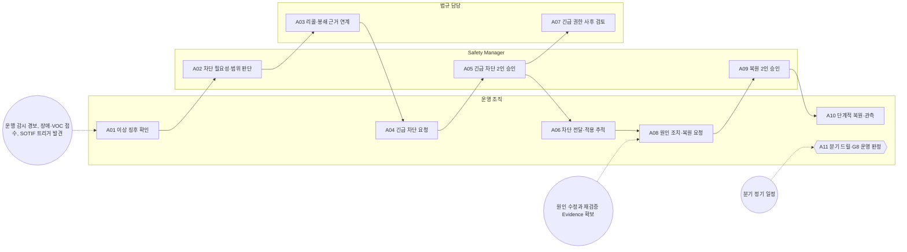

<!-- 생성물: docs/65-workflows/scripts/build_md.py — 손으로 고치지 않는다 -->

# WF-FPW-8 · FPW.8 운영·긴급 차단·복원 / Operation, Kill & Restore

> 출시된 Feature를 운행 중 감시하고, 이상 징후가 안전·보안·법규 위험으로 확인되면 2인 승인을 거친 긴급 차단을 발행해 차량별 적용을 확인한 뒤, 원인을 해소하고 다른 승인자의 승인으로 단계적으로 복원한다.

보고서 Gate: G8 · 근거: 표준 보고서 7장(비활성화·복원), 8.x FFG-PLT-005·016, 14장 FFG-SEC-003·004, 6.1절 G8

## 1. 업무 흐름

## 2. 활동

| ID | 활동 | RACI | 입력 | 출력 | 플랫폼 권한·화면 | 이행 규칙 |
|---|---|---|---|---|---|---|
| FPW.8-A01 | 이상 징후 확인 | R 운영 조직 · A 운영 조직 · C Safety Manager · I 품질 조직, Feature Owner | WP-G7-DECISION, WP-ROLLOUT-RECORD, WP-KPI-PLAN, WP-G5-EVIDENCE | WP-ANOMALY-CASE | `acknowledgeAnomaly`, `dismissAnomaly`, `createIncident`, `/ops/anomalies`, `/ops/safety-kpi`, `/ops/incidents` | FFG-TEL-009 |
| FPW.8-A02 | 차단 필요성·범위 판단 | R Safety Manager · A Safety Manager · C CSM, 법규 담당, 운영 조직 · I Feature Owner | WP-ANOMALY-CASE, WP-SAFETY-PROFILE, WP-VEX-DECISION | WP-KILL-PLAN | `gatePreview`, `/ops/kill` | FFG-ADS-011, FFG-SEC-003 |
| FPW.8-A03 | 리콜·봉쇄 근거 연계 | R 법규 담당 · A 법규 담당 · C Safety Manager, 법무 · I 운영 조직 | WP-KILL-PLAN | WP-RECALL-BASIS | 플랫폼 밖 | FFG-DEAC-010 |
| FPW.8-A04 | 긴급 차단 요청 | R 운영 조직 · A 운영 조직 · C Safety Manager · I CSM, 법규 담당 | WP-KILL-PLAN, WP-RECALL-BASIS | WP-KILL-REQ | `issueKill`, `/ops/kill` | FFG-PLT-005 |
| FPW.8-A05 | 긴급 차단 2인 승인 | R Safety Manager, CSM · A Safety Manager · C 법규 담당 · I 운영 조직, 품질 조직 | WP-KILL-REQ, WP-KILL-PLAN | WP-KILL-DECISION | `approveKill`, `rejectKill`, `/ops/kill` | FFG-PLT-005, FFG-SEC-003 |
| FPW.8-A06 | 차단 전달·적용 추적 | R 운영 조직 · A Safety Manager · C CSM · I 품질 조직, Feature Owner | WP-KILL-DECISION | WP-KILL-TRACE | `acknowledgeAnomaly`, `/fleet/live`, `/deployments` | FFG-SEC-004, FFG-DEAC-013 |
| FPW.8-A07 | 긴급 권한 사후 검토 | R 법규 담당 · A 품질 조직 · C CSM · I Safety Manager, 운영 조직 | WP-KILL-REQ, WP-KILL-DECISION | WP-POST-REVIEW | `recordKillPostReview`, `/audit/oversight` | FFG-PLT-016 |
| FPW.8-A08 | 원인 조치·복원 요청 | R 운영 조직 · A Safety Manager · C Feature Owner, 시험 조직 · I 법규 담당 | WP-KILL-TRACE, WP-G5-EVIDENCE | WP-RESTORE-REQ | `requestRestore`, `/ops/kill` | FFG-DEAC-008 |
| FPW.8-A09 | 복원 2인 승인 | R Safety Manager, 품질 조직 · A Safety Manager · C CSM · I 운영 조직, Feature Owner | WP-RESTORE-REQ, WP-KILL-DECISION | WP-RESTORE-DECISION | `approveRestore`, `rejectRestore`, `/ops/kill` | FFG-DEAC-008, FFG-PLT-005 |
| FPW.8-A10 | 단계적 복원·관측 | R 운영 조직 · A 운영 조직 · C Safety Manager, Release Manager · I Feature Owner, 품질 조직 | WP-RESTORE-DECISION | WP-RESTORE-ROLLOUT | `stageRollout`, `/fleet/live` | FFG-LCY-009 |
| FPW.8-A11 | 분기 드릴·G8 운영 판정 (G8 판정) | R 운영 조직 · A 운영 조직 · C Safety Manager, 품질 조직 · I Feature Owner, 법규 담당 | WP-KILL-TRACE, WP-POST-REVIEW | WP-DRILL-REPORT | `/ops/kill`, `/audit` | FFG-DEAC-012 |

### 수행 절차와 완료 기준

#### FPW.8-A01 이상 징후 확인
- 트리거: 운행 감시 경보, 장애·VOC 접수, SOTIF 트리거 발견
1. 운행 중 감시 지표와 장애·VOC를 확인해 이상 징후 건을 연다
2. 대상 Feature Version과 영향 차량 범위를 Fleet 적용 현황에서 확인한다
3. 안전·보안 영향이 의심되면 즉시 Safety Manager(보안은 CSM)에게 넘긴다
4. 확인 결과 이상이 아니면 사유를 남기고 이상 건을 기각한다

완료 기준:
- [ ] 이상 징후 건에 출처·대상 Version·영향 범위가 기록되었다

#### FPW.8-A02 차단 필요성·범위 판단
1. 사유를 분류하고 Feature의 설계 비활성화 등급에서 유효 등급을 정한다
2. 대상 범위를 24시간 누적 상한과 대조하고, 넘으면 CSM 추가 승인과 단계적 실행을 계획한다
3. ADS 기능이나 대량 대상이면 대량 원격 종료 계획에 따라 단계와 순서를 정한다
4. 게이트 미리보기로 요청이 판정을 통과할지 확인한다

완료 기준:
- [ ] 사유 분류·유효 등급·범위·누적 상한 대조가 차단 판단서에 있다

#### FPW.8-A03 리콜·봉쇄 근거 연계
1. 결함을 완화하는 F2 이상 안전 차단이면 시장별 리콜 번호나 봉쇄 결정 근거를 확보한다
2. 시장별 보고 기한을 정하고 보고 책임자를 지정한다
3. 근거 ID를 운영 조직에 넘겨 차단 요청에 붙이게 한다

완료 기준:
- [ ] 안전 차단 요청에 붙일 리콜·봉쇄 근거 ID가 있다(근거가 없으면 게이트가 차단한다)

#### FPW.8-A04 긴급 차단 요청
1. 긴급 차단 화면에서 대상·범위·사유를 입력하고 확인 문구를 직접 입력해 요청한다
2. 리콜·봉쇄 근거 ID를 요청에 붙인다
3. 요청자는 같은 명령의 승인자로 지정하지 않는다

완료 기준:
- [ ] 요청이 접수되어 승인 대기 상태가 되었다

#### FPW.8-A05 긴급 차단 2인 승인
1. 승인자 2명이 각자 개인 서명으로 승인한다. F2 이상 안전·보안 차단에는 Safety Manager가 반드시 포함된다
2. 누적 상한을 넘는 요청이면 Safety Manager와 CSM이 함께 승인한다
3. 두 번째 승인 뒤 게이트 판정 결과와 발행 명령 ID를 확인한다

완료 기준:
- [ ] 서로 다른 2명의 승인 서명이 있고 요청자는 승인자에 없다

#### FPW.8-A06 차단 전달·적용 추적
1. 차량별 전달·적용 상태를 유효한 상태 보고와 영속 저장 확인으로만 '적용'으로 본다
2. 기한 안에 적용되지 않은 차량은 이상 징후 건으로 넘긴다
3. 대기 상한 초과 경보가 오면 Safety Manager가 상위 대응을 정한다

완료 기준:
- [ ] 기한 초과 미적용 차량마다 연결된 이상 징후 건이 있다

#### FPW.8-A07 긴급 권한 사후 검토
1. 차단 발행 후 24시간 안에 요청자·승인자가 아닌 검토자가 사유·범위·절차 준수를 검토한다
2. 검토 결과와 개선 조치를 사후 검토 기록으로 한 번 남긴다
3. 미흡 사항은 품질 조직이 개선 과제로 등록한다

완료 기준:
- [ ] 검토 기록이 24시간 안에 있고 검토자가 요청자·승인자와 다르다

#### FPW.8-A08 원인 조치·복원 요청
- 트리거: 원인 수정과 재검증 Evidence 확보
1. 원인 분석과 수정(정책·SW·운행 조건 축소)을 마치고 재검증 Evidence가 G5 근거로 제출되었는지 확인한다
2. 복원 범위와 시작 Canary Cohort를 정해 복원을 요청한다
3. 직전 차단 승인자를 복원 승인 후보에서 뺀다

완료 기준:
- [ ] 복원 요청에 재검증 Evidence 참조와 Canary Cohort가 있다

#### FPW.8-A09 복원 2인 승인
1. 직전 차단을 승인하지 않은 승인자 2명이 개인 서명으로 승인한다. F2 이상은 Safety Manager가 포함된다
2. 플랫폼 감사 원장이 차단 승인자와의 중복을 판정하므로 거부되면 다른 승인자로 다시 승인한다
3. 두 번째 승인 뒤 게이트 판정과 복원 게시 ID를 확인한다

완료 기준:
- [ ] 복원 승인자 중 직전 차단 승인자가 없다

#### FPW.8-A10 단계적 복원·관측
1. Canary Cohort부터 복원을 적용하고 차량이 다음 시동 자체 시험 뒤 활성으로 돌아왔는지 확인한다
2. 사전에 정한 관측 기간 동안 중단 기준을 감시하고 만족할 때만 다음 Cohort로 넓힌다
3. 이상이 보이면 확대를 멈추고 다시 차단 판단(A02)으로 넘긴다

완료 기준:
- [ ] 단계마다 관측 결과와 확대·중단 결정이 기록되었다

#### FPW.8-A11 분기 드릴·G8 운영 판정
- 트리거: 분기 정기 일정
1. 시험 Cohort로 차단·복원 드릴을 수행해 전달 시간·적용률·보고 정확도를 잰다
2. 분기 차단 건의 추적표·사후 검토 결과와 드릴 결과를 묶어 운영 상태를 점검한다
3. Safety Manager·품질 조직의 의견을 받아 G8 운영 판정을 남긴다

완료 기준:
- [ ] 분기마다 드릴 결과와 G8 판정이 있다

## 3. 산출물

| 키 | 이름 | 종류 | 주요 내용 |
|---|---|---|---|
| WP-ANOMALY-CASE | 이상 징후 건 | 산출 | 이상 징후 출처(운행 지표·장애·VOC·SOTIF 트리거)와 대상 Feature Version; 영향 차량 수·지역·Variant와 확인 결과 |
| WP-KILL-PLAN | 차단 판단서 | 산출 | 사유 분류(SAFETY·SECURITY·REGULATORY·COMMERCIAL·OPERATIONAL)와 유효 등급; 대상 범위와 24시간 누적 상한 대조 결과; 대량 원격 종료 계획(단계·순서) 적용 여부 |
| WP-RECALL-BASIS | 리콜·봉쇄 근거 | 산출 | 리콜 번호 또는 봉쇄 결정 근거와 시장; 시장별 보고 기한과 보고 책임자 |
| WP-KILL-REQ | 긴급 차단 요청 | 산출 | 대상 Feature Version·차량 범위·사유 분류와 리콜·봉쇄 근거 참조; 요청자와 요청 시각 |
| WP-KILL-DECISION | 차단 승인 기록 | 산출 | 서로 다른 승인자 2명의 개인 서명과 역할; 게이트 판정(등급·대상 상한) 결과와 발행 명령 ID |
| WP-KILL-TRACE | 차단 적용 추적표 | 산출 | 차량별 전달·적용 상태(유효한 상태 보고와 영속 저장 확인 기준); 기한 초과 미적용 차량과 연결된 이상 징후 건; 대기 상한 초과 경보와 상위 대응 기록 |
| WP-POST-REVIEW | 긴급 권한 사후 검토 기록 | 산출 | 검토자(요청자·승인자 제외)와 검토 시각(24시간 이내); 사유·범위·절차 준수 판단과 개선 조치 |
| WP-RESTORE-REQ | 복원 요청 | 산출 | 원인 분석·수정 내용과 재검증 Evidence 참조; 복원 대상 범위와 Canary Cohort |
| WP-RESTORE-DECISION | 복원 승인 기록 | 산출 | 차단 승인자와 겹치지 않는 승인자 2명의 개인 서명; 게이트 판정과 복원 게시 ID |
| WP-RESTORE-ROLLOUT | 단계적 복원 관측 기록 | 산출 | Cohort 단계별 확대 시각과 관측 결과; 중단 기준 충족 여부와 재차단 여부 |
| WP-DRILL-REPORT | 드릴 결과·G8 판정 | 산출 | 시험 Cohort의 전달 시간·적용률·보고 정확도; 분기 운영 점검 결과와 G8 판정 서명 |

## 4. 진입·완료 기준

**진입**
- Feature Version이 RELEASED이고 운행 중 감시 지표와 경보 기준이 등록되어 있다
- 차단·복원 승인 후보자의 개인 서명 수단이 발급되어 있다

**완료**
- 발행한 차단마다 차량별 적용 결과·사후 검토·복원 또는 유지 결정이 기록되었다
- 분기 드릴 결과와 G8 운영 판정이 남았다

## 5. 결과(Outcome)

- O1 운행 중 이상 징후가 접수·확인되고 차단 필요성과 범위가 판단된다.
- O2 긴급 차단이 리콜·봉쇄 근거와 서로 다른 2인의 승인을 갖춰 발행된다.
- O3 차량별 차단 전달·적용이 추적되고 미적용 차량이 후속 조치로 넘어간다.
- O4 긴급 권한 사용이 24시간 안에 독립 검토된다.
- O5 원인 해소 뒤 차단 승인자와 다른 승인자의 승인으로 단계적으로 복원된다.
- O6 정기 드릴로 차단·복원 능력이 측정되고 G8 운영 판정이 남는다.
