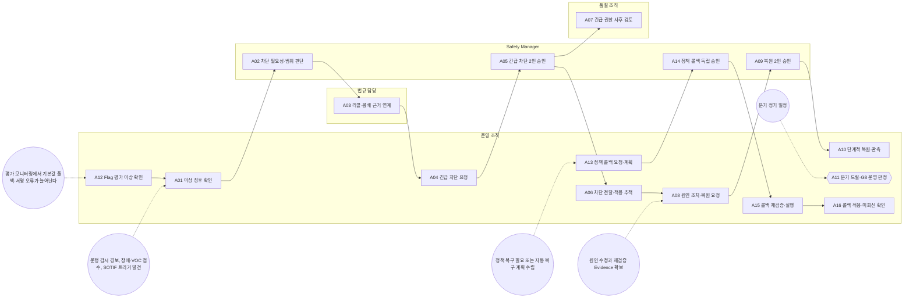

<!-- 생성물: docs/65-workflows/scripts/build_md.py — 손으로 고치지 않는다 -->

# WF-FPW-8 · FPW.8 운영·긴급 차단·복원 / Operation, Kill & Restore

> 출시된 Feature를 운행 중 감시하고, 이상 징후가 안전·보안·법규 위험으로 확인되면 2인 승인을 거친 긴급 차단을 발행해 차량별 적용을 확인한 뒤, 원인을 해소하고 다른 승인자의 승인으로 단계적으로 복원한다. 정책 복구가 필요하면 복구 기준·전 범위·독립 승인을 재검증하여 롤백하고 차량별 적용과 미회신을 추적한다.

보고서 Gate: G8 · 근거: 표준 보고서 7장(비활성화·복원), 8.x FFG-PLT-005·016, 14장 FFG-SEC-003·004, 6.1절 G8

## 1. 업무 흐름

## 2. 활동

| ID | 활동 | RACI | 입력 | 출력 | 플랫폼 권한·화면 | 이행 규칙 |
|---|---|---|---|---|---|---|
| FPW.8-A12 | Flag 평가 이상 확인 | R 운영 조직 · A 운영 조직 · C 통합 조직 · I Feature Owner |  | WP-FLAG-EVAL-INVESTIGATION | `/ops/flag-evaluations` | – |
| FPW.8-A01 | 이상 징후 확인 | R 운영 조직 · A 운영 조직 · C Safety Manager · I 품질 조직, Feature Owner | WP-G7-DECISION, WP-ROLLOUT-RECORD, WP-KPI-PLAN, WP-G5-EVIDENCE | WP-ANOMALY-CASE | `acknowledgeAnomaly`, `dismissAnomaly`, `createIncident`, `/ops/anomalies`, `/ops/safety-kpi`, `/ops/incidents`, `/ops/incident-reports/:id`, `/ops/feature-health`, `/ops/feature-health/:findingId`, `/ops/collection`, `/integration/datalake` | FFG-TEL-009 |
| FPW.8-A02 | 차단 필요성·범위 판단 | R Safety Manager · A Safety Manager · C CSM, 법규 담당, 운영 조직 · I Feature Owner | WP-ANOMALY-CASE, WP-SAFETY-PROFILE, WP-VEX-DECISION | WP-KILL-PLAN | `gatePreview`, `/ops/kill` | FFG-ADS-011, FFG-SEC-003 |
| FPW.8-A03 | 리콜·봉쇄 근거 연계 | R 법규 담당 · A 법규 담당 · C Safety Manager, 법무 · I 운영 조직 | WP-KILL-PLAN | WP-RECALL-BASIS | `/ops/incident-reports` | FFG-DEAC-010 |
| FPW.8-A04 | 긴급 차단 요청 | R 운영 조직 · A 운영 조직 · C Safety Manager · I CSM, 법규 담당 | WP-KILL-PLAN, WP-RECALL-BASIS | WP-KILL-REQ | `issueKill`, `/ops/kill` | FFG-PLT-005 |
| FPW.8-A05 | 긴급 차단 2인 승인 | R Safety Manager, CSM · A Safety Manager · C 법규 담당 · I 운영 조직, 품질 조직 | WP-KILL-REQ, WP-KILL-PLAN | WP-KILL-DECISION | `approveKill`, `rejectKill`, `/ops/kill` | FFG-PLT-005, FFG-SEC-003 |
| FPW.8-A07 | 긴급 권한 사후 검토 | R 품질 조직 · A 품질 조직 · C CSM, 법규 담당 · I Safety Manager, 운영 조직 | WP-KILL-REQ, WP-KILL-DECISION | WP-POST-REVIEW | `recordKillPostReview`, `/audit/oversight` | FFG-PLT-016 |
| FPW.8-A06 | 차단 전달·적용 추적 | R 운영 조직 · A Safety Manager · C CSM · I 품질 조직, Feature Owner | WP-KILL-DECISION | WP-KILL-TRACE | `acknowledgeAnomaly`, `/fleet/live`, `/deployments` | FFG-SEC-004, FFG-DEAC-013 |
| FPW.8-A08 | 원인 조치·복원 요청 | R 운영 조직 · A 운영 조직 · C Safety Manager, Feature Owner, 시험 조직 · I 법규 담당 | WP-KILL-TRACE, WP-G5-EVIDENCE | WP-RESTORE-REQ | `requestRestore`, `/ops/kill` | FFG-DEAC-008 |
| FPW.8-A09 | 복원 2인 승인 | R Safety Manager, 품질 조직 · A Safety Manager · C CSM · I 운영 조직, Feature Owner | WP-RESTORE-REQ, WP-KILL-DECISION | WP-RESTORE-DECISION | `approveRestore`, `rejectRestore`, `/ops/kill` | FFG-DEAC-008, FFG-PLT-005 |
| FPW.8-A10 | 단계적 복원·관측 | R 운영 조직 · A 운영 조직 · C Safety Manager, Release Manager · I Feature Owner, 품질 조직 | WP-RESTORE-DECISION | WP-RESTORE-ROLLOUT | `stageRollout`, `/fleet/live` | FFG-LCY-009 |
| FPW.8-A11 | 분기 드릴·G8 운영 판정 | R 운영 조직 · A 운영 조직 · C Safety Manager, 품질 조직 · I Feature Owner, 법규 담당 | WP-KILL-TRACE, WP-POST-REVIEW | WP-DRILL-REPORT | `/ops/kill`, `/audit` | FFG-DEAC-012 |
| FPW.8-A13 | 정책 롤백 요청·계획 | R 운영 조직 · A 운영 조직 · C Release Manager, Safety Manager · I 품질 조직 |  | WP-RBK-REQ | `previewRollback`, `createRollbackRequest`, `createRollbackPlan`, `/ops/rollback`, `/policies/:id` | – |
| FPW.8-A14 | 정책 롤백 독립 승인 | R Safety Manager · A Safety Manager · C Release Manager · I 운영 조직, 품질 조직 | WP-RBK-REQ | WP-RBK-DEC | `decideRollbackRequest`, `decideRollbackPlan`, `/ops/rollback` | – |
| FPW.8-A15 | 롤백 재검증·실행 | R 운영 조직 · A 운영 조직 · C Release Manager, Safety Manager · I 품질 조직 | WP-RBK-DEC | WP-RBK-EXEC | `executeRollbackRequest`, `/ops/rollback`, `/deployments/:id` | – |
| FPW.8-A16 | 롤백 적용·미회신 확인 | R 운영 조직 · A 운영 조직 · C Release Manager · I Safety Manager, 품질 조직 | WP-RBK-EXEC | WP-RBK-CLOSE | `/ops/rollback`, `/deployments/:id`, `/fleet/vehicles/:vin` | – |

### 수행 절차와 완료 기준

#### FPW.8-A12 Flag 평가 이상 확인
- 트리거: 평가 모니터링에서 기본값 폴백·서명 오류가 늘어난다
1. 평가 모니터링에서 기본값 폴백·서명 오류·오류 수가 늘어난 Flag를 찾는다
2. 차량 회신과 게시본을 대조해 원인이 배포·서명·차량 중 어디인지 가른다
3. 필요하면 긴급 차단 또는 재배포 절차로 넘긴다

완료 기준:
- [ ] 폴백 급증 Flag마다 원인과 조치가 기록됐다

#### FPW.8-A01 이상 징후 확인
- 트리거: 운행 감시 경보, 장애·VOC 접수, SOTIF 트리거 발견
1. 운행 중 감시 지표와 장애·VOC를 확인해 이상 징후 건을 연다
2. 대상 Feature Version과 영향 차량 범위를 Fleet 적용 현황에서 확인한다
3. 안전·보안 영향이 의심되면 즉시 Safety Manager(보안은 CSM)에게 넘긴다
4. 확인 결과 이상이 아니면 사유를 남기고 이상 건을 기각한다
5. 운영 점검(동작·문제·개선·위험 4축)의 조치 필요 점검 결과를 확인하고 조치 연결·효과 확인까지 이어 간다
6. Data Lake 지표가 신선도 기준을 넘으면 그 지표로 판단하지 않고 데이터 계약·수집 정책을 확인한다

완료 기준:
- [ ] 이상 징후 건에 출처·대상 Version·영향 범위가 기록되었다
- [ ] 기한이 지난 조치 필요 점검 결과가 담당자 검토함에 있다

#### FPW.8-A02 차단 필요성·범위 판단
1. 사유를 분류하고 Feature의 설계 비활성화 등급에서 유효 등급을 정한다
2. 대상 범위를 24시간 누적 상한과 대조하고, 넘으면 CSM 추가 승인과 단계적 실행을 계획한다
3. ADS 기능이나 대량 대상이면 대량 원격 종료 계획에 따라 단계와 순서를 정한다
4. 게이트 미리보기로 요청이 판정을 통과할지 확인한다

완료 기준:
- [ ] 사유 분류·유효 등급·범위·누적 상한 대조가 차단 판단서에 있다

#### FPW.8-A03 리콜·봉쇄 근거 연계
1. 결함을 완화하는 F2 이상 안전 차단이면 시장별 리콜 번호나 봉쇄 결정 근거를 확보한다
2. 시장별 보고 기한을 정하고 보고 책임자를 지정한다
3. 근거 ID를 운영 조직에 넘겨 차단 요청에 붙이게 한다

완료 기준:
- [ ] 안전 차단 요청에 붙일 리콜·봉쇄 근거 ID가 있다(근거가 없으면 게이트가 차단한다)

#### FPW.8-A04 긴급 차단 요청
1. 긴급 차단 화면에서 대상·범위·사유를 입력하고 확인 문구를 직접 입력해 요청한다
2. 리콜·봉쇄 근거 ID를 요청에 붙인다
3. 요청자는 같은 명령의 승인자로 지정하지 않는다

완료 기준:
- [ ] 요청이 접수되어 승인 대기 상태가 되었다

#### FPW.8-A05 긴급 차단 2인 승인
1. 승인자 2명이 각자 개인 서명으로 승인한다. F2 이상 안전·보안 차단에는 Safety Manager가 반드시 포함된다
2. 누적 상한을 넘는 요청이면 Safety Manager와 CSM이 함께 승인한다
3. 두 번째 승인 뒤 게이트 판정 결과와 발행 명령 ID를 확인한다

완료 기준:
- [ ] 서로 다른 2명의 승인 서명이 있고 요청자는 승인자에 없다

#### FPW.8-A07 긴급 권한 사후 검토
1. 차단 발행 후 24시간 안에 요청자·승인자가 아닌 검토자가 사유·범위·절차 준수를 검토한다
2. 검토 결과와 개선 조치를 사후 검토 기록으로 한 번 남긴다
3. 미흡 사항은 품질 조직이 개선 과제로 등록한다

완료 기준:
- [ ] 검토 기록이 24시간 안에 있고 검토자가 요청자·승인자와 다르다

#### FPW.8-A06 차단 전달·적용 추적
1. 차량별 전달·적용 상태를 유효한 상태 보고와 영속 저장 확인으로만 '적용'으로 본다
2. 기한 안에 적용되지 않은 차량은 이상 징후 건으로 넘긴다
3. 대기 상한 초과 경보가 오면 Safety Manager가 상위 대응을 정한다

완료 기준:
- [ ] 기한 초과 미적용 차량마다 연결된 이상 징후 건이 있다

#### FPW.8-A08 원인 조치·복원 요청
- 트리거: 원인 수정과 재검증 Evidence 확보
1. 원인 분석과 수정(정책·SW·운행 조건 축소)을 마치고 재검증 Evidence가 G5 근거로 제출되었는지 확인한다
2. 복원 범위와 시작 Canary Cohort를 정해 복원을 요청한다
3. 직전 차단 승인자를 복원 승인 후보에서 뺀다

완료 기준:
- [ ] 복원 요청에 재검증 Evidence 참조와 Canary Cohort가 있다

#### FPW.8-A09 복원 2인 승인
1. 직전 차단을 승인하지 않은 승인자 2명이 개인 서명으로 승인한다. F2 이상은 Safety Manager가 포함된다
2. 플랫폼 감사 원장이 차단 승인자와의 중복을 판정하므로 거부되면 다른 승인자로 다시 승인한다
3. 두 번째 승인 뒤 게이트 판정과 복원 게시 ID를 확인한다

완료 기준:
- [ ] 복원 승인자 중 직전 차단 승인자가 없다

#### FPW.8-A10 단계적 복원·관측
1. Canary Cohort부터 차단 해제를 적용하고 차량이 INACTIVE 상태로 복귀했는지 확인한다. 재활성화는 정상 활성화 Guard·ODD·자체 시험 조건을 별도로 확인한다
2. 사전에 정한 관측 기간 동안 중단 기준을 감시하고 만족할 때만 다음 Cohort로 넓힌다
3. 이상이 보이면 확대를 멈추고 다시 차단 판단(A02)으로 넘긴다

완료 기준:
- [ ] 단계마다 관측 결과와 확대·중단 결정이 기록되었다

#### FPW.8-A11 분기 드릴·G8 운영 판정
- 트리거: 분기 정기 일정
1. 시험 Cohort로 차단·복원 드릴을 수행해 전달 시간·적용률·보고 정확도를 잰다
2. 분기 차단 건의 추적표·사후 검토 결과와 드릴 결과를 묶어 운영 상태를 점검한다
3. Safety Manager·품질 조직의 의견을 받아 G8 운영 판정을 남긴다

완료 기준:
- [ ] 분기마다 드릴 결과와 G8 판정이 있다

#### FPW.8-A13 정책 롤백 요청·계획
- 트리거: 정책 복구 필요 또는 자동 복구 계획 수립
1. 현재 배포 ID와 같은 flag의 이전 배포 정책 및 복구 가능 근거를 확인한다
2. 전 대상 범위와 사유 또는 자동 조건을 정해 미리보기를 검증한다
3. 지정 승인대상자를 넣어 요청 또는 계획을 만들고 기준 배포를 고정한다

완료 기준:
- [ ] 현재 배포가 바뀌면 낡은 요청으로 실행하지 않는다
- [ ] 정책 전 범위를 덮지 못하거나 SW 버전 실행 위임이 미확정이면 보류한다

#### FPW.8-A14 정책 롤백 독립 승인
1. 자신이 지정 승인대상자이며 요청자와 다른 사람인지 확인한다
2. 복구 기준·적용 범위·조건과 안전 영향을 검토한다
3. 사유를 남겨 승인 또는 반려하고 후속 실행자에게 결과를 알린다

완료 기준:
- [ ] 요청자 자기 승인과 지정되지 않은 사람의 승인이 차단된다
- [ ] 자동 계획 승인도 승인된 조건·범위를 넘지 않는다

#### FPW.8-A15 롤백 재검증·실행
1. 승인된 요청 또는 계획과 현재 배포의 일치 여부를 확인한다
2. 복구 기준의 검증·운영 승인·서명·현재 적용 가능성을 다시 확인한다
3. 허용된 실행을 수행하고 새 게시본 및 실행 이력을 연결한다

완료 기준:
- [ ] 승인 후 상태·키·기준이 달라지면 재검증에서 차단된다
- [ ] 실행 응답을 차량 적용 완료로 간주하지 않는다

#### FPW.8-A16 롤백 적용·미회신 확인
1. 현재 롤백 게시본과 대상 차량 분모를 고정한다
2. 차량별 수신·적용·거부·기한초과를 확인하고 허용된 재시도를 수행한다
3. 모든 적용 완료 또는 미해결 차량·위험·담당자를 기록해 인계한다

완료 기준:
- [ ] 수신 ACK와 적용 READBACK을 구분한다
- [ ] 누락 데이터는 대상 0 또는 성공으로 표시하지 않는다

## 3. 산출물

| 키 | 이름 | 종류 | 주요 내용 |
|---|---|---|---|
| WP-ANOMALY-CASE | 이상 징후 건 | 산출 | 이상 징후 출처(운행 지표·장애·VOC·SOTIF 트리거)와 대상 Feature Version; 영향 차량 수·지역·Variant와 확인 결과 |
| WP-KILL-PLAN | 차단 판단서 | 산출 | 사유 분류(SAFETY·SECURITY·REGULATORY·COMMERCIAL·OPERATIONAL)와 유효 등급; 대상 범위와 24시간 누적 상한 대조 결과; 대량 원격 종료 계획(단계·순서) 적용 여부 |
| WP-RECALL-BASIS | 리콜·봉쇄 근거 | 산출 | 리콜 번호 또는 봉쇄 결정 근거와 시장; 시장별 보고 기한과 보고 책임자 |
| WP-KILL-REQ | 긴급 차단 요청 | 산출 | 대상 Feature Version·차량 범위·사유 분류와 리콜·봉쇄 근거 참조; 요청자와 요청 시각 |
| WP-KILL-DECISION | 차단 승인 기록 | 산출 | 서로 다른 승인자 2명의 개인 서명과 역할; 게이트 판정(등급·대상 상한) 결과와 발행 명령 ID |
| WP-KILL-TRACE | 차단 적용 추적표 | 산출 | 차량별 전달·적용 상태(유효한 상태 보고와 영속 저장 확인 기준); 기한 초과 미적용 차량과 연결된 이상 징후 건; 대기 상한 초과 경보와 상위 대응 기록 |
| WP-POST-REVIEW | 긴급 권한 사후 검토 기록 | 산출 | 검토자(요청자·승인자 제외)와 검토 시각(24시간 이내); 사유·범위·절차 준수 판단과 개선 조치 |
| WP-RESTORE-REQ | 복원 요청 | 산출 | 원인 분석·수정 내용과 재검증 Evidence 참조; 복원 대상 범위와 Canary Cohort |
| WP-RESTORE-DECISION | 복원 승인 기록 | 산출 | 차단 승인자와 겹치지 않는 승인자 2명의 개인 서명; 게이트 판정과 복원 게시 ID |
| WP-RESTORE-ROLLOUT | 단계적 복원 관측 기록 | 산출 | Cohort 단계별 확대 시각과 관측 결과; 중단 기준 충족 여부와 재차단 여부 |
| WP-DRILL-REPORT | 드릴 결과·G8 판정 | 산출 | 시험 Cohort의 전달 시간·적용률·보고 정확도; 분기 운영 점검 결과와 G8 판정 서명 |
| WP-FLAG-EVAL-INVESTIGATION | Flag 평가 이상 조사 기록 | 산출 | 영향 Flag·Version·차량과 관측 기간; 폴백·서명·평가 오류와 대조한 게시본·회신; 원인·조치·차단 또는 재배포 인계 |
| WP-RBK-REQ | 정책 롤백 요청·계획 | 산출 | 현재 배포 ID·복구 정책 버전·전 범위·수동 사유 또는 자동 조건; 미리보기 검증과 지정 승인대상자 |
| WP-RBK-DEC | 정책 롤백 승인 기록 | 산출 | 지정 승인대상자와 요청자 분리; 승인/반려 사유·범위·복구 기준 및 판정 시각 |
| WP-RBK-EXEC | 정책 롤백 실행 추적 | 산출 | 실행 직전 재검증·실행자·현재 배포 변화 확인; 새 서명 게시본 ID·전송·실패 및 원본 배포 연결 |
| WP-RBK-CLOSE | 정책 롤백 적용 확인 | 산출 | 대상 분모·차량별 ACK/READBACK·적용·거부·미회신; 재시도·기한초과·완료 또는 미해결 인계 근거 |

## 4. 진입·완료 기준

**진입**
- Feature Version이 RELEASED이고 운행 중 감시 지표와 경보 기준이 등록되어 있다
- 차단·복원 승인 후보자의 개인 서명 수단이 발급되어 있다

**완료**
- 발행한 차단마다 차량별 적용 결과·사후 검토·복원 또는 유지 결정이 기록되었다
- 분기 드릴 결과와 G8 운영 판정이 남았다

## 5. 결과(Outcome)

- O1 운행 중 이상 징후가 접수·확인되고 차단 필요성과 범위가 판단된다.
- O2 긴급 차단이 리콜·봉쇄 근거와 서로 다른 2인의 승인을 갖춰 발행된다.
- O3 차량별 차단 전달·적용이 추적되고 미적용 차량이 후속 조치로 넘어간다.
- O4 긴급 권한 사용이 24시간 안에 독립 검토된다.
- O5 원인 해소 뒤 차단 승인자와 다른 승인자의 승인으로 단계적으로 복원된다.
- O6 정기 드릴로 차단·복원 능력이 측정되고 G8 운영 판정이 남는다.
- O7 정책 롤백의 복구 기준·범위·독립 승인·실행 재검증과 차량별 적용·미회신 결과가 추적된다.

## 6. 업무 수행 정의(Base Practices)

업무 정의 초안이다. 개인 활동 체크·서버 처리·Gate 승인 및 ASPICE 적합성 평가와 구분한다.

### FPW.8.BP1 Flag 평가 이상 확인

평가 오류·기본값 폴백·서명 이상을 식별하여 코드·배포·차량 회신과 대조한다. 원인·영향·조치를 기록하고 필요한 차단 또는 재배포 판단에 근거를 제공한다.

- 기여 성과: O2
- 연결 활동: FPW.8-A12

### FPW.8.BP2 이상 징후 확인

운행 관측·경보·VOC에서 이상 징후와 영향 기능·차량을 식별한다. 데이터 신선도와 사실의 범위를 확인하고 조사·조치·효과 확인 또는 기각의 근거와 책임을 추적한다.

- 기여 성과: O1
- 연결 활동: FPW.8-A01

### FPW.8.BP3 차단 필요성·범위 판단

이상 징후의 사유와 설계된 종료 동작에 따라 차단 필요성과 유효 범위를 판단한다. 누적 상한·대량 종료 계획과 게이트 결과를 확인하여 승인에 필요한 차단 계획을 마련한다.

- 기여 성과: O1
- 연결 활동: FPW.8-A02

### FPW.8.BP4 리콜·봉쇄 근거 연계

안전 차단의 근거가 되는 리콜·봉쇄 결정과 시장별 보고 책임·기한을 확인한다. 검증 가능한 근거 ID를 요청 담당자에게 전달하고 불충분한 근거는 보완하도록 한다.

- 기여 성과: O2
- 연결 활동: FPW.8-A03

### FPW.8.BP5 긴급 차단 요청

확정한 대상·사유·범위와 리콜 또는 봉쇄 근거를 갖추어 긴급 차단을 요청한다. 명시적 확인과 요청·승인자 분리를 유지하며 승인 대기 결과를 확인한다.

- 기여 성과: O2
- 연결 활동: FPW.8-A04

### FPW.8.BP6 긴급 차단 2인 승인

필요한 역할의 서로 다른 승인자가 차단의 근거·범위·상한을 독립적으로 검토한다. 개인 서명을 수집하고 최종 게이트와 발행 명령을 확인하여 승인과 발행의 연결을 보존한다.

- 기여 성과: O2
- 연결 활동: FPW.8-A05

### FPW.8.BP7 긴급 권한 사후 검토

긴급 권한 사용의 사유·범위·절차 준수를 요청·승인에 참여하지 않은 검토자가 기한 내 확인한다. 개선 항목과 책임을 한 번의 독립 검토 기록으로 보존한다.

- 기여 성과: O4
- 연결 활동: FPW.8-A07

### FPW.8.BP8 차단 전달·적용 추적

게시 명령의 전달과 실제 차량 적용을 유효한 보고 근거로 구분하여 추적한다. 기한 초과·불일치 차량을 식별하고 연결된 이상 건과 상위 대응 결정을 관리한다.

- 기여 성과: O3
- 연결 활동: FPW.8-A06
- 참고 1: 전송 수락이나 OTA 전달 통보만으로 차량의 적용 완료를 선언하지 않는다.

### FPW.8.BP9 원인 조치·복원 요청

원인을 조치하고 재검증 근거를 확보한 뒤 차단 해제 범위와 관측 단계를 요청한다. 이전 차단 승인자와의 분리를 유지하고 복원 승인에 필요한 근거와 Cohort를 명시한다.

- 기여 성과: O5
- 연결 활동: FPW.8-A08

### FPW.8.BP10 복원 2인 승인

직전 차단 승인에 참여하지 않은 승인자들이 복원 근거·범위·재검증을 독립적으로 검토한다. 요구되는 서명과 게이트를 만족한 복원 게시본을 확인하고 판단을 보존한다.

- 기여 성과: O5
- 연결 활동: FPW.8-A09

### FPW.8.BP11 단계적 복원·관측

승인 범위의 차단 해제를 Canary부터 적용하고 회신과 관측 결과를 확인한다. 정상 활성화는 차량 자체 시험·ODD·Guard의 별도 조건에 따르며 관측 기준을 만족할 때만 복원 범위를 넓힌다.

- 기여 성과: O5
- 연결 활동: FPW.8-A10
- 참고 1: 복원 명령의 차단 해제(INACTIVE)는 기능을 즉시 ACTIVE로 만드는 명령이 아니다.

### FPW.8.BP12 분기 드릴·G8 운영 판정

시험 범위에서 차단·복원 드릴을 수행하여 전달·적용·보고의 정확성을 확인한다. 분기 운영 근거와 독립 검토 의견을 모아 개선 사항과 운영 판정을 기록한다.

- 기여 성과: O6
- 연결 활동: FPW.8-A11

### FPW.8.BP13 정책 롤백 요청·계획

현재 배포와 복구 기준 정책을 식별하고 대상 전 범위·조건·승인대상자를 가진 롤백 요청 또는 계획을 작성한다. 긴급 차단 해제와 정책 버전 복구를 구분하며 SW 바이너리 롤백을 임의 실행하지 않는다.

- 기여 성과: O7
- 연결 활동: FPW.8-A13

### FPW.8.BP14 정책 롤백 독립 승인

요청자와 다른 지정 승인대상자가 복구 기준·범위·조건을 검토하여 승인 또는 반려한다. 조직 역할의 참여만으로 승인되지 않으며 해당 요청의 실제 승인 이력을 확인한다.

- 기여 성과: O7
- 연결 활동: FPW.8-A14

### FPW.8.BP15 롤백 재검증·실행

승인된 수동 요청을 실행하거나 승인된 자동 계획의 조건 충족 실행을 확인한다. 실행 직전의 현재 배포·검증·운영 승인·서명과 적용 가능성을 재확인하고 새 서명 게시본을 원본 배포에 연결한다.

- 기여 성과: O7
- 연결 활동: FPW.8-A15
- 참고 1: 자동 실행은 기존 서버의 승인 계획·조건 판정 경로에 따른다. 업무 체크를 완료해도 자동 롤백이 발생하지 않는다.

### FPW.8.BP16 롤백 적용·미회신 확인

새 롤백 게시본의 동일 대상 집합을 기준으로 전달과 실제 적용을 구분해 추적한다. 거부·미회신·기한초과는 재시도 및 미해결 위험으로 남기고 운영 화면의 성공 표지만으로 종결하지 않는다.

- 기여 성과: O7
- 연결 활동: FPW.8-A16

### BP × 성과

| BP | O1 | O2 | O3 | O4 | O5 | O6 | O7 |
|---|---|---|---|---|---|---|---|
| FPW.8.BP1 | – | ● | – | – | – | – | – |
| FPW.8.BP2 | ● | – | – | – | – | – | – |
| FPW.8.BP3 | ● | – | – | – | – | – | – |
| FPW.8.BP4 | – | ● | – | – | – | – | – |
| FPW.8.BP5 | – | ● | – | – | – | – | – |
| FPW.8.BP6 | – | ● | – | – | – | – | – |
| FPW.8.BP7 | – | – | – | ● | – | – | – |
| FPW.8.BP8 | – | – | ● | – | – | – | – |
| FPW.8.BP9 | – | – | – | – | ● | – | – |
| FPW.8.BP10 | – | – | – | – | ● | – | – |
| FPW.8.BP11 | – | – | – | – | ● | – | – |
| FPW.8.BP12 | – | – | – | – | – | ● | – |
| FPW.8.BP13 | – | – | – | – | – | – | ● |
| FPW.8.BP14 | – | – | – | – | – | – | ● |
| FPW.8.BP15 | – | – | – | – | – | – | ● |
| FPW.8.BP16 | – | – | – | – | – | – | ● |

### 출력 근거 × 성과

모델에 명시한 연결만 표시한다. 연결 존재는 실제 산출물 확보나 승인 완료의 증거가 아니다.

| 산출물 | O1 | O2 | O3 | O4 | O5 | O6 | O7 | 근거 BP |
|---|---|---|---|---|---|---|---|---|
| WP-FLAG-EVAL-INVESTIGATION | – | ● | – | – | – | – | – | FPW.8.BP1 |
| WP-ANOMALY-CASE | ● | – | – | – | – | – | – | FPW.8.BP2 |
| WP-KILL-PLAN | ● | – | – | – | – | – | – | FPW.8.BP3 |
| WP-RECALL-BASIS | – | ● | – | – | – | – | – | FPW.8.BP4 |
| WP-KILL-REQ | – | ● | – | – | – | – | – | FPW.8.BP5 |
| WP-KILL-DECISION | – | ● | – | – | – | – | – | FPW.8.BP6 |
| WP-POST-REVIEW | – | – | – | ● | – | – | – | FPW.8.BP7 |
| WP-KILL-TRACE | – | – | ● | – | – | – | – | FPW.8.BP8 |
| WP-RESTORE-REQ | – | – | – | – | ● | – | – | FPW.8.BP9 |
| WP-RESTORE-DECISION | – | – | – | – | ● | – | – | FPW.8.BP10 |
| WP-RESTORE-ROLLOUT | – | – | – | – | ● | – | – | FPW.8.BP11 |
| WP-DRILL-REPORT | – | – | – | – | – | ● | – | FPW.8.BP12 |
| WP-RBK-REQ | – | – | – | – | – | – | ● | FPW.8.BP13 |
| WP-RBK-DEC | – | – | – | – | – | – | ● | FPW.8.BP14 |
| WP-RBK-EXEC | – | – | – | – | – | – | ● | FPW.8.BP15 |
| WP-RBK-CLOSE | – | – | – | – | – | – | ● | FPW.8.BP16 |
