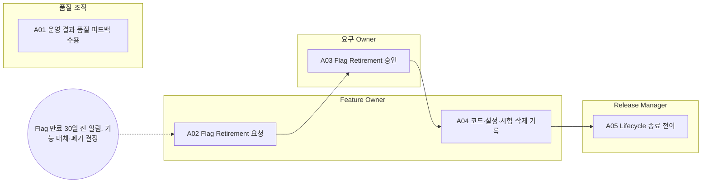

<!-- 생성물: docs/65-workflows/scripts/build_md.py — 손으로 고치지 않는다 -->

# WF-FPW-9 · FPW.9 사후 검토·Flag Retirement / Post-Operation Review & Flag Retirement

> 운영 중 드러난 이상·복원 결과를 품질 피드백으로 되돌려 시나리오와 다음 Version에 반영하고, 만료되었거나 대체된 Flag를 승인된 Retirement 절차로 처리해 코드·설정·시험을 정리한다.

보고서 Gate: – · 근거: 표준 보고서 6.5절(Retirement), 5장 FFG-CLS-008, 6장 FFG-LCY-011, 14장 FFG-SOT-003, 3장 FFG-ADS-010

## 1. 업무 흐름

## 2. 활동

| ID | 활동 | RACI | 입력 | 출력 | 플랫폼 권한·화면 | 이행 규칙 |
|---|---|---|---|---|---|---|
| FPW.9-A01 | 운영 결과 품질 피드백 수용 | R 품질 조직 · A 품질 조직 · C Safety Manager, 시험 조직 · I Feature Owner, 운영 조직 | WP-DRILL-REPORT, WP-RESTORE-ROLLOUT | WP-QUALITY-FEEDBACK | `acceptFeedback`, `/quality/feedback` | FFG-SOT-003 |
| FPW.9-A02 | Flag Retirement 요청 | R Feature Owner · A Feature Owner · C Release Manager, 통합 조직 · I Safety Manager, 요구 Owner | WP-FEAT-REG | WP-RETIRE-REQ | `requestFlagRetirement`, `/flag-retirements` | FFG-CLS-008 |
| FPW.9-A03 | Flag Retirement 승인 | R 요구 Owner, Safety Manager · A Feature Owner · C Release Manager · I 통합 조직, 운영 조직 | WP-RETIRE-REQ | WP-RETIRE-APPROVAL | `approveFlagRetirement`, `/flag-retirements` | FFG-ADS-010 |
| FPW.9-A04 | 코드·설정·시험 삭제 기록 | R Feature Owner · A Feature Owner · C 통합 조직, 시험 조직 · I Release Manager | WP-RETIRE-APPROVAL | WP-RETIRE-LOG | `recordFlagRetirementStep`, `/flag-retirements` | FFG-LCY-011 |
| FPW.9-A05 | Lifecycle 종료 전이 | R Release Manager · A Release Manager · C Feature Owner · I 상품 Owner, 운영 조직 | WP-RETIRE-LOG | WP-RETIRE-CLOSE | `transition`, `/features/:id/:ver` | – |

### 수행 절차와 완료 기준

#### FPW.9-A01 운영 결과 품질 피드백 수용
1. 분기 드릴·복원 관측·이상 징후 결과에서 개선 항목을 추린다
2. 텔레메트리와 사고 데이터에서 찾은 트리거 조건·오용을 시험 조직에 넘겨 시나리오 저장소에 추가하게 한다
3. 품질 피드백을 수용하고 다음 Version 개선 과제로 Feature Owner에게 연결한다

완료 기준:
- [ ] 수용한 피드백마다 담당과 반영 대상(시나리오·Version)이 있다

#### FPW.9-A02 Flag Retirement 요청
- 트리거: Flag 만료 30일 전 알림, 기능 대체·폐기 결정
1. 만료 알림을 받은 Release·Experiment Flag의 연장 또는 Retirement를 정한다
2. Retirement면 사유·영향 차량·다음 정기 릴리스 예정일을 적어 요청한다
3. 구 Version이 남은 차량이 있는지 Fleet 적용 현황으로 확인해 요청에 붙인다

완료 기준:
- [ ] Retirement 요청에 사유와 영향 범위가 있다

#### FPW.9-A03 Flag Retirement 승인
1. 요청자가 아닌 요구 Owner가 Retirement를 승인하고, F2 이상이면 Safety Manager도 승인한다
2. ADS Feature를 폐기하는 경우 영구 비활성화·명령 키 폐기·Catalog 퇴역을 승인 조건으로 단다
3. 승인 후 삭제 기한을 정해 Feature Owner와 통합 조직에 알린다

완료 기준:
- [ ] 승인자가 요청자와 다르고 F2 이상에 Safety Manager 승인이 있다

#### FPW.9-A04 코드·설정·시험 삭제 기록
1. 삭제 기한 안에 해당 Flag의 차량 SW 코드·설정·시험을 지우도록 통합 조직과 계획을 세운다
2. 단계마다 완료 조건을 확인하고 Retirement 단계로 기록한다
3. 구 Version이 남은 차량은 상태 보고로 잔존이 0이 된 것을 확인한 뒤 마지막 단계를 닫는다

완료 기준:
- [ ] Retirement 단계가 순서대로 모두 기록되고 잔존 차량이 0이다

#### FPW.9-A05 Lifecycle 종료 전이
1. Feature Version을 DEPRECATED로 전이해 신규 사용을 막는다
2. Retirement 단계가 모두 끝나면 RETIRED로 전이한다
3. Flag ID를 재사용 금지로 남기고 상품 Owner에게 Catalog 반영을 알린다

완료 기준:
- [ ] Lifecycle이 RETIRED이고 Flag ID 재사용 금지 표시가 있다

## 3. 산출물

| 키 | 이름 | 종류 | 주요 내용 |
|---|---|---|---|
| WP-QUALITY-FEEDBACK | 품질 피드백 기록 | 산출 | 이상·복원·드릴에서 나온 개선 항목과 담당; 시나리오 저장소에 추가한 트리거 조건과 재평가 대상 |
| WP-RETIRE-REQ | Flag Retirement 요청 | 산출 | Retirement 사유(만료·대체·폐기)와 다음 정기 릴리스 예정일; 영향 받는 차량·Variant와 구 Version 잔존 여부 |
| WP-RETIRE-APPROVAL | Retirement 승인 기록 | 산출 | 승인자(F2 이상은 Safety Manager 포함)와 시각; 삭제 기한(승인 후 6개월 또는 다음 정기 릴리스 중 이른 시점) |
| WP-RETIRE-LOG | Retirement 단계 기록 | 산출 | 코드·설정·시험 삭제 단계별 완료 시각; 상태 보고로 확인한 구 Version 잔존 차량 수 |
| WP-RETIRE-CLOSE | Lifecycle 종료 기록 | 산출 | DEPRECATED·RETIRED 전이 시각; Flag ID 재사용 금지 표시와 Catalog 퇴역 결과 |

## 4. 진입·완료 기준

**진입**
- 분기 드릴·복원 결과 또는 Flag 만료 알림이 있다

**완료**
- 수용한 품질 피드백이 시나리오 저장소와 개선 과제에 연결되었다
- Retirement된 Flag의 삭제 단계가 모두 기록되고 Lifecycle이 RETIRED가 되었다

## 5. 결과(Outcome)

- O1 운영 결과와 새 트리거 조건이 품질 피드백으로 수용되어 시나리오와 다음 Version에 반영된다.
- O2 Flag Retirement가 요청자와 다른 승인자의 승인을 받는다.
- O3 Retirement 대상 Flag의 코드·설정·시험이 기한 안에 삭제되고 Lifecycle이 종료된다.
